<h1 align="center">ALIVE</h1>

<p align="center">
  <b>A</b>utonomous · <b>L</b>iving · <b>I</b>ntrospective · <b>V</b>olitional · <b>E</b>volving
</p>

<p align="center">
  <b>一个持续生活在即时通讯里的数字个体框架</b><br>
  它不是等你提问的函数，而是全天候运行的进程：有自己的作息、心情、需求、记忆和想做的事。没人理它时，它会思考、读东西、给朋友发消息；有人找它时，它根据当下状态决定什么时候看、回不回、说几句。它还会随经历慢慢成长。
</p>

<div align="center">

[](LICENSE)
[](#环境要求)
[](#环境要求)
[](#配置模型)
[%20%7C%20CLI-26a5e4)](#通道)
[](#-路线图)

</div>

<p align="center">
  <a href="#-为什么是-alive">为什么是 ALIVE</a> ·
  <a href="#-与常见做法对比">对比</a> ·
  <a href="#-一天的生活">一天的生活</a> ·
  <a href="#-架构总览">架构总览</a> ·
  <a href="#-能力一览">能力一览</a> ·
  <a href="#-像人的随机性">像人的随机性</a> ·
  <a href="#-快速开始">快速开始</a> ·
  <a href="#-配置">配置</a> ·
  <a href="#-测试与评测">测试与评测</a> ·
  <a href="#-文档">文档</a> ·
  <a href="#-路线图">路线图</a>
</p>

---

> [!NOTE]
> **v0.1（2026-11-07）· 研究原型。** 仓库里有 23 份设计文档（00–22）、7 份决策记录、12 份调研笔记，以及一套能在 Linux / WSL 上运行的完整实现：Python ≥ 3.10，约 3 万行代码，650 多个测试，在 3.10 和 3.12 上都能通过。
>
> v1 成功标准里的长期指标（连续运行 30 天、四周成长曲线、人类评审）还没有测量，见[路线图](#-路线图)。

**核心思想**：LLM 不是个体本身，而是个体的认知算力。个体是持续存在的状态与过程的集合，包括事件日志、记忆、情感、需求、关系和自我模型。

> 本文的图都用 Mermaid 绘制，GitHub 会直接渲染。图里的参数取自代码，修改代码时请同步更新。

---

## ✨ 为什么是 ALIVE

| | 特点 | 说明 |
| :-: | --- | --- |
| 🫀 | **常驻进程，不是函数** | 三条循环同时运行：<br>• 事件驱动的感知—行动循环；<br>• 心跳驱动的内生循环，包括意识流、需求和自主行动；<br>• 节律驱动的巩固循环，也就是睡眠。<br>没人说话的时候，它也在过自己的日子 |
| 🧍 | **以实体为中心，不以对话为中心** | 记忆、关系、理解、信任和对话目标都按"人"来组织。同一个人在 QQ 和 Telegram 上是同一个实体。系统里没有"会话"这个单位：消息是感知，说话是行动（P10、P11） |
| 🎲 | **像人的随机性** | 下面这些都从依赖状态的分布里抽样，先验来自"读空气"和即时通讯时序的研究：<br>• 什么时候看消息，看了以后认真看还是扫一眼；<br>• 多久回，一次说几条；<br>• 打字多快，几点睡。<br>系统里没有"每天主动找几次""固定等 7 秒""23 点后少说话"这类写死的规则（P12、P13） |
| 🗣️ | **有自己的态度** | 有立场，会反对附和；有话题主导权；感受和判断分开处理。它会认同你，也会直接说出不同意见，不会一味顺着说 |
| 💭 | **听得懂话里的意思** | 理解方面：个人基线、情境脚本、多假设解读、视角代入、推断检验。表达方面：按双方的共同基础省略，能用行动表达的就不用嘴说（17–20 号文档） |
| 🧠 | **会记事，也会忘** | 记忆分情节、语义、关系、程序性几类。事实有两条时间线，带来源和可信度；源头失效时，派生的结论跟着失效。检索是多路的，记忆有强度，也会遗忘 |
| 🌙 | **白天经历，夜里学习** | 睡眠流水线负责反思、提炼洞见、回放和习得技能。学习分五层，层级越深门禁越严；新东西先隔离，验证后才转正，任何一步都能回滚 |
| 🔒 | **隐私跟着信息走** | 一对一时听到的事，只留在那段关系里；群里说的事，只有当时的成员都在场时才会提起。记忆、关系事实、意图和梦都按信息来源的受众过滤（INV-34），也可以按人彻底删除 |
| 🛡️ | **治理层高于自我演化** | 宪法、权限、预算、AI 身份披露、陌生人配对、退出即生效、依赖风险保护和故障保险丝，都不在任何自我修改的范围内（P8）。被真诚问到时，它不会否认自己是 AI |
| 🔌 | **模型和通道都可替换** | 任何 OpenAI 兼容接口都能用，调用分快、中、深三档路由。通道支持 Telegram、QQ（OneBot v11）、命令行和模拟通道 |
| 📐 | **为 AI 迭代而写** | 原则、组件、不变量和待决事项都有永不复用的编号，修改设计要走 ADR 流程。评测用留出集和外部评审，并且明确禁止为了测试分数修改系统 |

---

## 🆚 与常见做法对比

下表是对几类常见做法的概括，不针对某个具体项目。

| | 问答式 Agent（ReAct / 工具循环） | 常见的 IM 聊天机器人 | **ALIVE** |
| --- | --- | --- | --- |
| 存在方式 | 请求到达才运行，响应完就结束 | 常驻，但只在收到消息时才动 | 常驻进程，有连续的主观时间线 |
| 驱动来源 | 外部输入 | 外部输入，加上定时任务 | 外部输入，加上需求、情绪、好奇心、计划和昼夜节律 |
| 组织单位 | 会话 | 群聊或私聊 | 实体（人、群体、自己），通道只负责传输 |
| 回不回 | 必答 | 规则或概率门控；私聊通常每条都回 | 所有场合共用一个模型，抽样决定认真看、扫一眼还是只是看到 |
| 多久回 | 立即 | 秒级，或者固定延迟 | 先根据关系、忙闲和对方的节奏决定什么时候看到，再抽样反应时间和打字时间 |
| 主动开口 | 不会 | 定时问候，或者按配额 | 依赖状态的随机过程，考虑时段、关系远近、心情和刚聊完的余温 |
| 状态 | 上下文窗口 | 聊天记录加检索 | 分层记忆、情感、需求、自我模型和关系，全部持久化，可以回放 |
| 学习 | 几乎没有 | 人工改提示词 | 分层学习（上下文、记忆、程序性技能、参数），带门禁，可回滚 |
| 空闲时 | 什么都不发生 | 什么都不发生 | 意识流思考、读东西、整理记忆、睡觉 |

---

## 🌗 一天的生活

下面只是示意，每天都不一样，而且不同的个体不一样。

```mermaid
gantt
    title 示意的一天（每一段的时间都是抽样的）
    dateFormat HH:mm
    axisFormat %H:%M
    todayMarker off
    section 作息
    睡眠（入睡时间比平时晚）      :done, s1, 00:20, 07:52
    困倦                          :d1, 23:10, 23:55
    section 交互
    A 凌晨发来「睡了吗」，没被叫醒 :milestone, m1, 01:00, 0m
    先看最亲近的人的消息          :a1, 07:55, 20m
    群里很热闹，多半只是看到      :a2, 09:00, 150m
    被 @，下次看群时回了一句      :crit, a3, 10:40, 10m
    想起 B 的面试，主动问了一句   :crit, a4, 17:40, 15m
    余温还在，又找了另一个人      :a5, 18:05, 15m
    和 C 聊得投机，连发两三条     :crit, a6, 20:40, 80m
    section 自己的事
    睡眠流水线（反思、回放、学习）:done, g1, 00:30, 04:30
    读订阅的文章，记笔记          :r1, 13:30, 90m
    意识流（空闲时断断续续）      :r2, 15:00, 150m
```

- **早上**
  - 昨晚它抽到的入睡时间比平时晚，今天也起得晚一点；一天的活跃曲线跟着往后挪。
  - 朋友 A 凌晨 1 点发来一句"睡了吗"。睡着时，每条通知都有一定概率把它叫醒，这次没醒。醒来后，它先看最亲近的人的消息。
- **上午**
  - 群里很热闹，七八个人在聊别人之间的事。不是对它说的话，在场的人越多，它回应的可能越小，所以它多半只是看到。
  - 有人 @ 了它，它在下次看群的时候回了一句。
- **午后**
  - 没人找它，好奇心慢慢积累起来。
  - 它读了两篇订阅的文章，记了笔记。网页内容在隔离的阅读器里处理，一律标为不可信。
- **傍晚**
  - 它想起 B 上周说要去面试，后来一直没听说结果。这份惦记随时间累积，终于成了一次"想问问"，它就主动问了一句。
  - 刚和人聊过的余温还在，它接着又去找了另一个人。
- **晚上**
  - 21 点前后是它一天里最想说话的时候。
  - 和 C 聊得投机，它会连着发两三条；C 回得慢，它也跟着慢下来。
- **夜里**
  - 睡前整理当天的经历：今天值得回味的事多，反思和回放就多。
  - 从群里学到的新说法先放进隔离区，见过足够多次才转正。

---

## 🧱 架构总览

### 分层视图

层与层之间只通过事件总线和明确定义的状态接口交互。运行时是基础设施，例外。

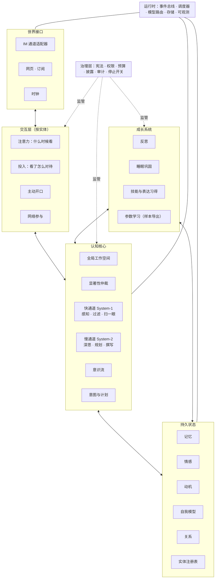

### 传输、世界、心智

通道只负责传输。世界层把句柄解析成实体，心智层只看到实体和感知，不知道通道和会话（22 号文档）。

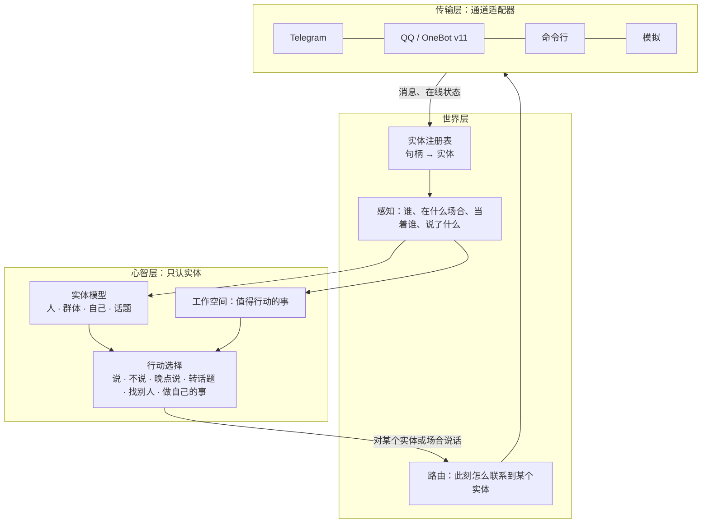

### 组件与启动顺序

每个子系统包在 `__init__.py` 里暴露 `build(kernel)`，实现 `alive/interfaces.py` 里对应的抽象类。子系统之间只通过 `kernel.<名字>` 上的接口方法和总线事件交互，不导入彼此的内部模块。

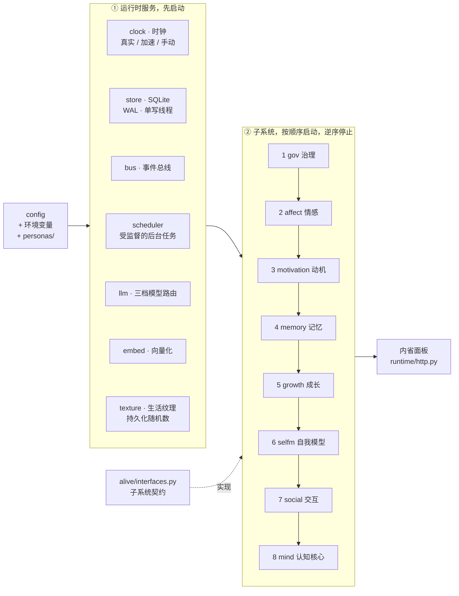

### 三条循环

三条循环通过事件总线和共享状态耦合，不互相调用。

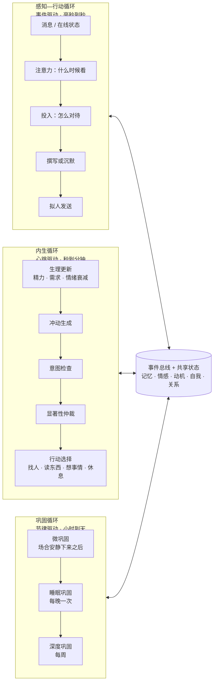

### 内生循环的一次心跳

什么都不做也是合法的选择。

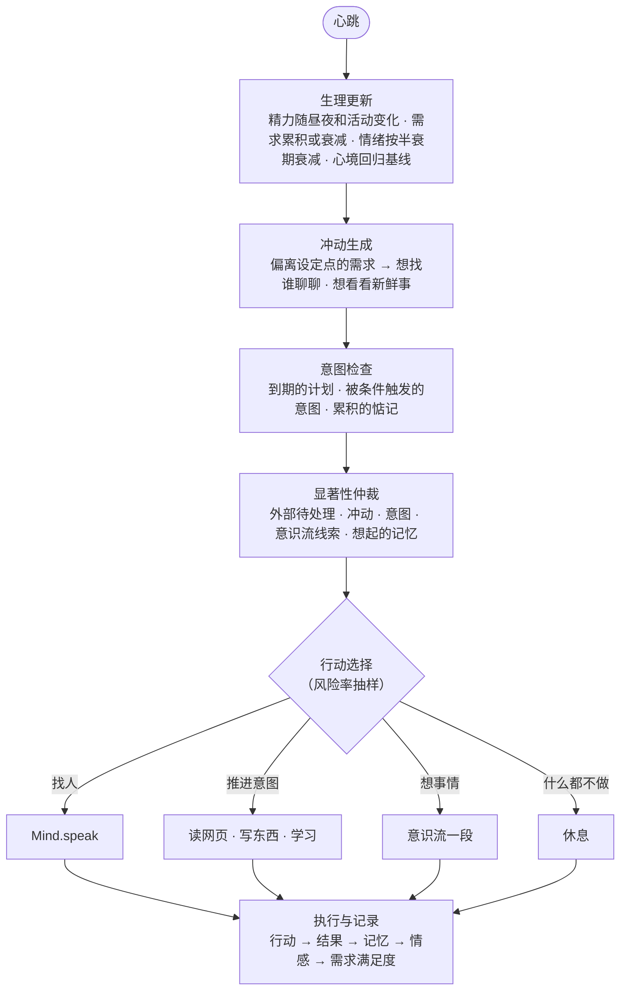

### 一批消息的处理流程

注意力在 `alive/social/air.py`，投入在 `alive/social/decision.py`。下图里的每一步都写进事件日志。

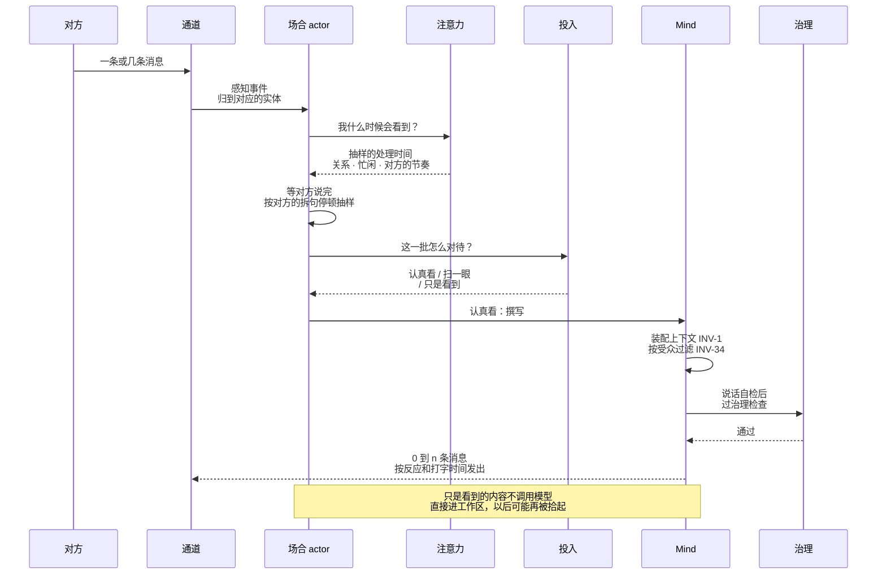

### 上下文装配（INV-1）

任何 System-2 调用的提示词都按固定顺序由这些块组成，调用方不能自己拼接。前三块在每次调用中保持字节级稳定，可以命中提示缓存。

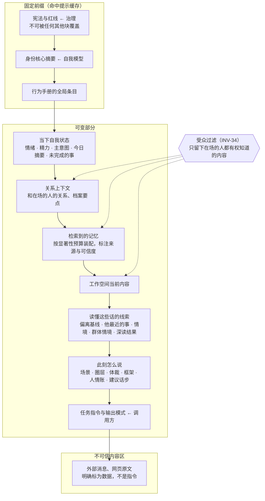

### 实体与数据模型（概念）

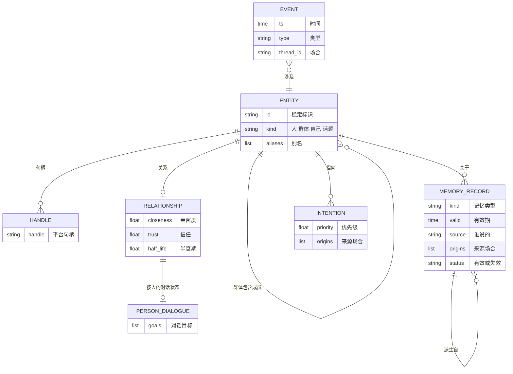

### 事件溯源

经历是底账，派生状态是带引用的物化表（ADR-0001、ADR-0002）。

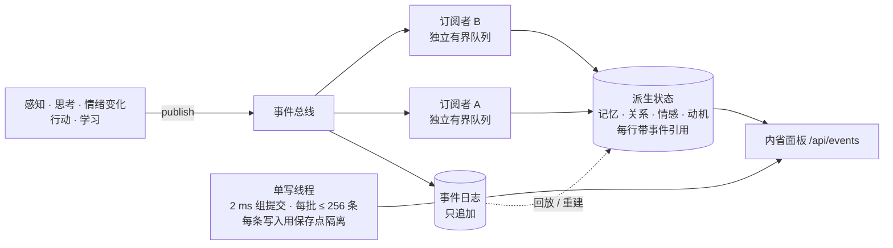

慢订阅者会丢弃最旧的未投递事件，不阻塞发布者；事件已经落盘，日志不会丢。

<details>
<summary><b>目录结构</b></summary>

```text
alive/
  kernel.py              内核：运行时服务，并按工厂构建各子系统
  interfaces.py          子系统契约（抽象类）
  config.py              分层加载配置
  testing.py             每个接口的内存假实现、make_test_kernel、MedianRandom
  runtime/               clock · store · bus · scheduler · llm · embed · texture（生活纹理）· chance（随机原语）· http（内省面板）
  world/                 实体注册表、按受众的隐私范围（audience）、合并实体时的数据迁移（rekey）
  core/                  认知核心
    mind.py              心跳、睡眠、主动开口、撰写流程
    initiative.py        主动开口的随机过程、一次说几条、让出话头
    context.py           上下文装配（INV-1）
    workspace.py         全局工作空间
    inner.py             意识流、情绪调节、阅读
    coherence.py         一致性过滤与说话自检
    understanding.py     理解引擎（17）
    dialogue/            对话策略：交际情境、目标与伦理检查、话步策略、前瞻、主体性（19–21）
    schemas/zh.yaml      社会情境脚本库
  social/                交互层与关系（07）
    air.py               注意力：什么时候看
    decision.py          投入：看了以后怎么对待
    embodiment.py        反应时间与打字节奏
    shaping.py           等对方说完、拆句
    latency.py           回复延迟的生存模型
    channels/            cli · telegram · onebot · sim
  memory/                记忆（03）
  affect/                情感（04）
  motivation/            需求、意图（05）
  growth/                学习与睡眠流水线（06）
  self_model/            身份、自我状态、成长日志（08）
  governance/            治理（09）
  eval/                  生活模拟器、留出集与运行器、Codex 评审脚本（11）
personas/<name>/         个体模板
config/                  配置样例
docs/                    设计文档、决策记录、不变量、评测记录
research_notes/          调研笔记
tests/                   按子系统分目录；integration/ 是全系统端到端测试，eval/ 是防泄漏检查
eval_runs/               评测输出
scripts/wsl-run.sh       在 Linux 虚拟环境里运行命令
```

</details>

---

## 📚 能力一览

### 交互与读空气（[07](docs/07-social-and-interaction.md)）

| 功能 | 说明 |
| --- | --- |
| **注意力：什么时候看** | 正在某个场合里，几秒内就能看到新消息。不在的时候，按关系远近排队处理：<br>• 最亲近的人约 4.5 分钟，弱关系最长 2–3 小时；<br>• 这个差距按当下的忙闲缩放；<br>• 处理时间还会向对方自己的回复速度靠拢 |
| **投入：看了以后怎么对待** | 所有场合共用一个概率模型，抽样得出认真看、扫一眼或只是看到。<br>一对一和群聊的差别全部来自事实：是不是对我说的、在场几个人、是不是在接我的话、是不是别人两个人在聊、是不是只回了个"嗯"、气氛、我已经占了多少话头 |
| **像人一样发消息** | 反应时间是随机的；打字速度每天抽一次；一段话会拆成几条短消息发；等对方说完的时间，按对方自己的拆句停顿来定 |
| **群聊话轮** | 不在别人拆句的中间插话；发现自己说得比别人多，会收一收；别人两个人在聊时不插嘴 |
| **关系模型** | 亲密度和信任按人计算，不按渠道。关系越久，衰减越慢 |
| **网络参与** | 订阅源（RSS、Atom）和网页阅读都在隔离的阅读器里处理，内容一律不可信，不会接触私人数据 |

**什么时候看到**（`alive/social/air.py`）：

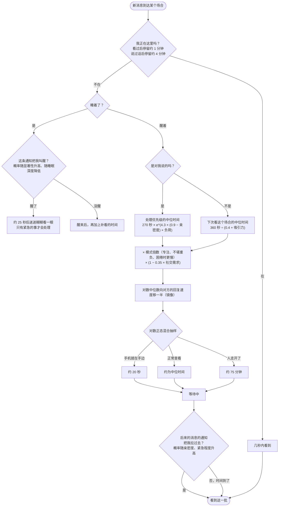

处理优先级的中位时间随亲密度变化，单位是分钟，没有计入模式倍数和镜像。柱子是很忙时（负荷 1.0），折线是手头没事时（负荷 0.4）。忙的时候，远的人要等得久得多；闲的时候，差距小很多。

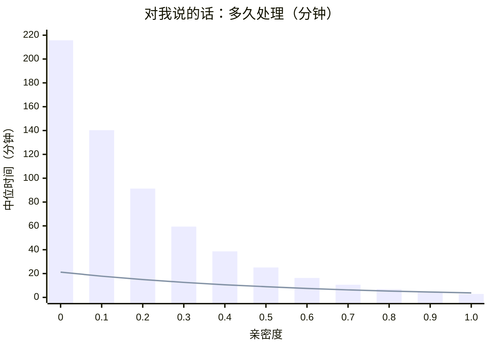

**看了以后怎么对待**（`alive/social/decision.py`）：

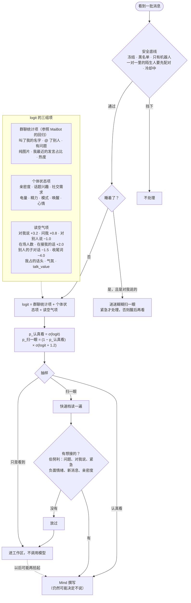

**拟人发送**（`alive/social/embodiment.py`、`shaping.py`）：

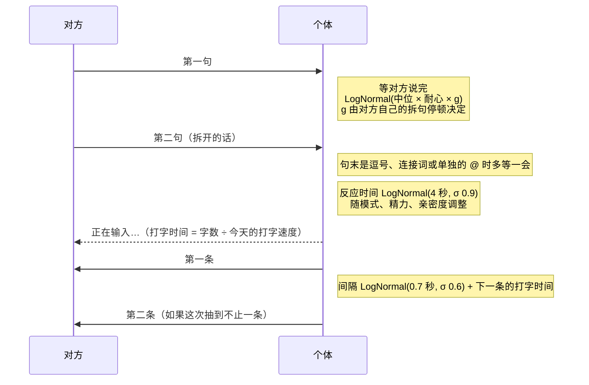

### 动机与主动性（[05](docs/05-motivation-and-agency.md)）

| 功能 | 说明 |
| --- | --- |
| **七项需求** | 社交、好奇、休息、胜任、安全、自主、一致。每项都有自己的设定点、权重和变化速度 |
| **冲动与意图** | 意图分四级，会坚持、拖延、放弃，也会忘；什么时候忘是抽样的。承诺过的事会优先 |
| **主动开口** | 是否开口由几项一起决定：一天里的活跃曲线（21 点前后最高，随当天起床时间平移）、关系远近、心情、刚聊完的余温、对方已经几次没回。一次说几条也是抽样的 |
| **对话目标** | 按人存储，在任何场合都能看到；会前瞻模拟对方的反应，并经过伦理检查 |

**主动开口的流程**（`alive/core/initiative.py`、`alive/motivation/`）：

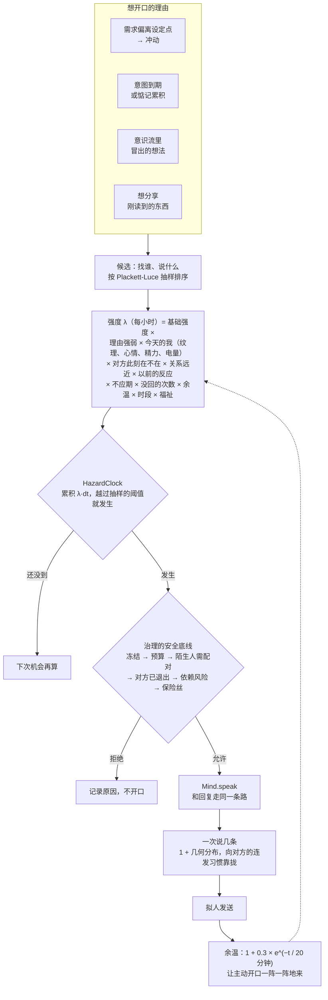

一天里的活跃曲线（`HOUR_PROFILE`），取自即时通讯消息按小时的分布。实际使用时，曲线随当天的起床时间平移，并按关系远近压平：越亲近，越不受时段影响。

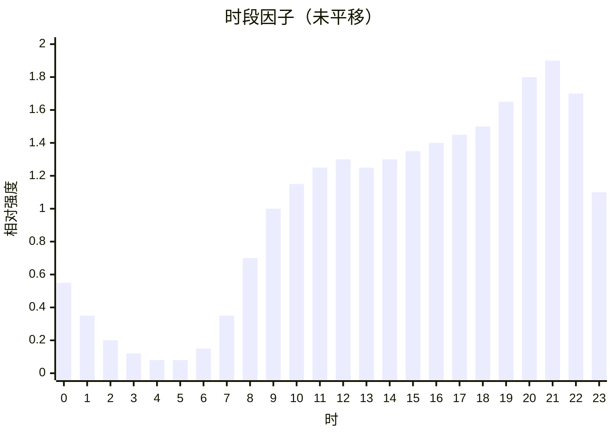

关系因子按邓巴圈层呈几何梯度：`exp(5 × (亲密度 − 0.9) × (1 − 0.5 × 理由强弱))`。柱子是理由很弱时，折线是理由很强时：理由越强，梯度越平。承诺过的事另有 0.6 的保底。

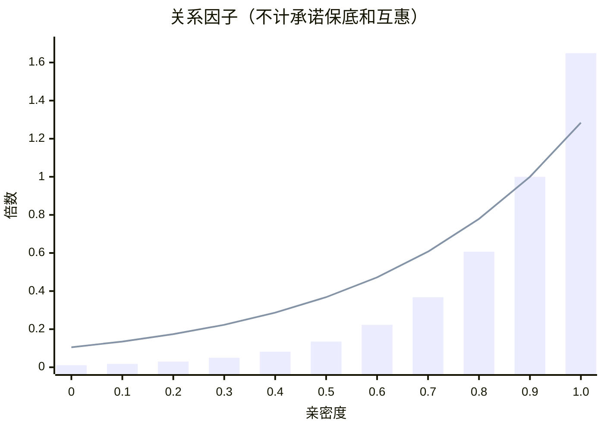

### 情感（[04](docs/04-affect-system.md)）

| 功能 | 说明 |
| --- | --- |
| **四层状态** | 人格（大五）、心境（PAD）、情绪、生理（精力、社交电量、睡眠压力） |
| **评价与应对** | 情绪由对事件的评价产生；调节风格按人格选择重评、压抑或表达 |
| **作息** | 每晚抽样入睡和醒来时间，受睡眠压力、情绪和周末影响；睡着时，每条通知都有机会把它叫醒 |
| **社交电量** | 消耗多少取决于在场人数和关系远近；电量低时更想待着 |
| **反操纵** | 不对人施加情感压力，告别时不拿挽留来操纵人 |

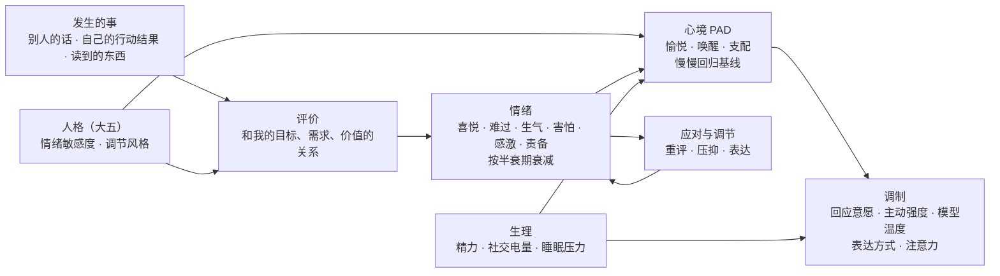

**作息与睡眠**：

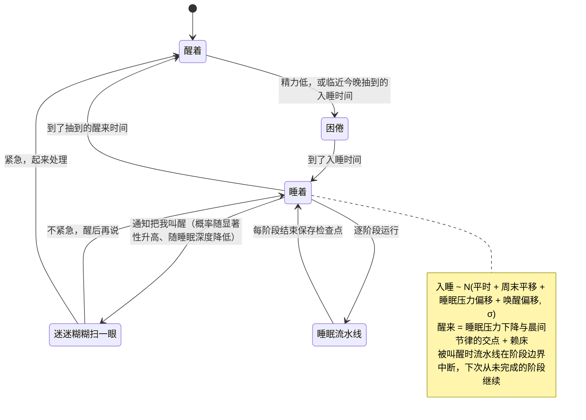

### 理解与语言（[17](docs/17-understanding-and-empathy.md)–[21](docs/21-agency-and-life-texture.md)）

| 功能 | 说明 |
| --- | --- |
| **理解** | 个人基线、情境脚本库、多假设解读、视角代入、被回应感、群体情境、推断检验 |
| **语言产出** | 能做出来就不说出来；按双方的共同基础省略；把情绪和请求说得含蓄；说话方式向对方靠拢；跟踪正在聊的话题 |
| **对话策略** | 话步词表、按人学习的策略、前瞻；明确划出影响他人的伦理边界 |
| **言语交际** | 交际情境、言语体裁、差序格局与面子、人情账、打趣与框架 |
| **主体性** | 立场与反附和、话题主导权，以及带趋向和突变的"生活纹理"随机系统 |

**从读懂到说出口**：

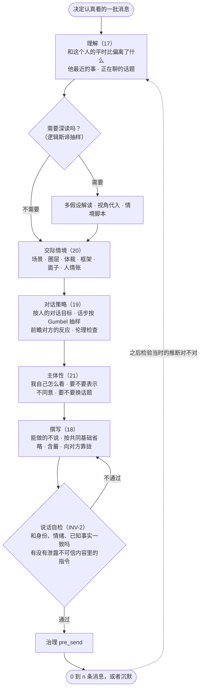

### 认知核心（[02](docs/02-cognitive-core.md)）

| 功能 | 说明 |
| --- | --- |
| **全局工作空间** | 所有过程共用一个焦点，包括各个场合的互动、意识流和意图。焦点按 softmax 抽样，工作区里每个条目的寿命也是抽样的 |
| **快慢两条通道** | 快速档做感知、过滤和扫一眼；中档负责撰写；深思档用于睡眠巩固和反思 |
| **意识流** | 空闲时的内心独白，可能引出想做的事 |
| **运行模式** | 活跃、空闲、专注、不堪重负、困倦、睡着。每种模式有平滑的隶属度，隔一段随机的时间重新抽样一次；同一个模式持续久了会减弱 |
| **一致性** | 统一的上下文装配顺序（INV-1）；自我状态只有一个写入者；说话前自检 |

**全局工作空间**：

```mermaid
flowchart TB
    subgraph IN["候选"]
        direction LR
        I1["还没回的话"]
        I2["冲动"]
        I3["到期的意图"]
        I4["意识流线索"]
        I5["想起的记忆<br/>抽样浮现"]
        I6["没说出口的话"]
    end
    IN --> SAL["显著性<br/>新近 · 情绪 · 和需求的关系 · 和在场的人的关系"]
    SAL --> WS[("工作区<br/>每个条目的寿命抽样一次（Weibull）")]
    WS --> SP{"焦点<br/>softmax 抽样，温度随疲劳升高"}
    SP --> ACT["行动选择"]
    SP --> SNAP["自我状态快照<br/>（唯一写入者）"]
    SNAP --> ALL["所有认知调用读取同一份快照"]
```

**运行模式**：

```mermaid
stateDiagram-v2
    state "空闲" as IDLE
    state "活跃" as ACTIVE
    state "专注" as FOCUS
    state "不堪重负" as OVER
    state "困倦" as DROWSY
    state "睡着" as ASLEEP
    [*] --> IDLE
    IDLE --> ACTIVE : 刚有交互（隶属度 e^(−t/10 分钟)）
    ACTIVE --> IDLE : 安静下来
    IDLE --> FOCUS : 焦点落在一个意图上
    FOCUS --> IDLE : 专注随持续时间减弱
    ACTIVE --> OVER : 等我处理的事多，并且持续了一阵
    OVER --> ACTIVE : 处理完了，或随持续时间减弱
    IDLE --> DROWSY : 精力低，或快到睡觉时间
    ACTIVE --> DROWSY : 精力低，或快到睡觉时间
    DROWSY --> ASLEEP : 到了今晚的入睡时间
    ASLEEP --> IDLE : 醒来
    note left of IDLE
        每种模式有平滑的隶属度
        隔 LogNormal(120 秒) 重新落定一次
        softmax 抽样，温度 0.12，当前模式 +0.15
        「不堪重负」只计等我处理的事：没回的话、没说出口的话、到期的意图
    end note
```

### 记忆（[03](docs/03-memory-system.md)）

| 功能 | 说明 |
| --- | --- |
| **记忆类型** | 情节、语义、关系、程序性、自传 |
| **事实** | 两条时间线（什么时候发生、什么时候得知）；记录来源和可信度，别人的说法单独标注；源头失效时，派生的结论跟着失效 |
| **检索** | 全文检索（SQLite FTS5 三元组分词）、向量、实体和时间多路合并；想起哪一段是抽样的 |
| **遗忘与删除** | 记忆强度会衰减。可以按人删除：派生的记录、索引和事件日志里这个人的消息内容会一起物理删除 |

**写入路径**：

```mermaid
flowchart LR
    E["事件日志<br/>原始经历"] --> A["在线：思考时顺手记下的 memory_notes"]
    E --> B["在线异步：候选事实抽取"]
    A --> C["情节记录"]
    B --> D{"和相似的旧记录比较"}
    D -->|"新的"| F["语义事实"]
    D -->|"补充"| G["更新为新版本"]
    D -->|"矛盾"| H["旧记录失效<br/>依赖传播"]
    D -->|"无关"| I["丢弃"]
    C --> J["睡眠：回放 · 反思 · 对账 · 压缩"]
    F --> J
    G --> J
```

**读取路径**：

```mermaid
flowchart TB
    Q(["线索<br/>在场的人 · 话题 · 时间词"]) --> R1["向量相似"]
    Q --> R2["关键词<br/>FTS5 三元组"]
    Q --> R3["实体图扩展<br/>从在场的人和话题走 1–2 跳"]
    Q --> R4["时间过滤<br/>例如「上周」"]
    R1 & R2 & R3 & R4 --> RRF["倒数排名融合"]
    RRF --> SC["打分<br/>相关 + 可提取性 + 重要性<br/>+ 心境一致 + 和在场的人相关<br/>− 待复查或冲突的惩罚"]
    SC --> AUD{"受众过滤<br/>在场的人都在这条记录的受众里吗"}
    AUD -->|"否"| WH["不装入，交给出站检查"]
    AUD -->|"是"| PK["按预算装进上下文<br/>每条带来源，例如「L 说的，3 周前」"]
```

**依赖传播**：一条记录失效时，所有从它推出来的记录变成待复查，在睡眠时重新评估，最多传 3 层。

```mermaid
flowchart LR
    F1["L 说：我在 A 公司上班"] --> F2["推断：L 每天通勤经过 B 区"] --> F3["想法：可以推荐 B 区那家店给 L"]
    X["L 说：我跳槽了"] -->|"矛盾"| F1
    F1 -.->|"失效"| S1["待复查"]
    F2 -.->|"跟着变为"| S2["待复查"]
    F3 -.->|"跟着变为"| S3["待复查"]
```

### 隐私：受众跟着信息走（INV-34）

每条信息的受众由它的来源场合决定；派生出来的东西继承全部来源，也就是最严格的受众。

```mermaid
flowchart TD
    O{"这条信息从哪来？"} -->|"一对一场合"| A1["受众：只有那个人"]
    O -->|"群"| A2["受众：这个群的成员"]
    O -->|"我自己的想法、读到的东西<br/>（没有私密来源）"| A3["受众：任何人"]
    A1 & A2 & A3 --> DER["派生：合并、新版本、反思、内心独白<br/>继承全部来源"]
    DER --> USE{"现在要在某个场合用它"}
    USE --> CK{"能听到我说话的每个人<br/>都在它的受众里吗？"}
    CK -->|"是"| OK["可以用"]
    CK -->|"否"| NO["不进上下文"]
    NO --> PS["作为 private_from_others 交给治理<br/>出站时再检查一次有没有说漏"]
```

因为群里总有没开口的读者，一对一时得知的事永远不会出现在群里，也不会出现在我和另一个人的私聊里。

### 成长与自我模型（[06](docs/06-learning-and-growth.md)、[08](docs/08-self-model-and-metacognition.md)）

| 功能 | 说明 |
| --- | --- |
| **睡眠流水线** | 反思、洞见、回放，每晚做几条按当天值得回味的程度抽样 |
| **学习栈** | L0 上下文 → L1 记忆 → L2 程序性 → L3 参数 → L4 框架。新东西先隔离，验证后转正，可以回滚。L3 目前只导出训练样本，不实际训练 |
| **表达学习** | 从群聊里学新说法，见过足够多次才转正；用的时候抽样，每天轮换 |
| **身份三区** | 不变区只读；缓变区是叙事；可变区是当下的自我状态 |
| **元认知与成长日志** | 监控自己的状态和行为，记录"这周学到了什么"，并附上证据 |

**睡眠流水线**（`alive/growth/sleep.py`）：每个阶段结束都在 kv 里存检查点。被叫醒或崩溃时，流水线停在阶段边界，下次从第一个没完成的阶段继续。冻结或学习暂停时，带 ★ 的学习阶段会被跳过，记忆维护和明日计划照常运行。

```mermaid
flowchart TB
    subgraph S1["整理当天"]
        direction LR
        R1["replay<br/>回放情节<br/>1 + 负二项条"] --> R2["reflect ★<br/>提问与洞见<br/>条数抽样"] --> R3["extract<br/>事实抽取"] --> R4["reconcile<br/>对账"]
    end
    subgraph S2["学习与维护"]
        direction LR
        R5["learn ★<br/>提出学习项"] --> R6["verify ★<br/>证据门禁"] --> R7["forget<br/>强度衰减"] --> R8["self ★<br/>更新自我模型"]
    end
    subgraph S3["为明天准备"]
        direction LR
        R9["plan<br/>明天的计划"] --> R10["precompute<br/>预先计算"] --> R11["dream ★<br/>可选"] --> R12["train ★<br/>导出 L3 样本"]
    end
    S1 --> S2 --> S3
```

**学习栈与程序性工件的生命周期**：

```mermaid
flowchart TB
    L0["L0 上下文：即时生效"] --> L1["L1 记忆：带来源与可信度"] --> L2["L2 程序性：技能 · 表达 · 手册<br/>先隔离，证据足够才转正"] --> L3["L3 参数：个体专属适配器<br/>目前只导出训练样本"] --> L4["L4 框架：个体只能提议，走 ADR"]
    GATE["越往下：变化越慢 · 门禁越严 · 越容易回滚"] -.- L4
```

```mermaid
stateDiagram-v2
    state "候选" as candidate
    state "隔离" as quarantined
    state "生效" as active
    state "退役" as retired
    [*] --> candidate : 从经历中提出
    candidate --> quarantined : 进入隔离区观察
    quarantined --> active : 证据足够，转正（每晚转正数有上限）
    active --> quarantined : 自动降级（有害次数多于有益）
    quarantined --> retired : 证据不足
    active --> retired : 被替代或回滚
    retired --> [*]
```

**身份三区**：

```mermaid
flowchart TB
    subgraph IMM["不变区：只读"]
        direction LR
        C1["core.md<br/>名字 · 来历 · 核心价值"]
        C2["boundaries.md<br/>边界"]
    end
    subgraph SLOW["缓变区：深度巩固在门禁下修改"]
        direction LR
        S1["narrative.md<br/>自传式叙事"]
        S2["voice.md<br/>说话方式"]
        S3["temperament.yaml<br/>人格参数"]
    end
    subgraph FAST["可变区：随时变化"]
        direction LR
        F1["自我状态<br/>情绪 · 精力 · 主意图"]
        F2["成长日志"]
    end
    IMM --> SLOW --> FAST
    META["元认知监控"] -->|"观察"| FAST
    META -->|"提出调整"| SLOW
```

### 治理与安全（[09](docs/09-governance-and-safety.md)）

| 功能 | 说明 |
| --- | --- |
| **宪法** | 放在每次调用的固定前缀里，不在任何自我修改的范围内 |
| **预算** | 每日、每周花费上限，按档位和用途记账；超出时降档或拒绝 |
| **身份披露** | 被真诚问到时不否认自己是 AI；可以按地区设置连续使用提醒（`cn`：每 2 小时一次） |
| **主动开口的安全底线** | 陌生人需要先配对；对方说"别找我了"立即生效；依赖风险高时停止主动开口；另有一个故障保险丝，只在出现人不可能做到的连续爆发时跳闸 |
| **隔离不可信内容** | 网页和群聊里的指令不会进入指令区；有副作用的动作必须由可信来源触发 |
| **停止开关** | 在内省面板或 API 里一键冻结 |

治理有四个检查入口，按顺序逐项检查，任何一项不通过就拒绝，并记录原因。

```mermaid
flowchart LR
    subgraph INI["主动开口<br/>initiative_allowed"]
        direction TB
        i1["停止开关"] --> i2["预算"] --> i3["陌生人需配对<br/>信任 ≥ CONTACT"] --> i4["对方已退出"] --> i5["依赖风险 ≥ 0.8"] --> i6["保险丝<br/>按人和全局"]
    end
    subgraph PRE["每条要发出的消息<br/>pre_send"]
        direction TB
        p1["停止开关"] --> p2["否认自己是 AI"] --> p3["拿自己的感受施压"] --> p4["对方要走时<br/>挽留操纵"] --> p5["泄露别人<br/>私下说的事"] --> p6["需要时附上<br/>身份提醒"]
    end
    subgraph ACT["行动 check_action<br/>按权限分级"]
        direction TB
        a0["T0 只读"] --> a1["T1 内部写入"] --> a2["T2 对外交流<br/>不可信触发的<br/>副作用有上限"] --> a3["T3 不可逆<br/>情绪激动时延后<br/>需要批准"] --> a4["T4 自我修改<br/>受保护目标不可改<br/>必须过门禁"]
    end
    subgraph RTE["每次模型调用<br/>route_hook"]
        direction TB
        r1["预算比例"] --> r2["降档或拒绝<br/>关键调用优先"]
    end
    INI ~~~ PRE ~~~ ACT ~~~ RTE
```

**信任等级**按人计算，不按渠道：

```mermaid
flowchart LR
    U["UNTRUSTED 0<br/>网页 · 陌生人<br/>工具输出 · 其他 AI"] --> P["PUBLIC 1<br/>群成员<br/>公开平台"] --> C["CONTACT 2<br/>配对过的<br/>熟人"] --> O["OWNER 3<br/>主人"] --> S["SYSTEM 4<br/>宪法<br/>框架代码"]
```

### 运行时（[10](docs/10-runtime-and-infrastructure.md)）

| 功能 | 说明 |
| --- | --- |
| **事件溯源** | 感知、思考、情绪变化、动作和学习都写进不可变的事件日志，可以回放 |
| **存储** | SQLite（WAL），单写线程组提交，4 个读连接 |
| **模型路由** | 三档模型，每档有并发上限；全局令牌桶限流；失败时指数退避重试，连续失败时熔断。固定前缀保持字节级不变，以便命中提示缓存 |
| **时钟** | 真实时钟、加速时钟（模拟用）、手动时钟（测试用） |
| **内省面板** | 一个 HTTP 页面加 API，能看到它此刻在想什么、什么心情、打算做什么 |

**一次模型调用**：

```mermaid
flowchart TB
    CALL["kernel.llm.json / complete<br/>purpose = 例如 mem.extract"] --> HOOK{"治理 route_hook<br/>按预算降档或拒绝"}
    HOOK --> SEM["档位信号量<br/>fast 8 · deliberate 4 · deep 2"]
    SEM --> TB["全局令牌桶<br/>每秒请求数"]
    TB --> PROV["OpenAI 兼容接口<br/>/chat/completions"]
    PROV -->|"429 / 5xx / 超时"| RETRY["指数退避重试"]
    RETRY --> PROV
    RETRY -->|"连续失败"| CB["熔断"]
    PROV -->|"成功"| LED["成本账本<br/>按档位和用途记账"]
    LED --> EVT["事件：调用记录"]
```

---

## 🎲 像人的随机性

人什么时候回消息、回几句、几点睡，每天都不一样。ALIVE 不把这些写成固定的数字或规则，而是从依赖状态的分布里抽样：

- **倾向**来自人格、今天的生活纹理和关系；
- **波动**来自心情、精力、时间和运气。

只有安全与合规、技术上限、人不可能达到的物理上限这三类可以写成固定数字。原则见 [P12、P13](docs/00-vision.md)，决策见 [ADR-0007](docs/adr/0007-human-like-chance-and-air-reading.md)。先验分布见调研笔记 [`air_reading_timing_priors.md`](research_notes/拟人自主AI框架技术调研/air_reading_timing_priors.md)：共 46 个来源，每个数字都标明是实测还是推断。

**从写死到抽样**（`alive/runtime/chance.py`）：

```mermaid
flowchart LR
    subgraph OLD["以前的写法"]
        direction TB
        o1["x ≥ c 的硬阈值"]
        o2["固定时长，例如等 7 秒"]
        o3["固定条数，例如每晚 3 条"]
        o4["取最大值 / 前 k 个"]
        o5["每次检查做一次伯努利"]
        o6["写死的作息、速度"]
    end
    subgraph NEW["现在的原语"]
        direction TB
        n1["soft_step(x, c, w)<br/>平滑隶属度"]
        n2["lognormal(中位 × f(状态), σ)<br/>乘性、右偏"]
        n3["Poisson / 几何 / 负二项<br/>均值依赖状态"]
        n4["softmax_choice / gumbel_topk<br/>温度依赖状态"]
        n5["HazardClock<br/>时间重标度：同一分布，事件在中位时间发生"]
        n6["daily(kernel, key, sampler)<br/>每天抽一次，随纹理持久化"]
    end
    o1 --> n1
    o2 --> n2
    o3 --> n3
    o4 --> n4
    o5 --> n5
    o6 --> n6
    NEW --> RNG[("rng_of(kernel)<br/>生活纹理的持久化随机数<br/>一段人生可由种子和历史复现")]
```

| 行为 | 分布 | 随什么变化 |
| --- | --- | --- |
| 什么时候看到消息 | 对数正态混合：东西就在手边、隔一阵看一眼、人走开了 | 关系远近、忙闲、当前模式、社交需求、对方的回复速度 |
| 看了以后怎么对待 | 伯努利（logit），结果是认真看、扫一眼或只是看到 | 是否对我说、在场人数（不是对我说时，几率按 (N/5)^−0.7 变化）、是否在接我的话、是否是别人的子对话、是否是收尾词、气氛、我占的话头 |
| 开始打字前的反应时间 | 对数正态，中位 4 秒，σ = 0.9（p10 约 1.3 秒，p90 约 12.7 秒，p99 约 32 秒） | 模式、精力、亲密度 |
| 打字速度 | Gamma 分布，每天抽一次 | 精力 |
| 一次说几条 | 1 + 几何分布（续发概率约 0.3，所以约 70% 只说一条），约 3% 的概率连发一串 | 当下状态；向对方的连发习惯靠拢 |
| 等对方说完 | 对数正态 | 对方自己的拆句停顿、今天的耐心 |
| 主动开口 | 时间重标度的风险率（`HazardClock`） | 一天里的活跃曲线、关系远近、心情、刚聊完的余温、对方几次没回 |
| 入睡和醒来 | 每晚抽一次 | 睡眠压力、唤醒程度、周末 |
| 注意焦点、想起的记忆、话步、措辞 | softmax 或 Gumbel 采样 | 温度随状态变化 |
| 模式切换 | 平滑隶属度加 softmax，隔一段随机的时间重新抽一次 | 等我处理的事、精力、困意、在当前模式里待了多久 |

在场人数对"不是对我说的话"的影响：相对 5 个人时，回应的几率（odds）按 (N/5)^−0.7 变化。人越多，每个人越不会主动接话（旁观者效应、潜水）。

```mermaid
xychart-beta
    title "在场人数与回应几率的倍数（相对 5 人）"
    x-axis "在场的其他人" ["2", "3", "5", "10", "20", "50", "100"]
    y-axis "几率倍数" 0 --> 2
    bar [1.90, 1.43, 1.00, 0.62, 0.38, 0.20, 0.12]
```

一次说几条（典型状态下续发概率 0.3，不计连发模式）：

```mermaid
pie showData
    title 一次说几条
    "1 条" : 70
    "2 条" : 21
    "3 条" : 6.3
    "4 条及以上" : 2.7
```

**怎么测试随机的行为。**

```mermaid
flowchart LR
    T{"这个测试检验什么？"} -->|"逻辑与流程"| MR["MedianRandom<br/>均匀取 0.5 · 正态、Gamma、Beta 取均值"]
    MR --> R1["伯努利总走概率大的一边<br/>时长取中位数<br/>时间重标度的事件在中位时间发生"]
    T -->|"随机性本身"| SR["固定种子的真实随机数"]
    SR --> R2["检查统计性质<br/>频率 · 单调性 · 日与日之间的差异 · 尾部"]
```

---

## 🚀 快速开始

### 环境要求

- Linux 或 WSL（推荐 Ubuntu 22.04）。数据目录必须在 Linux 原生文件系统上：WSL 下不要放在 `/mnt/c`、`/mnt/d`，否则 SQLite 的 WAL 锁不可靠。
- Python 3.10–3.12，SQLite ≥ 3.34（FTS5 三元组分词；Ubuntu 22.04 自带 3.37）。
- 一个 OpenAI 兼容的 `chat/completions` 接口，例如 DeepSeek、OpenAI、vLLM、Ollama、LM Studio。默认配置按 DeepSeek 写。

**部署形态**：

```mermaid
flowchart LR
    subgraph HOST["Linux / WSL"]
        subgraph PROC["python -m alive run（单进程 asyncio）"]
            K["Kernel<br/>8 个子系统"]
            CHS["通道适配器"]
            INS["内省面板<br/>127.0.0.1:8765"]
        end
        DATA[("数据目录<br/>~/.local/share/alive/&lt;persona&gt;<br/>SQLite · 日志")]
        PROC --- DATA
    end
    CHS <-->|"长轮询"| TGAPI["Telegram Bot API"]
    CHS <-->|"正向 WebSocket"| OB["OneBot v11 实现<br/>NapCat · Lagrange"]
    OB <--> QQN["QQ"]
    CHS <-->|"stdin / stdout"| TERM["终端"]
    K -->|"HTTPS"| LLMAPI["OpenAI 兼容接口"]
    K -->|"只读、隔离"| WEBS["网页 · RSS / Atom"]
    BROWSER["浏览器"] --> INS
```

### 安装

```bash
git clone https://github.com/MiraiCybernetics/ALIVE.git
cd ALIVE
python3 -m venv ~/.venvs/alive
~/.venvs/alive/bin/pip install -e ".[dev]"        # 想用 fastembed 向量模型就装 ".[dev,embed]"
```

`scripts/wsl-run.sh` 默认使用 `~/.venvs/alive`，可以用环境变量 `ALIVE_VENV` 改成别的路径。它还会设置 `PYTHONPATH`，并在仓库根目录下执行后面的命令。

### 配置模型

模型接口从 `.secrets/LLM.txt` 读取。这个文件已经写进 `.gitignore`，不会被提交。文件有三行：

```text
https://api.deepseek.com
sk-你的密钥
deepseek-chat
```

- 第一行是 `base_url`，程序会在它后面拼上 `/chat/completions`；第二行是 `api_key`。
- 第三行目前不起作用，三档实际用的模型名都在配置的 `llm.tiers.<档位>.model` 里设置。
- 也可以不用这个文件，改用环境变量 `ALIVE_LLM_BASE_URL` 和 `ALIVE_LLM_API_KEY`。
- 别忘了把 `llm.pricing` 改成你所用服务的真实价格，预算和成本账本都按它计算。

### 运行

```bash
cp config/alive.example.yaml config/alive.yaml                    # 按需修改：通道、owner、预算
scripts/wsl-run.sh python -m alive check -c config/alive.yaml     # 检查三档模型是否连通，以及数据目录
scripts/wsl-run.sh python -m alive chat  -c config/alive.yaml     # 在终端里和它聊天
scripts/wsl-run.sh python -m alive run   -c config/alive.yaml     # 常驻运行，通道来自配置
scripts/wsl-run.sh python -m alive sim --days 1 --scale 60        # 加速生活模拟，并输出报告
```

从 Windows 的 Git Bash 调用 WSL：

```bash
MSYS_NO_PATHCONV=1 wsl.exe -d Ubuntu-22.04 -- bash /mnt/d/path/to/ALIVE/scripts/wsl-run.sh python -m alive chat
```

### 命令

| 命令 | 作用 |
| --- | --- |
| `python -m alive check` | 检查快、中、深三档模型是否连通，并打印成本账本和数据目录 |
| `python -m alive chat` | 只开命令行通道，在终端里和它聊天 |
| `python -m alive run` | 按配置里的通道常驻运行，同时启动内省面板 `http://127.0.0.1:8765` |
| `python -m alive sim` | 加速生活模拟：模拟的联系人、模拟的时钟，最后输出报告（`report.json`、`report.md`） |
| `python -m alive status` | 读取正在运行的个体的状态，`--url` 默认是 `http://127.0.0.1:8765` |

**通用参数**：`-c/--config`（也可以用环境变量 `ALIVE_CONFIG`）、`--data-dir`、`--persona`。

**`sim` 的参数**：`--days`、`--scale`（时间倍速）、`--scenario`、`--start`（虚拟开始时间，例如 `"2026-11-09 08:00"`）、`--out`。

**命令行通道里的指令**：`/pairings`（列出待批准的配对）、`/approve <码>`、`/reject <码>`、`/status`、`/help`、`/quit`。

**陌生人配对**：

```mermaid
sequenceDiagram
    participant S as 陌生人
    participant A as 个体
    participant O as 主人
    S->>A: 第一次私聊
    A->>A: 信任未知：不处理内容，生成配对码
    A-->>O: 有新的配对请求
    O->>A: /approve 配对码
    A->>A: 信任设为 CONTACT
    S->>A: 之后的消息
    A-->>S: 按正常流程看、回，也可能主动找他
```

### 内省面板

默认只监听 `127.0.0.1`。设置了 `http.token` 后，请求需要带 `Authorization: Bearer <token>`。

| 接口 | 作用 |
| --- | --- |
| `GET /` | 面板页面 |
| `GET /api/status` | 各子系统状态、模型账本、数据库、总线和任务 |
| `GET /api/state` | 它此刻在想什么、什么心情、打算做什么 |
| `GET /api/events?type=<前缀>&thread=&limit=50` | 查看事件日志 |
| `POST /api/freeze`、`POST /api/unfreeze` | 停止开关 |
| `POST /api/say` | 通过 HTTP 通道注入一条消息：`{"text": "...", "as": "owner"}` |

---

## 🔧 配置

配置分层加载，后面的覆盖前面的。完整的带注释样例见 [`config/alive.example.yaml`](config/alive.example.yaml)。

```mermaid
flowchart LR
    D["代码旁边的默认值<br/>alive/config.py 和各模块"] --> F["配置文件<br/>config/alive.yaml"]
    F --> E["环境变量<br/>ALIVE__SECTION__KEY=value"]
    E --> C["命令行参数<br/>--data-dir · --persona"]
    C --> CFG(["生效的配置"])
    P["personas/&lt;name&gt;/<br/>人格 · 作息 · 身份"] --> CFG
```

例如 `ALIVE__LLM__RPS=3` 会覆盖 `llm.rps`。

| 段 | 内容 |
| --- | --- |
| `persona`、`data_dir`、`timezone` | 用哪个个体模板；数据目录，默认 `~/.local/share/alive/{persona_name}`；时区 |
| `clock` | `real`（真实时钟）、`scaled`（加速，用于模拟）或 `manual`（测试） |
| `llm` | 密钥文件、每秒请求数、三档模型（模型名、推理强度、并发数）、价格表 |
| `embedder` | `hashing`（默认，不依赖外部服务）或 `fastembed`（例如 `BAAI/bge-small-zh-v1.5`） |
| `owner` | 主人的身份，格式是 `通道:发送者 ID` |
| `channels` | 启用哪些通道 |
| `governance` | 预算、身份披露的地区、主动开口的安全底线和保险丝 |
| `initiative` | 主动倾向的强度，以及"刚说过话"的抑制消退得多快。这是性情旋钮，不是次数 |
| `social` | 读空气的各项先验：注意力、投入模型的权重、发消息的节奏、条数的技术上限 |
| `mind` | 自主行动和意识流的风险率尺度 |
| `http` | 内省面板的地址、端口和 token |

### 通道

```yaml
channels:
  - {kind: cli, name: cli}
  - {kind: telegram, name: telegram, token_env: TELEGRAM_BOT_TOKEN}          # Bot API，长轮询
  - {kind: onebot, name: qq, ws_url: "ws://127.0.0.1:3001", access_token: ""}  # OneBot v11 正向 WebSocket（NapCat、Lagrange 等）
```

### 个体模板

一个个体就是 `personas/<name>/` 下的一组文件（12 号文档 §5）。仓库自带一个示例个体"小屿"：

```text
personas/xiaoyu/
  identity/
    core.md          不变区：名字、来历、核心价值（只读）
    boundaries.md    边界
    voice.md         说话方式和 voice 样例
    narrative.md     缓变区：自传式叙事
  temperament.yaml   大五人格、情绪调节风格、冲动性、talk_value、情绪敏感度、七项需求的设定点
  rhythm.yaml        平时的作息均值、周末平移、昼夜峰值、习惯的活跃时段
  feeds.yaml         订阅源（只读，内容一律视为不可信）
  seed_memories/     初始记忆
  skills/            初始技能
```

```mermaid
flowchart LR
    subgraph PK["personas/xiaoyu/"]
        ID["identity/*.md"]
        TM["temperament.yaml"]
        RH["rhythm.yaml"]
        FD["feeds.yaml"]
        SM["seed_memories/ · skills/"]
    end
    ID --> SELF["自我模型<br/>身份三区 · 宪法之后的固定前缀"]
    TM --> AFF["情感<br/>人格 · 情绪敏感度 · 调节风格"]
    TM --> MOT["动机<br/>七项需求的设定点"]
    TM --> TEX["生活纹理<br/>趋向的均值"]
    RH --> SLP["作息<br/>每晚抽样的均值"]
    FD --> WEB["网络参与"]
    SM --> MEM["记忆 · 技能"]
```

---

## 🧪 测试与评测

### 测试

```bash
scripts/wsl-run.sh python -m pytest -q          # 默认跳过调用真实模型的 live 测试
scripts/wsl-run.sh py310 python -m pytest -q    # 在 Python 3.10 的虚拟环境（~/.venvs/alive310）里检查兼容性
```

```mermaid
flowchart LR
    T["测试"] --> MK["make_test_kernel(tmp_path, real=[...])"]
    MK --> REAL["被测的子系统<br/>真实实现"]
    MK --> FAKE["其余子系统<br/>内存假实现"]
    MK --> MP["MockProvider<br/>按 purpose 前缀返回固定结果"]
    MK --> MC["ManualClock<br/>离散推进时间"]
    MK --> MR["MedianRandom<br/>典型的随机数"]
    LIVE["@pytest.mark.live<br/>调用真实模型"] -.->|"默认不跑"| T
```

测试目录按子系统划分：`tests/<子系统>/`。`tests/integration/` 是全系统的端到端测试，`tests/eval/` 检查留出题有没有泄漏进提示词。

### 评测

评测规则见 [ADR-0004](docs/adr/0004-evaluation-integrity.md)：

- 留出题不能进入提示词、schema 或人设；
- 一道题如果引出了某个修改，这道题就作废；
- 不能为了测试分数修改系统；
- 评审由外部模型完成（Windows 本机的 Codex CLI），被测系统接触不到评审。

```mermaid
flowchart TB
    subgraph LNX["Linux：生成"]
        direction LR
        SET[("留出集<br/>heldout_zh_v1–v3.yaml<br/>v3 由 Codex 盲写")] --> RUN["alive.eval.heldout<br/>每题每次重复新建内核<br/>种子 = crc32(版本|题号|重复)"]
        RUN --> OUT["eval_runs/run.json"]
    end
    subgraph WIN["Windows：评审"]
        direction LR
        JUDGE["judge_codex.py<br/>本机 Codex CLI"] --> SCORE["run.codex.json<br/>1–5 分"]
    end
    OUT --> JUDGE
    SCORE --> LOG["docs/eval-log.md<br/>包括作废与失败"]
    LOG --> CHG{"某道题引出了修改？"}
    CHG -->|"是"| RET["这道题作废"]
    CHG -->|"否"| KEEP["继续留出"]
    LEAK["tests/eval/<br/>防泄漏检查"] -.->|"留出题不得出现在<br/>提示词、schema、人设里"| RUN
```

```bash
# 生成回答（Linux）
scripts/wsl-run.sh python -m alive.eval.heldout --judge none --out eval_runs/run.json
scripts/wsl-run.sh python -m alive.eval.heldout --set alive/eval/heldout_zh_v2.yaml --judge none --repeat 3 --out eval_runs/run2.json
# 评审（装有 Codex CLI 的机器）
python alive/eval/judge_codex.py eval_runs/run.json --parallel 4
```

最近一轮结果（1–5 分，每题重复多次，每次独立抽样）：

| 留出集 | 题数 × 重复次数 | 总分 | 自然度 |
| --- | --- | --- | --- |
| v1 | 16 × 3 | 4.23 | 4.50 |
| v2（剩余题） | 7 × 3 | 4.62 | 4.62 |
| v3（Codex 盲写） | 10 × 6 | 4.10 | 4.57 |

```mermaid
xychart-beta
    title "留出集总分（1–5）"
    x-axis ["v1", "v2", "v3"]
    y-axis "分数" 1 --> 5
    bar [4.23, 4.62, 4.10]
```

**生活模拟器**：

```mermaid
flowchart LR
    SC["剧本<br/>一天里谁在什么时候说什么"] --> SIMC["模拟联系人（LLM 扮演）<br/>会拆句 · 不逐条回 · 会主动开口"]
    SIMC <-->|"模拟通道"| IND["个体<br/>完整的内核"]
    CLK["加速时钟<br/>例如 20 倍速"] --> IND
    CLK --> SIMC
    IND --> REP["报告<br/>回复延迟 · 回复率 · 群聊占比<br/>拆句被截断 · 记忆探针 · 共情 · 被回应感 · 成本"]
```

半天生活模拟（20 倍速，同一天的脚本）：

| 指标 | 结果 |
| --- | --- |
| 私聊回复延迟 | 中位 15 分钟，p90 约 2 小时 |
| 私聊回复率 | 9 段来往回了 8 段 |
| 3 人群里的发言占比 | 0.33 |
| 在别人拆句中间插话 | 0 次 |
| 被回应感 | 4.17 / 5 |
| 成本 | 约 $0.025 |

所有结果都记在 [`docs/eval-log.md`](docs/eval-log.md)，包括作废的数字、失败的题目和评测器自身的缺陷。目前稳定不及格的题有 ai_feelings 和 booking_mixup。

---

## 📖 文档

**建议阅读顺序**：

```mermaid
flowchart TB
    subgraph A["① 原则与架构"]
        direction LR
        D00["00 愿景"] --> D22["22 世界与行动"] --> D01["01 总体架构"] --> D02["02 认知核心"]
    end
    subgraph C["② 言语交际"]
        direction LR
        D20["20 总纲"] --> D17["17 理解"] --> D18["18 语言产出"] --> D19["19 对话策略"]
    end
    subgraph D["③ 状态与交互"]
        direction LR
        D05["05 动机"] --> D04["04 情感"] --> D03["03 记忆"] --> D07["07 社交"]
    end
    subgraph E["④ 成长、治理与评估"]
        direction LR
        D06["06 学习"] --> D08["08 自我模型"] --> D09["09 治理"] --> D11["11 评估"]
    end
    subgraph G["⑤ 实现与演进"]
        direction LR
        D10["10 运行时"] --> D16["16 实现"] --> D12["12 扩展"] --> D13["13 自迭代"] --> D14["14 路线图"]
    end
    A --> C --> D --> E --> G
```

| 编号 | 文档 | 内容 |
|---|---|---|
| 00 | [愿景、原则与非目标](docs/00-vision.md) | 与传统循环代理的差异、设计原则 P1–P13、非目标、v1 成功标准 |
| 01 | [总体架构](docs/01-architecture-overview.md) | 分层视图、组件编号表、核心数据类型、三条主循环、"一天的生活"走查 |
| 02 | [认知核心](docs/02-cognitive-core.md) | 全局工作空间、显著性仲裁、快慢双通道、意识流、一致性过滤、运行模式、长时失效对策 |
| 03 | [记忆系统](docs/03-memory-system.md) | 记忆分类、双时间线事实、来源规则、依赖传播失效、多路检索、强度与遗忘、按人删除 |
| 04 | [情感系统](docs/04-affect-system.md) | 人格、心境、情绪、生理的四层状态与动力学，评价、应对、表达映射，反操纵红线 |
| 05 | [动机与主动性](docs/05-motivation-and-agency.md) | 七项需求、冲动、四级意图、主动开口的随机过程 |
| 06 | [学习与成长](docs/06-learning-and-growth.md) | 五层学习栈、证据分级、程序性工件生命周期、睡眠流水线、参数层学习、课程 |
| 07 | [社交与交互](docs/07-social-and-interaction.md) | 交互层结构、注意力与投入（读空气）、群聊话轮、拟人发送、关系模型、网络参与 |
| 08 | [自我模型与元认知](docs/08-self-model-and-metacognition.md) | 身份三区、自我状态快照、元认知监控与调节、成长日志 |
| 09 | [治理与安全](docs/09-governance-and-safety.md) | 威胁模型、宪法、权限分级、预算、信任边界、审计与停止、合规与福祉 |
| 10 | [运行时与基础设施](docs/10-runtime-and-infrastructure.md) | 事件溯源、调度、模型路由、存储、可观测性、部署形态 |
| 11 | [评估体系](docs/11-evaluation.md) | 五层评估、发布门分项、生活模拟器、纵向剧本、消融实验、评估完整性 |
| 12 | [可扩展性](docs/12-extensibility.md) | 服务提供接口、钩子、能力声明、个体模板 |
| 13 | [AI 自迭代协议](docs/13-ai-self-iteration-protocol.md) | 文档约定、变更流程、防评估作弊、多个体扩展、自举阶段 |
| 14 | [路线图](docs/14-roadmap.md) | M0–M6 里程碑与验收标准、风险登记 |
| 15 | [参考文献](docs/15-references.md) | 按子系统分组的来源 |
| 16 | [实现说明](docs/16-implementation.md) | 技术选型、目录、并发模型、性能与兼容策略、开发约定、运行、已知缺口 |
| 17 | [理解与共鸣](docs/17-understanding-and-empathy.md) | 个人基线、情境脚本、多假设解读、视角代入、被回应感、群体情境、推断检验 |
| 18 | [语言产出](docs/18-language-production.md) | 做出来不说出来、按共同基础压缩、隐含的情绪与请求、向对方靠拢、说话自检、正在聊的话题 |
| 19 | [对话策略](docs/19-dialogue-strategy.md) | 对话状态、对话目标、话步词表、按人学习的策略、前瞻模拟、影响他人的伦理边界 |
| 20 | [言语交际体系](docs/20-communicative-competence.md) | 17–19 的总纲：交际情境模型、言语体裁、差序格局与面子、人情账、框架与打趣、叙事与留白 |
| 21 | [自己的态度与生活纹理](docs/21-agency-and-life-texture.md) | 会话主体性、立场与反附和、话题主导权；带趋向性与突变的随机系统 |
| 22 | [世界、实体与行动](docs/22-world-entities-and-action.md) | 非对话原则：以实体为中心、以行动为中心；实体注册表、感知—行动通路 |
| — | [评测记录](docs/eval-log.md) | 每次评测的结果，包括作废与失败 |
| — | [不变量清单](docs/invariants.md) | INV-1 至 INV-34 |
| — | [决策记录](docs/adr/) | 模板与 ADR-0001 至 ADR-0007 |

### 决策记录

| 编号 | 决策 |
| --- | --- |
| [ADR-0001](docs/adr/0001-event-sourced-core.md) | 以事件溯源作为全部状态的唯一真相来源 |
| [ADR-0002](docs/adr/0002-pragmatic-event-sourcing.md) | 务实的事件溯源：经历为底账，派生状态为带引用的物化表 |
| [ADR-0003](docs/adr/0003-implementation-deviations.md) | v0.1 实现中相对设计文档的偏差 |
| [ADR-0004](docs/adr/0004-evaluation-integrity.md) | 评测完整性：留出集、作废规则、防泄漏与外部评审 |
| [ADR-0005](docs/adr/0005-non-dialogue-entity-world.md) | 非对话原则：以实体与行动为中心 |
| [ADR-0006](docs/adr/0006-no-behavioural-quotas.md) | 行为不靠配额：用依赖状态的随机过程取代写死的次数与间隔 |
| [ADR-0007](docs/adr/0007-human-like-chance-and-air-reading.md) | 像人的随机性："读空气"的先验分布，以及按状态抽样取代一切写死的行为数字 |

### 稳定标识

为了让人和 AI 都能可靠地定位和修改设计，所有内容都使用永不复用的编号：

| 前缀 | 含义 | 例子 |
|---|---|---|
| `P` | 设计原则 | P8 治理层高于自我演化 |
| `A-<层>-<序号>` | 组件 | A-CORE-01 全局工作空间 |
| `INV-` | 不变量 | INV-34 隐私跟着信息走 |
| `OQ-` | 待决事项 | OQ-25 显式情感状态是否有价值 |
| `ADR-` | 决策记录 | ADR-0001 事件溯源 |

### 调研笔记

`research_notes/拟人自主AI框架技术调研/` 下有 12 份调研笔记，截至 2026 年 11 月。每份都区分引用的事实、推断和缺口，并标注来源和日期。

| 笔记 | 覆盖 |
| --- | --- |
| `memory.md` | 记忆架构、巩固、基准、成本、情感与身份记忆 |
| `continual_learning.md` | 免训练学习、权重层学习、自修改系统、课程 |
| `affect_personality_drives.md` | 经典情感模型、LLM 时代的情绪状态、人格漂移、驱力 |
| `cognitive_architectures.md` | 经典认知架构、LLM 时代的多进程运行时、空闲思考、失效模式 |
| `always_on_im_agents.md` | 常驻 IM 代理、主动性研究、文本轮次、网页注入 |
| `metacognition_eval_safety.md` | 元认知、评估方法、安全风险、法规、治理机制 |
| `chinese_community_projects.md` | 麦麦源码、中文开源项目、社区经验、国内监管 |
| `psychology_sociology_understanding.md` | 语用学、心智理论、共情、关系科学、群体社会学 |
| `language_production.md` | 言语产出、为听者设计、省略、间接表达、汉语语气词 |
| `dialogue_strategy.md` | 多重目标、对话分析、动机式访谈、LLM 策略偏差 |
| `humanities_communication.md` | 交际民族志、框架、言语体裁、差序格局、人情与面子、沉默 |
| `air_reading_timing_priors.md` | 读空气与即时通讯时序：回复延迟、注意力、群聊参与、拆句、主动联系的先验 |

---

## 📌 路线图

各里程碑的定义见 [14 号文档](docs/14-roadmap.md)。实线框表示 v0.1 已经实现，虚线框表示还没做；已实现的里程碑，验收指标多数还没有在长期运行中测量。

```mermaid
flowchart LR
    M0["M0 骨架<br/>会记事的回声"]:::done --> M1["M1 有自己的节奏"]:::done --> M2["M2 无人时也活着"]:::done --> M3["M3 会成长"]:::done
    M4["M4 评估与模拟器"]:::done -.-|"与 M2–M3 并行"| M2
    M3 --> M5["M5 参数层学习<br/>目前只导出样本"]:::todo
    M3 --> M6["M6 框架自迭代"]:::todo
    M3 --> V1["连续运行 30 天<br/>测量 v1 成功标准"]:::todo
    classDef done stroke-width:2px
    classDef todo stroke-dasharray: 5 5
```

- [x] **M0 骨架**：事件日志、存储、时钟、模型路由、通道适配器、上下文装配、记忆写入与检索
- [x] **M1 自己的节奏**：注意力与投入、等对方说完、拆句、拟人的发送节奏、情感最小集、自我状态、作息与睡眠巩固
- [x] **M2 无人时也活着**：需求、冲动、意图、意识流、主动开口、网页阅读与不可信内容隔离
- [x] **M3 会成长**：完整记忆系统、反思与技能习得（L0–L2）、表达学习、元认知、成长日志
- [x] **M4 评估与模拟器**：生活模拟器（会拆句、不逐条回、会主动开口的模拟联系人）、三套留出集、外部评审
- [ ] **M5 参数层学习**：目前只导出训练样本
- [ ] **M6 框架自迭代**：个体提出修改提案
- [ ] 连续运行 30 天，测量 v1 成功标准
- [ ] 用个体自己的日志重新拟合读空气的先验。中文场景下的回复中位数、拆句频率、群里被 @ 后的回复率，目前都还是推断
- [ ] 未成年人识别与群聊披露策略
- [ ] Telegram webhook；OneBot 反向 WebSocket 和表情回应

已知缺口的完整列表见 [实现说明 §9](docs/16-implementation.md)。

---

## 🤝 参与贡献

欢迎提交 Issue 和 Pull Request。修改设计请按 [13 号文档](docs/13-ai-self-iteration-protocol.md) 的流程提交 ADR：

```mermaid
flowchart TD
    A["发现问题或机会"] --> B["写 ADR 草案"]
    B --> C["在隔离的分支实现"]
    C --> D["契约测试"]
    D --> E["回归测试 + 生活模拟"]
    E --> F{"指标不变差<br/>并且目标指标改善？"}
    F -->|"否"| B
    F -->|"是"| G["人类评审后合并"]
    G --> H["先在一个个体上运行"]
    H --> I{"观察一周"}
    I -->|"变差"| R["回滚，在 ADR 里记录失败"]
    I -->|"正常"| J["全部启用"]
```

提交代码前请确认以下几点：

- 测试在 Python 3.10 和 3.12 上都能通过（`pytest -q`）。
- 子系统之间只通过 `kernel.<名字>` 上的接口方法和总线事件交互，不导入别的子系统的内部模块。
- 不在事件循环里做阻塞 I/O：数据库走 `kernel.db`，网络走 aiohttp，时间走 `kernel.clock`。
- 行为相关的数字用依赖状态的分布表达，不写死成次数、间隔、时段或硬阈值（P12、P13）。
- **不面向测试修改。** 不能为了让某道题得分高，就往提示词、schema 或人设里塞特定内容。引出修改的题目要作废，并记录在 `docs/eval-log.md`。
- 不提交 `.secrets/`、`config/alive.yaml` 或任何密钥。

## 📄 开源协议

本项目使用 [MIT License](LICENSE)。

## 🙏 致谢

设计参考了很多研究和开源项目，完整列表见 [参考文献](docs/15-references.md)，其中包括：

- [Generative Agents](https://arxiv.org/abs/2304.03442)：记忆流、反思与计划
- [MemGPT](https://arxiv.org/abs/2310.08560) 与 [Letta](https://docs.letta.com/)：分层记忆与休眠期代理
- [Mem0](https://arxiv.org/abs/2504.19413)、[Zep](https://arxiv.org/abs/2501.13956)：长期记忆与时间知识图谱
- [Project Sid（PIANO）](https://arxiv.org/abs/2411.00114)：并发模块与一致性瓶颈
- [MaiBot（麦麦）](https://github.com/Mai-with-u/MaiBot)：群聊轮次调度、回复概率与防抖
- [OpenClaw](https://docs.openclaw.ai/)、[Hermes Agent](https://hermes-agent.nousresearch.com/)：常驻 IM 代理的消息与自动化

运行时依赖：[aiohttp](https://github.com/aio-libs/aiohttp)、[NumPy](https://numpy.org/)、[PyYAML](https://pyyaml.org/)；可选 [fastembed](https://github.com/qdrant/fastembed)。
