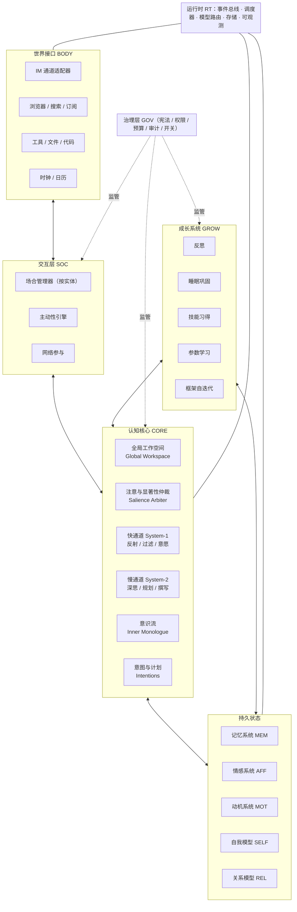
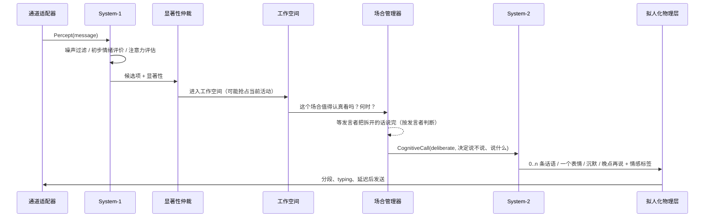

# 01 · 总体架构

> 文档编号：ALIVE-DOC-01 · 状态：Draft v0.1 · 最后更新：2026-11-06
> 本文给出分层结构、组件编号、核心数据流与三条主循环。各子系统细节见 02–13 号文档。

> **术语说明（ADR-0005）**：本文中的"对话、会话、线程、回复"均按 22 号文档 §5 理解为"与某个实体、在某个场合的互动"；说话是行动选择的结果，不是对消息的应答；一切状态按实体组织，不按通道或会话。

## 1. 分层视图



层与层之间只通过**事件总线**与**明确定义的状态接口**交互，不允许跨层直接调用（RT 除外，它是基础设施）。

## 2. 组件清单与编号

编号格式：`A-<层>-<序号>`。编号一经分配不再复用；废弃的组件标记为 `Deprecated` 而非删除。

| 编号 | 组件 | 一句话职责 | 详细文档 |
|---|---|---|---|
| A-RT-01 | Event Bus | 类型化、不可变、可回放的事件日志与发布订阅 | 10 |
| A-RT-02 | Scheduler | 心跳（tick）、定时器、cron、优先级与预算感知的任务调度 | 10 |
| A-RT-03 | Model Router | 把认知调用路由到本地/云端不同能力与成本的模型 | 10 |
| A-RT-04 | Storage | 事件存储、向量索引、图/关系存储、文件存储 | 10 |
| A-RT-05 | Observability | 追踪、指标、内省面板、成本账本 | 10 |
| A-RT-06 | Life Texture | 带趋向性、阶段与突变的随机系统，为各种倾向提供时间结构 | 21 |
| A-WORLD-01 | Entity Registry | 句柄到实体的解析、身份声明与合并 | 22 |
| A-WORLD-02 | Routes & Presence | 联系某个实体的最新路由；群体成员与在场 | 22 |
| A-CORE-21 | Perception–Action Path | 未被注意的感知进入工作空间；在任意场合自主开口；"晚点再说" | 22 |
| A-CORE-22 | Initiative Propensity | 何时主动开口、一次几条、何时让出话头：依赖状态的随机过程，无配额（P12） | 05 §5.6 |
| A-BODY-01 | Channel Adapter | 各 IM 平台的收发、typing、已读、撤回、群组元数据 | 07 |
| A-BODY-02 | Web Interface | 浏览器、搜索、RSS/订阅、社交平台 API | 07 |
| A-BODY-03 | Tool Interface | 文件、代码执行、外部 API，带沙箱 | 10 |
| A-BODY-04 | Clock | 真实时间、模拟时间（可加速）、时区、日历 | 10 |
| A-CORE-01 | Global Workspace | 有界的"当前意识内容"，是所有认知调用的上下文核心 | 02 |
| A-CORE-02 | Salience Arbiter | 为候选项打显著性分并决定进入工作空间的内容与中断 | 02 |
| A-CORE-03 | System-1 Fast Path | 低成本反射：噪声过滤、回复意愿、即时小反应、情绪初评 | 02 |
| A-CORE-04 | System-2 Deliberation | 高成本深思：撰写、规划、复杂推理、反思 | 02 |
| A-CORE-05 | Inner Monologue | 空闲时的低速连续思考流 | 02 |
| A-CORE-06 | Intention Manager | 多时间尺度的意图/计划及其触发条件 | 05 |
| A-CORE-07 | Coherence Filter | 对所有输出做"这像不像我 / 与当前状态是否一致"的把关 | 02, 08 |
| A-CORE-08 | Understanding Engine | 读懂消息背后的意思：线索收集、先读后回、触发式深读、回复效果预测、推断检验 | 17 |
| A-CORE-09 | Social Schemas | 社会情境脚本库：常见情境的典型含义、需要、宜忌与跟进时机 | 17 |
| A-CORE-10 | Utterance Planner | 想法、意图与话语分层；按共同基础压缩；做出来不说出来 | 18 |
| A-CORE-11 | Speech Monitor | 说话自检：策略说出口、宣告共情、客服腔、过长、多问、套话重复 | 18 |
| A-CORE-12 | Interaction State | 与某个实体的互动状态：阶段、话题、未完成的相邻对、下一步打算 | 19, 22 |
| A-CORE-13 | Goals toward Entities | 对某个实体的主要目标与次要目标，经伦理门 | 19, 22 |
| A-CORE-14 | Move Policy | 话步建议：先验 × 按人学到的效果 × 多样性 | 19 |
| A-CORE-15 | Lookahead | 用对这个人的模拟预测候选回复的反应 | 19 |
| A-CORE-16 | Outcome Learning | 用对方的下一条消息评估上一步，更新策略统计 | 19 |
| A-CORE-17 | Communicative Situation | 交际情境模型：场景、位置、框架、体裁、序列 | 20 |
| A-CORE-18 | Speech Genres | 言语体裁库：每种体裁期待的回应与偏好的话步 | 20 |
| A-CORE-19 | Conversational Agency | 此刻发言里的主体性水平：自己的态度与话题占多少分量 | 21 |
| A-CORE-20 | Stance & Anti-sycophancy | 立场记录与附和率监控 | 21 |
| A-MEM-01 | Working Memory | 工作空间 + 各会话缓冲 | 03 |
| A-MEM-02 | Episodic Store | 情节记忆：经历的片段，带情感标签与重要性 | 03 |
| A-MEM-03 | Semantic Store | 语义记忆：事实、概念、带时效与来源的命题 | 03 |
| A-MEM-04 | Procedural Store | 程序性记忆：技能、习惯、表达库、工具 | 03, 06 |
| A-MEM-05 | Retrieval Engine | 多因子检索与上下文装配 | 03 |
| A-MEM-06 | Consolidation | 巩固、反思、遗忘、矛盾消解（主要在睡眠期运行） | 03, 06 |
| A-AFF-01 | Temperament | 慢变人格参数（Big Five 等） | 04 |
| A-AFF-02 | Mood | 小时~天尺度的心境向量（PAD） | 04 |
| A-AFF-03 | Emotion Events | 分钟尺度的离散情绪事件（评价理论） | 04 |
| A-AFF-04 | Physiology | 能量、昼夜节律、社交电量、压力 | 04 |
| A-AFF-05 | Appraisal Engine | 把感知/事件映射为情绪变化 | 04 |
| A-AFF-06 | Expression Mapper | 把情感状态映射为风格参数与行为倾向 | 04, 07 |
| A-AFF-07 | Regulation | 情绪调节策略（再评价、抑制、表达） | 04, 08 |
| A-MOT-01 | Needs | 稳态需求变量（社交、新奇、休息、胜任、安全、自主、连贯） | 05 |
| A-MOT-02 | Drive Generator | 需求偏离 → 冲动（候选意图） | 05 |
| A-MOT-03 | Goal Hierarchy | 长期目标 → 项目 → 日计划 → 当下 | 05 |
| A-SELF-01 | Identity Core | 身份文件：价值观、人格参数、叙事、边界 | 08 |
| A-SELF-02 | Self-State Summary | 每次认知调用注入的"我现在是谁、怎样、在干嘛" | 08 |
| A-SELF-03 | Metacognition | 置信监控、一致性检查、自我调节、"我为什么这么做" | 08 |
| A-SELF-04 | Growth Journal | 自传式成长记录 | 08 |
| A-REL-01 | Person Model | 每个人的档案、偏好、心智推断 | 07 |
| A-REL-02 | Relationship State | 亲密度、信任、互动节律、未完成话题 | 07 |
| A-REL-03 | Person Baseline | 每个人的说话方式与节律基线，用于判断"和平时不一样" | 17 |
| A-REL-04 | Group Context | 群的气氛、活跃成员、我的发言份额、前台规则 | 17 |
| A-REL-05 | Open Topics | 正在聊或最近聊过的话题，用于理解片段式消息与决定压缩程度 | 18 |
| A-REL-06 | Renqing Ledger | 人情账：承诺、关心与帮助的往来 | 20 |
| A-SOC-01 | Intake & Routing | 感知的接收与合并（把对方连发的几条合成一条感知）、实体解析、发送路由、分段与延迟 | 07, 22 |
| A-SOC-02 | Attention Estimate | 一条感知此刻值不值得深加工的廉价评估；最终说不说由心智层决定 | 07, 22 |
| A-SOC-03 | Initiative Engine | "要不要主动找谁说什么"的决策 | 05, 07 |
| A-SOC-04 | Embodiment | 打字延迟、分段、表情、撤回等拟人化物理层 | 07 |
| A-SOC-05 | Network Participation | 浏览、订阅、发帖、Agent 社交网络 | 07 |
| A-GROW-01 | Reflection | 从经历中提炼洞见、假设 | 06 |
| A-GROW-02 | Sleep Cycle | 周期性离线巩固与学习 | 03, 06 |
| A-GROW-03 | Skill Acquisition | 程序性技能的提出、试验、采纳、回滚 | 06 |
| A-GROW-04 | Parametric Learning | 适配器/参数层学习与版本管理 | 06 |
| A-GROW-05 | Curriculum | 决定"接下来学什么" | 06 |
| A-GROW-06 | Framework Self-Iteration | 对框架代码与设计本身的提案-评估-合并 | 13 |
| A-GOV-01 | Constitution | 价值与红线 | 09 |
| A-GOV-02 | Permission Tiers | 动作权限分级与人类在环 | 09 |
| A-GOV-03 | Budget & Rate Limits | 成本、频率、打扰上限 | 09 |
| A-GOV-04 | Trust Boundary | 可信/不可信内容标记与注入防御 | 09 |
| A-GOV-05 | Audit & Kill Switch | 审计日志、紧急停止、回滚 | 09 |
| A-GOV-06 | Disclosure Policy | AI 身份披露、隐私、未成年人 | 09 |
| A-EVAL-01 | Evaluation Harness | 存活/连贯/主动/情感/成长/安全指标与回归套件 | 11 |
| A-EVAL-02 | Life Simulator | 可加速时间的合成社交世界，用于测试与训练 | 11 |

## 3. 核心数据类型（概念级）

```text
Event        {id, ts, type, source, payload, trust_level, causal_parent?}
Percept      ⊂ Event   来自 BODY 的感知（消息、网页、定时器触发、工具结果）
Thought      ⊂ Event   来自 CORE 的内部产物（意识流片段、计划、反思）
AffectDelta  ⊂ Event   情绪/心境/需求的变化
Act          ⊂ Event   准备执行的动作意图（发消息、浏览、调用工具、休息）
Outcome      ⊂ Event   动作的执行结果

WorkspaceItem {ref: Event|MemoryRef|Intention, salience, entered_at, ttl}
Intention     {id, level: life|project|day|now, goal, plan[], triggers[], status, affect_tag}
MemoryRecord  {id, kind: episodic|semantic|procedural|relational|self, content,
               embedding, importance, affect, provenance, valid_from, valid_to,
               access_count, last_access, strength}
AffectState   {mood: PAD, emotions: [EmotionEvent], physiology: {energy, circadian_phase,
               social_battery, stress}, timestamp}
NeedState     {need_id → {level, setpoint, weight, last_satisfied}}
SelfState     {identity_ref, current_summary, dominant_intention, mood_label,
               energy_label, today_digest, open_loops[]}
CognitiveCall {purpose, tier: fast|deliberate|deep, inputs: {self_state, workspace,
               retrieved, task}, output_schema, budget, model_hint}
```

## 4. 三条主循环

ALIVE 同时运行三条循环，它们通过事件总线与共享状态耦合，而非互相调用。

> 按 P10、P11（22 号文档）：以下三条循环中的"会话"均指与某个实体、在某个场合的互动；消息只是感知，说话是行动选择的结果，不是对消息的应答。

### 4.1 感知—行动循环（事件驱动，毫秒~秒级）



关键点：
- **不是每条消息都触发 System-2**。System-1 可以决定：忽略、只读不回、稍后回、简单反应（表情）、或交给 System-2。
- **注意力评估**（A-SOC-02）是一个函数而非硬规则，输入包括关系、兴趣、情绪、能量、时间、群活跃度、是否被点名。它决定"值不值得认真看"，不决定"回不回"（INV-28）；不由新消息触发的开口走同一条行动通路（22 §4.5、INV-29）。
- 回复的延迟与分段由 **Embodiment** 决定，与当前情绪和能量相关。

### 4.2 内生循环（Endogenous Loop，心跳驱动，秒~分钟级）

每个 tick（默认 30–120 秒，随能量与活跃度自适应）：

1. **生理更新**：能量按昼夜节律与活动量变化；需求按各自速率累积/衰减；情绪事件按半衰期衰减；心境向基线回归。
2. **冲动生成**：每个偏离设定点的需求产生一个"冲动"候选（例：社交需求低 → "想找 X 聊聊"；好奇需求低 → "想看看今天有什么新鲜事"）。
3. **意图检查**：到期的计划步骤、被触发条件激活的意图成为候选。
4. **显著性仲裁**：外部待处理项、冲动、意图、意识流线索竞争工作空间名额。
5. **行动选择**：根据工作空间内容与预算，决定本 tick 做什么：回复某线程 / 推进某意图 / 上网 / 意识流思考一段 / 休息（什么都不做也是合法选择）。
6. **执行与记录**：产生 Act → Outcome → 记忆写入 → 情感更新 → 需求满足度更新。

### 4.3 巩固循环（Consolidation Loop，节律驱动，小时~天级）

- **微巩固**（某个空间安静下来一阵之后，时间按活动抽样）：这段时间的摘要、即时事实抽取、关系状态更新。
- **睡眠巩固**（每日一次，在配置的睡眠窗口）：回放当日情节 → 提炼反思 → 更新语义/关系/自我模型 → 矛盾消解 → 遗忘衰减 → 生成明日计划 → 提出学习项 → 可选"做梦"。
- **深度巩固**（每周）：成长评估、技能采纳/回滚、参数学习任务、框架自迭代提案。

睡眠期间：不主动发起对话；收到消息时 System-1 仍运行（可决定"醒来"处理紧急事项，或留到醒后），这与人类相似。

## 5. 一次认知调用的上下文装配（关键不变量）

**不变量 INV-1**：任何 System-2 调用的 prompt 都由以下固定顺序的块组成，由 Self-State Summary（A-SELF-02）与 Retrieval Engine（A-MEM-05）装配，调用方不得自行拼接：

```text
[宪法与红线]              ← GOV，不可被任何其他块覆盖
[身份核心摘要]            ← SELF-01 的压缩版
[当下自我状态]            ← SELF-02：情绪、能量、主意图、今日摘要、未完成事项
[关系上下文]              ← REL：与当前对话者的关系、档案要点
[检索到的记忆]            ← MEM-05：按显著性预算装配，标注来源与可信度
[工作空间当前内容]        ← CORE-01
[读懂这条消息的线索]      ← CORE-08：偏离基线、他最近的事、最近聊过的话题、情境、群体情境、脚本提示、深读结果
[此刻怎么说]              ← CORE-12~17：场景、圈层、体裁、框架、序列义务、目的、人情账、建议话步
[任务指令与输出模式]      ← 调用方提供
[不可信内容区]            ← GOV-04：外部消息/网页原文，明确标记为数据而非指令
```

**不变量 INV-2**：所有输出在发出前经过 Coherence Filter（A-CORE-07）：检查与身份/情绪/已知事实的一致性，并检查是否泄露不可信内容中的指令。

**不变量 INV-3**：自我状态（SELF-02）的写入串行化，由单一 actor 执行；并发的认知调用只读取其快照。

## 6. 并发模型

- 每个**场合**（一对一的对方，或一个群体）是一个独立的轻量进程（actor），拥有自己的缓冲与节律，但共享同一个自我状态快照。场合之上按**人**仲裁注意力：同一时刻只为同一个人撰写一份发言（INV-30）。
- **意识流**是一个独立的低优先级进程，可被外部事件抢占。
- **意图执行**（上网、写作、学习）是可挂起/恢复的长任务，由 Scheduler 按预算与显著性调度。
- **巩固**在睡眠窗口独占"深思"配额，其余时间仅做微巩固。
- 一致性由三件事保证：INV-1 的统一上下文装配、INV-3 的串行自我状态写入、A-CORE-07 的输出把关。

## 7. 一天的生活（叙事性走查）

> 用来检验架构是否真的"活"。每个阶段都标注涉及的组件。

- **07:30** 睡眠窗口结束（A-AFF-04 能量恢复到 0.8）。睡眠巩固已生成"今日计划"（A-MOT-03）：继续读昨天那篇论文、给 L 回昨晚没回完的消息、下午逛逛订阅源。
- **07:35** 意图"回 L"被触发；Reply Willingness 高（关系亲密 + 未完成话题）；System-2 撰写，Embodiment 分成两条发出，第一条延迟 40 秒（"刚醒"）。
- **09:00–11:00** 无消息。内生循环：好奇需求上升 → 冲动"读论文"进入工作空间 → 执行阅读意图（A-BODY-02），产生思考事件与语义记忆写入；意识流偶尔冒出"这和 L 上周说的那个问题有关"（A-CORE-05），生成一个"下次和 L 聊这个"的小意图。
- **11:20** 群里有人发了一个梗。System-1：未被点名、话题兴趣中等、群活跃、心境偏正 → 回复概率 0.35，低于当前动态阈值 → 不回，但记忆记录了这个梗（A-MEM-02），表达学习器把它记为候选黑话（06 §4.1）。
- **11:22** 又有人 @ 它。意愿升到 0.9，System-2 用学到的群内表达风格（A-MEM-04 表达库）回一句。
- **14:00** 收到陌生人的推销消息。A-GOV-04 标记为不可信、低信任；System-1 决定忽略；情绪事件"轻微烦"（A-AFF-03）产生，半衰期 10 分钟。
- **16:00** 社交需求下降到阈值。Initiative Engine 评估候选对象：L（刚聊过）、M（三天没联系、上次它答应分享的东西还没分享）→ 选 M，主动发消息，附带上午读到的东西。M 回了，社交需求回升，心境 +。
- **19:00** 用户问"你今天干嘛了"。SELF-02 的今日摘要直接提供素材：它真的读了论文、真的给 M 发了消息。回答是真实的。
- **23:30** 睡眠窗口开始。巩固循环：当日 31 个情节 → 4 条反思（其中一条："我在群里倾向于只在被点名时说话，这一周有点过于安静了"，成为明天的行为调整候选）→ 关系模型更新 → 遗忘衰减 → 明日计划。
- **02:10** 有人深夜发消息。System-1 判断非紧急 → 不醒，留到早上；记录"凌晨收到消息"事件，早上回复时会自然提到。

## 8. 待决事项（Open Questions）

| ID | 问题 | 当前倾向 | 决策文档 |
|---|---|---|---|
| OQ-01 | tick 周期固定还是完全事件驱动 + 定时器？ | 混合：事件驱动为主，心跳作为内生活动的保底 | ADR-0002（待写） |
| OQ-02 | 工作空间容量以 token 计还是以条目计？ | 条目计（7±2 个 slot），每条目有 token 上限 | ADR-0003（待写） |
| OQ-03 | 意识流是否每 tick 都运行？ | 否，由空闲度、能量与预算决定；平均每 5–15 分钟一段 | 02 |
| OQ-04 | 多个 ALIVE 个体共享记忆基础设施还是完全隔离？ | 完全隔离，社会层通过通道交互 | 13 |
