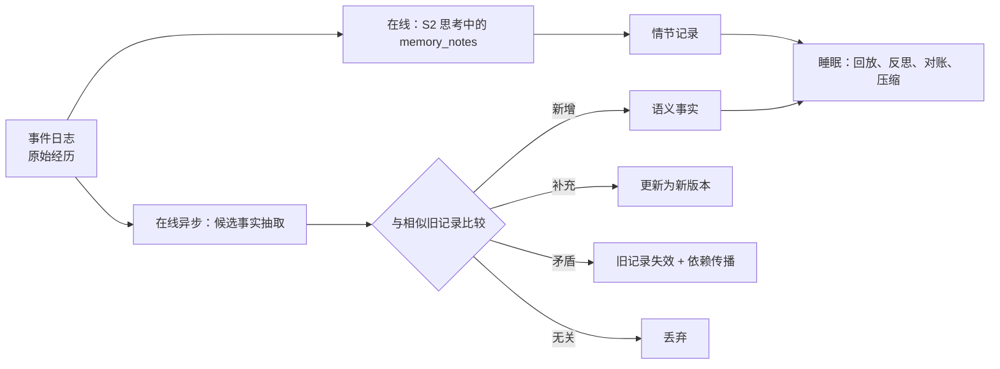

# 03 · 记忆系统（MEM）

> 文档编号：ALIVE-DOC-03 · 状态：Draft v0.1 · 最后更新：2026-11-06
> 覆盖组件：A-MEM-01 ~ A-MEM-06。回答"它记住什么、怎么记、怎么想起来、怎么忘、记错了怎么办"。

> **术语说明（ADR-0005）**：本文中的"对话、会话、线程、回复"均按 22 号文档 §5 理解为"与某个实体、在某个场合的互动"；说话是行动选择的结果，不是对消息的应答；一切状态按实体组织，不按通道或会话。

## 1. 设计立场

2025–2026 年的记忆系统逐渐收敛到一套共同模式，ALIVE 采用它作为底座：

1. **原始经历不可变**：原始事件无损保存，是唯一底账。ALIVE 的事件日志（10）天然满足这一点。
2. **派生记忆可失效、不删除**：模型从经历中抽取事实；新事实与旧事实矛盾时，旧事实被标记失效并记录时间，历史保留。Zep/Graphiti、Mem0 的图变体、ChatGPT 的 Dreaming 都这样做。
3. **混合检索**：向量、关键词、实体图扩展、时间过滤多路召回，再融合排序，最后按 token 预算装包。
4. **在线轻写，离线重整**：白天只做轻量写入，繁重的抽取、合并、反思放到睡眠期。

在此之上，ALIVE 针对"拟人、长期、多人"三个特点做了四项加强：
- **写入时规范化时间**。2026 年在时间推理上得分最高的方案都在写入时显式记录日期。
- **依赖传播的失效机制**。所有现有系统在"连锁失效的多跳更新"上都很弱，最高只有 28%，Mem0 只有 2%（MemoryAgentBench）。
- **来源与自生成隔离**。防止个体用自己想象、梦到、自言自语的内容污染事实记忆。
- **情感作为元数据**。情感是记忆的标签和晋升信号，而不是独立的记忆模块。

## 2. 记忆的分类

采用"功能 × 形态"两轴（参照 2025 年 12 月的综述 *Memory in the Age of AI Agents*），并补充拟人个体特有的两类：

| 功能类 | 存什么 | 存储 | 由谁写 | 文档 |
|---|---|---|---|---|
| 工作记忆 | 当下在意的事 | 工作空间、会话缓冲 | CORE | 02 |
| 情节记忆 | 经历：发生了什么、和谁、在哪、当时感觉如何 | 情节存储 | 在线写 + 睡眠整理 | 本文 |
| 语义记忆 | 事实与知识：带有效期的命题 | 语义存储 | 抽取 + 对账 | 本文 |
| 观点记忆 | 主观判断与信念，带置信度 | 观点存储 | 反思 | 本文 |
| 关系记忆 | 对每个人的认识、态度、共同经历 | 人物模型 | 抽取 + 反思 | 07 |
| 程序性记忆 | 策略、习惯、表达方式、技能 | 行为手册、表达库、技能 | 学习 | 06 |
| 自传记忆 | 我是谁、我的经历如何构成我 | 身份文件、成长日志 | 深度巩固 | 08 |
| 前瞻记忆 | 要做的事、答应的事、等的事 | 意图与未完成事项 | CORE/MOT | 05 |

**观点与事实分开存**是关键。反思得出的"L 好像最近工作压力很大"是观点，不是事实；它带置信度和证据指针，新证据到来时增减，而不是被当作事实写进语义记忆。这一做法来自 Hindsight 的四网络设计，它把客观事实、自身经历、实体摘要和主观信念分别存放。

## 3. 记忆记录

### 3.1 通用字段

```text
MemoryRecord {
  id, kind: episodic | semantic | opinion | relational | self
  content: string                         // 自然语言
  embedding: vector
  entities: entity_id[]                   // 涉及的人、物、话题
  // —— 时间（写入时规范化）——
  observed_at: ts                         // 我是什么时候知道的
  refers_to: {start?, end?, granularity}  // 内容说的是什么时候的事（"下周三" → 绝对日期）
  valid_from, valid_to?                   // 事实有效期（semantic 用）
  recorded_at, expired_at?                // 系统时间线：何时写入、何时被取代
  // —— 来源 ——
  provenance: {
    source: experienced | told_by:<person> | read_from:<url> | inferred | reflected
          | seeded | dreamed | monologue
    evidence: Event.id[]
    trust: trusted | owner | contact | public | untrusted
  }
  // —— 显著性与强度 ——
  importance: 1..10                       // 写入时评估，"刻骨铭心"程度
  affect: {valence: -1..1, arousal: 0..1, label?, peak: bool}
  strength: float                         // 记忆强度，决定遗忘速度
  access_count, last_access
  // —— 依赖与受众 ——
  derived_from: MemoryRecord.id[]         // 推导依据，用于失效传播
  thread_id / meta.origins                // 来源场合，决定受众（§8.1）
  status: active | stale | invalid | compressed | pinned | tombstoned
  version, parent_version
}
```

### 3.2 时间规范化

写入时把相对时间解析为绝对时间，并保留三种日期：何时得知、内容指向何时、原文的相对说法。例如 L 在周一说"我下周三面试"，记录为：得知于周一，指向下周三的具体日期，原文"下周三"。这是长期对话中提升时间推理最便宜的手段。Mastra 的观察记忆用三日期格式，Hindsight 用"发生区间 + 提及时间"，二者都因此在时间推理题上大幅领先。

### 3.3 来源规则

**不变量 INV-11**：来源为 `dreamed`、`monologue`、`seeded` 的记录永远不能被晋升为语义事实。来源为 `inferred`、`reflected` 的记录只能进入观点记忆。只有 `experienced` 与可信度足够的 `told_by` 和 `read_from` 可以成为语义事实。

这条规则防止"自我强化的虚构"：个体在意识流里想象了一件事，第二天把它当成真的发生过。OpenClaw 的做法相同，它的定时任务、心跳和子代理会话被排除在记忆晋升来源之外。长时运行实验也观察到，幻觉一旦写进记忆，就会被当作事实读回，甚至在多个代理之间传播。

## 4. 写入路径



### 4.1 在线写入（白天）

- **来自思考本身**：System-2 的结构化输出里有 `memory_notes` 字段（02 §5.2），个体在想的时候就决定"这个要记住"。
- **候选事实抽取**：会话空闲或每 N 条消息后，异步抽取候选事实。参照 Mem0：输入包括会话摘要、最近 10 条消息和新消息对；每个候选事实取 10 条最相似的已有记录，由模型选择新增、补充、标记失效或忽略。异步运行，不增加回复延迟。
- **情节分段**：按话题边界切分会话为情节片段，参考 LightMem 的做法，用语义相似度判断话题切换。
- **重要性与情感**：写入时评估重要性 1–10 分，并从当时的情感状态（04）复制情感标签。情绪峰值时刻写入的情节，`affect.peak = true`。

### 4.2 对账（矛盾检测）

新事实与旧事实矛盾时：

1. 若有效期重叠，旧记录的有效期在新事实生效时截止，状态改为失效。
2. 若来源可信度新低于旧，例如陌生人说的与 owner 说的冲突，不覆盖，两条并存，标记冲突，交给睡眠期复审。
3. 若矛盾涉及**他人声称的关于我的事**（"你上次答应过我…"但我的记忆里没有），记为 `told_by` 并标记待核实，不直接改写自传记忆。这是抵抗记忆操纵的关键。

### 4.3 依赖传播：真值维护

每条派生记录都记录推导依据。一条记录失效时：

```text
on_invalidate(r):
  for d in dependents(r):                 // 所有 derived_from 包含 r 的记录
    d.status ← stale
    enqueue(d, "recheck_in_sleep")        // 睡眠期重新评估：是否仍成立、是否需修订
    on_stale_propagate(d, depth+1)        // 递归，最多 3 层
```

例子：L 说"我在 A 公司上班"，个体推出"L 每天通勤经过 B 区"，又推出"可以推荐 B 区那家店给 L"。L 跳槽后，第一条失效，第二、三条随之变为待复查，而不是继续被当作事实使用。这直接针对多跳冲突更新这一行业短板。

## 5. 读取路径（A-MEM-05）

### 5.1 三档检索

| 档 | 用于 | 方法 | 延迟目标 |
|---|---|---|---|
| 快 | System-1、显著性评估、预取 | 关键词 + 向量，候选 ≤ 20 | < 50 ms |
| 标准 | System-2 撰写回复 | 多路召回 + 融合 + 打分 + 预算装包 | < 500 ms |
| 深 | "让我想想"、睡眠反思、复杂问题 | 迭代检索：模型用搜索、按时间翻阅、按人翻阅等工具多轮查找 | 数秒到数十秒 |

深档的设计依据是 Letta 的实验：只给强模型简单熟悉的文件工具并让它迭代检索，在 LoCoMo 上拿到 74.0%，超过多种复杂的记忆中间件。深档对外也有拟人表现：个体会说"等一下，我想想……"，然后真的去翻记忆。

### 5.2 标准检索流程

1. **多路召回**：向量相似、关键词、实体图扩展（从当前对话者与话题出发走 1–2 跳，即扩散激活）、时间过滤（问题里提到"上周"时）。
2. **融合**：倒数排名融合（RRF）。
3. **打分**：

```text
score(r | cue) =
    w_rel · relevance(r, cue)
  + w_rec · retrievability(r)                // 见 §6，强度与时间决定
  + w_imp · importance(r) / 10
  + w_aff · mood_congruence(r, current_mood)  // 心境一致性效应，权重小
  + w_per · person_match(r, interlocutor)     // 与当前对话者相关的记忆优先
  − penalty(status ∈ {stale, 冲突})

默认 w_rel=1.0, w_rec=0.6, w_imp=0.5, w_aff=0.15, w_per=0.4
```

Generative Agents 的检索使用相关性、新近性、重要性三项等权相加，ALIVE 在此基础上加入心境一致性与对话者匹配，并把新近性换成基于强度的可提取性。

4. **可选重排**：候选集较小时用交叉编码器重排。
5. **装包**：按调用方给出的 token 预算装进 INV-1 的 `[检索到的记忆]` 块。每条记录带来源标签与置信度，例如"（L 说的，3 周前）""（我猜的）"。模型因此能用恰当的确定程度说话。

### 5.3 被动想起

不是只有被问到才检索。工作空间每次变化都触发一次快档的扩散激活预取。被想起的记忆以 `memory_cue` 的形式成为显著性候选（02 §2）。这就是"聊着聊着突然想起一件事"的计算形式，也是意识流种子的来源之一。

被动想起是抽样，不是"阈值 + 取前几名"（2026-11-07 修订）：
- 每条候选以 `soft_step(激活度, 中心, 宽度)` 的概率浮现；唤醒高时中心略降，更容易想起。
- 与当前心境一致的记忆激活略强（心境一致性）。
- 浮现出来的几条里先注意到哪条，按 Plackett-Luce（Gumbel-top-k）抽样，温度随疲劳升高、随唤醒降低。
- 带查询的主动检索（§5.2）仍按得分排序。

## 6. 强度与遗忘

### 6.1 模型

```text
retrievability(r, now) = exp( −(now − r.last_access) / r.strength )

初始强度  S0 = base[kind] × (1 + importance/5) × (1 + 0.5·|affect.valence|·affect.arousal) × (peak ? 2 : 1)
每次被回忆  S ← S × (1 + g · spacing_bonus)      // 间隔越久的回忆强化越多
```

默认 `base`：情节 3 天，语义 30 天，观点 14 天，关系 60 天，钉选记录不衰减。

现有系统的衰减常数相差很大：Generative Agents 的新近性半衰期约 5.8 天，MemoryOS 的时间常数约 116 天。本框架因此按记忆类型分别设默认值，并允许学习系统在门禁下调整。

### 6.2 遗忘做什么、不做什么

- **影响检索排名**：弱记忆更难被想起，但深档检索仍能找到，对应"我印象模糊"。
- **触发压缩**：睡眠期把可提取性低于阈值、且重要性 ≤ 4 的情节压缩成摘要，细节丢失，状态改为 `compressed`。
- **不删除原始事件**：原始事件日志仍在。深档检索可以去翻原始记录，相当于"翻聊天记录"，个体也会这样表述。
- **隐私删除是例外**：见 §8。

## 7. 睡眠期的记忆整理

对应 06 §5 的第 3、4、7 阶段，并借鉴 OpenClaw Dreaming 的多相分离：前几个阶段只暂存，最后一个阶段才持久写入。

| 规则 | 默认值 | 来源 |
|---|---|---|
| 晋升到长期语义/观点需过多信号门槛：被回忆次数、跨不同情境被用到的次数、重要性、近期性、与已有知识的整合度 | 加权和 ≥ 阈值 | OpenClaw 的晋升打分 |
| 单次重写某份汇总记忆，最多丢弃的旧条目比例 | 25% | OpenClaw |
| 重写前保存原像，可回滚 | 必须 | OpenClaw、Letta 的 git 记忆文件系统 |
| 晋升片段长度上限 | 160 token | OpenClaw |
| 钉选记录不可被自动重写 | 必须 | ChatGPT Dreaming 用户反馈：无法钉选、无法阻止自动改写 |
| 观察类汇总按日期分节、只追加，作为稳定前缀以提高缓存命中 | 推荐 | Mastra 观察记忆 |
| 实体社区摘要周期性全量刷新，防止增量结果漂移 | 每周 | Zep |

**睡眠期的预计算**：Letta 的休眠期计算实验表明，在查询到来前离线思考，达到同等准确率所需的在线算力约降 5 倍，准确率最多提升 13% 到 18%，且问题越可预测收益越大。IM 场景中可预测性很高，例如对方说过明天要考试。因此睡眠的计划阶段为明天可能出现的话题预先装配好相关记忆与跟进意图。

## 8. 隐私与删除

事件不可变与"被遗忘权"冲突。解法是**按人加密**：涉及某个人的原始事件与派生记录，用该人专属的密钥加密存储。对方要求删除时，销毁密钥，所有相关内容即不可读，同时写入墓碑事件。之后压缩任务物理清理。被删除者相关的派生观点同步失效。

其他规则：
- 健康、政治、宗教、性取向等敏感类别默认不抽取为语义事实，除非对方明确希望被记住。Claude 的产品记忆也默认不存这些类别。
- 从 A 那里得知的关于 B 的私事，记录 `told_by: A` 与可见范围；向 B 或第三方提及前由 GOV 检查（09）。

### 8.1 受众：隐私跟着信息走，不跟着通道走（INV-34）

每条记录的受众由它的来源场合决定（`thread_id`；派生记录在 `meta.origins` 里保留全部来源场合）：

| 来源 | 受众 |
|---|---|
| 一对一场合（场合编号就是对方的人物编号） | 只有那个人 |
| 共享场合（群） | 该群成员，即群内半公开 |
| 没有来源（我自己的想法、读到的东西） | 任何人 |

- **检索时过滤**：为某个场合检索（`retrieve(thread_id=…)`、`about_person(thread_id=…)`）时，只保留"所有能听到我说话的人都在其受众里"的记录。共享场合永远有没开口的读者，所以一对一得知的事永远不会出现在群里，也不会出现在我和另一个人的私聊里。
- **派生继承**：合并、新版本、睡眠压缩、反思、内心独白都继承来源记录的全部 `origins`，即最严格的受众。没有私密来源的自己的想法到处可用。
- **出站检查**：被过滤掉的内容随撰写结果交给 GOV 的 `pre_send`（`private_from_others`），确保不会经别的路径说出去（09 §7）。
- **二选一规则**：提示里是否含私密数据（来自一对一场合的记录）按实际内容判断，不按场合类型（09 §3.2）。
- 同一套规则也用于"同一个人在别处"的近况、跨场合的话题线索、工作空间里来自某个场合的条目（17 §3.1）。
- 每个人都可以要求"你记得我什么"，个体以自然语言如实列出。这是 ZifaMem 作者建议的查看、更正、删除控制权的拟人化版本。

## 9. 成本参考

| 项 | 参考值 |
|---|---|
| 热路径上下文 | 固定核心块约 2–4k token；检索装包约 1.5–5k；加最近消息尾部 |
| 检索 p95 | 快档 < 50 ms，标准档 < 500 ms |
| 在线写入 | 每轮异步一次小模型调用 |
| 睡眠整理 | 占每日深思预算的大部分；LightMem 显示在线轻写加离线批处理可把在线 token 降两个数量级 |

## 10. 评估接口

交给 11 号文档：
- 长期记忆问答：LongMemEval 风格题型，包括单会话、多会话、时间推理、知识更新、偏好。
- **选择性遗忘与连锁更新**：MemoryAgentBench 风格的多跳冲突题，这是本设计重点要超越基线的指标。
- 私有时间线回放：用真实时间线回放数月的合成聊天，按日检查。
- 来源正确率：个体陈述时附带的确定程度是否与记录来源一致。

## 11. 待决事项

| ID | 问题 | 倾向 |
|---|---|---|
| OQ-21 | 是否需要图数据库来做实体扩展？ | 先用 SQL 表存实体与边，规模变大后再迁移（同 OQ-14） |
| OQ-22 | 心境一致性检索是否会放大低落情绪，即越难过越想起难过的事？ | 会，有风险。权重小，且情绪调节（04）可以临时把它设为负值 |
| OQ-23 | 深档迭代检索是否允许在对话中途使用？ | 允许。延迟由拟人层表现为"我想想"，并受预算约束 |
| OQ-24 | 观点记忆是否对外可见？ | 被直接问到时可以如实说"我觉得……但我不确定"；不主动把对人的负面观点说给第三方 |
