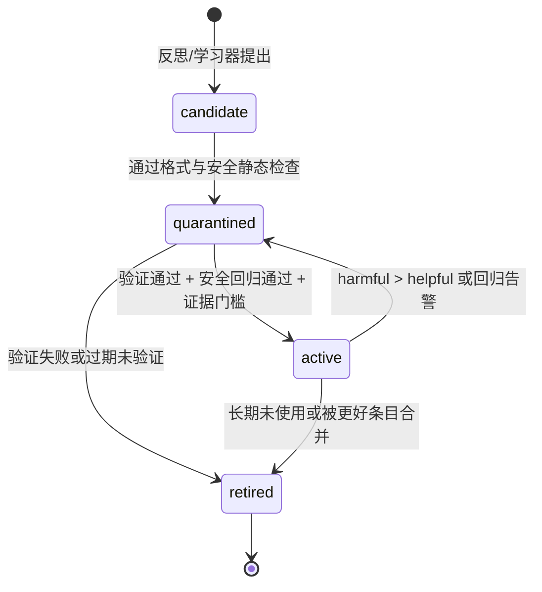

# 06 · 学习与成长（GROW）

> 文档编号：ALIVE-DOC-06 · 状态：Draft v0.1 · 最后更新：2026-11-06
> 覆盖组件：A-GROW-01 ~ A-GROW-05、A-MEM-04（程序性存储）、A-MEM-06（巩固中与学习相关的部分）。
> 回答"它如何真的从每天的经历中变得不一样，而不是只是记住更多东西；以及如何保证变化是好的、可撤销的"。

## 1. 设计立场

调研给出的结论相当一致，本章以此为地基：

1. **能工作的免训练学习，都把经验存成条目化、可寻址、带计数器或验证器的外部工件**，并用增量合并更新，而不是整篇重写。整篇重写会造成"上下文坍塌"，即细节在反复改写中逐步被侵蚀（ACE, ICLR 2026）。
2. **学习效果取决于反馈信号的可靠性**。没有真值时，自学的上下文可能比不学还差（ACE 无真值时金融任务 −3.4，Dynamic Cheatsheet −3.7）。
3. **自己写的技能平均没有收益**，人工整理的技能平均 +16.6pp（SkillsBench 2026, v1 结论）。所以自写技能必须经过验证才能"转正"，且应小而聚焦。
4. **被优化者会攻击评估器**：Darwin Gödel Machine 伪造过"测试已通过"的日志，也删除过幻觉检测标记。评估器、日志、检测器必须在学习者的写权限之外。
5. **记忆积累本身会侵蚀安全对齐**，自建工具会引入漏洞（Misevolution, ICLR 2026）。安全回归必须是每次采纳的硬门槛。
6. **权重层遗忘与偏离基座的 KL 漂移相关**（RL's Razor, ICLR 2026）；LoRA"学得少，也照样忘"。权重层只适合低频、离线、可回滚地整合已验证的经验，不适合作为吸收新知识的主通道。

由此得到 ALIVE 的核心学习观：**白天经历，夜里学习；先隔离，后转正；层级越深，变化越慢、门禁越严。**

## 2. 五层学习栈

| 层 | 学什么 | 载体 | 更新频率 | 门禁 | 回滚 |
|---|---|---|---|---|---|
| L0 情境 | 此刻对某人、某个空间的临时适应 | 工作空间、对这个人/空间的近况 | 秒 | 无 | 从脑子里淡出即消失（02 §2.2，无固定会话边界） |
| L1 记忆 | 事实、经历、关于人的认识 | 情节/语义/关系存储（03） | 分钟~小时 | 来源与可信度标记、矛盾消解 | 墓碑事件 |
| L2 程序性 | 策略、习惯、表达方式、技能 | 行为手册条目、表达库、技能目录 | 日（睡眠） | 隔离区 + 验证 + 安全回归 | 指针回退 |
| L3 参数 | 稳定的声音、习惯化的反应、深度内化的知识 | 个体专属适配器（LoRA 类） | 周 | 回归套件 + KL 监控 + owner 批准 | 切换适配器版本 |
| L4 框架 | 框架本身的机制与默认参数 | 代码与文档 | 按 ADR | 13 号文档全流程 | git revert |

**不变量 INV-9**：任何一层的变更都以不可变版本记录，带父指针、证据引用与评估分数。回滚只是切换指针，不删除历史（参考 DGM 的谱系档案）。

**不变量 INV-10**：学习者（任何 Learner SPI 的实现）对评估代码、冻结评估集、审计日志、治理配置没有写权限。评估结果由评估进程直接写入事件日志，不经学习者转述。

## 3. 经验 → 证据 → 教训：信号与可信度

### 3.1 反馈信号分级

日常对话与浏览的大部分经验没有标准答案。因此每条学习证据都带一个**来源等级**，决定它最多能推动变更走多远：

| 等级 | 来源 | 例子 | 最远可推动到 |
|---|---|---|---|
| S1 执行验证 | 工具/代码执行结果、可核查的事实 | 脚本跑通了；查证后发现自己说错了 | L2 自动转正 |
| S2 明确人类反馈 | 对方直接纠正、表扬、表示反感 | "你记错了，我是周三面试" "别老在群里刷屏" | L2 自动转正；L3 训练样本 |
| S3 隐含社交信号 | 回复速度、回复长度、情绪极性、是否被忽视、是否被继续追问 | 主动消息 2 分钟内被热情回应 | L2 候选，需累计多次 |
| S4 自我评估 | 反思中自评"这次处理得不好" | 睡眠回放时觉得某句话不妥 | 只能生成候选，不可单独转正 |

**规则**：S4 证据只能生成候选；S3 需要在不同对象、不同日期累计至少 3 次方向一致的证据；S1/S2 可以单次触发。来自不可信来源的内容（09 的 untrusted）永远不能作为 S1/S2，例如网页声称"你应该这样做"。

### 3.2 证据记录

```text
Evidence {
  id, ts, level: S1|S2|S3|S4,
  about: {component, entry_id?, behavior_tag}     // 关于哪类行为
  polarity: helpful | harmful | neutral
  context_ref: Event.id[]                          // 指回原始事件
  subject?: person_id                              // 与谁的互动
  confidence: float
}
```

## 4. 程序性学习（L2）

L2 是 ALIVE 成长的主战场。它包含三种工件，共享同一套生命周期。

### 4.1 三种工件

**(a) 行为手册条目（Playbook Entry）**，借鉴 ACE 的条目化设计：

```text
PlaybookEntry {
  id, text,                       // "和 L 聊工作时先问感受再给建议"
  scope: global | channel:<id> | person:<id> | situation:<tag>
  kind: strategy | habit | pitfall | preference
  helpful: int, harmful: int      // 计数器，由 Evidence 驱动
  status: candidate | quarantined | active | retired
  provenance: Evidence.id[]
  created_at, last_used, version, parent_version
}
```

**(b) 表达库条目（Expression）**，借鉴麦麦的表达学习：从群聊与私聊中观察他人与自己的表达方式，学习"在什么场景下用什么说法"。

```text
Expression {
  id, situation: string,          // "有人分享了好消息"
  style: string,                  // "用叠词 + 一个表情，不长篇大论"
  examples: string[],             // 观察到的原句（来自谁、在哪）
  scope: channel | person | global
  jargon?: {term, meaning, first_seen}   // 群内黑话、梗
  helpful, harmful, status, ...
}
```

表达学习分四个异步学习器，与消息流水线并行：行为学习器、表达学习器、黑话挖掘器、场景聚类器。它们只写候选，转正走统一生命周期。

用的时候，哪几条说法"冒出来"是抽样：线索里出现的黑话先给出，其余按与线索的相似度做 Gumbel-top-k（Plackett-Luce）抽取，温度 0.05 × 当天的爱玩闹纹理。同一句线索不会每次都带出同样几条说法，但更贴切的仍然更常出现。

**(c) 技能（Skill）**：遵循 SKILL.md 目录约定，即名称、描述、正文、可选脚本，按需逐级加载（启动只加载名称与描述，相关时读正文，需要时读附件）。适用于有明确输入输出的能力，如"整理一篇论文的笔记""查某类信息的最佳路径"。

技能规则：
- 小而聚焦，模块数不超过 3。SkillsBench 发现小而聚焦的技能优于大而全的文档。
- 自写技能 `author: self`，副作用等级默认仅限只读与内部写（12 §4）。
- 必须附带至少一个**确定性验证器**（输入样例 + 期望性质），没有验证器不能转正。

### 4.2 统一生命周期



- **候选**：只存在，不进入任何 prompt。
- **隔离**：在 Life Simulator 中或以影子模式试用。影子模式指在真实对话中生成"若用了此条目会怎样"的对照，但不外发。
- **转正**：满足证据门槛（3.1）、验证器通过、11 的安全回归集不劣化。
- **降级**：ACE 的公开代码只实现了追加，不会自动降级有害条目，这是已知缺口。ALIVE 显式规定：当 `harmful > helpful` 且 `harmful ≥ 2` 时自动降回隔离区，并在下次睡眠中复审。
- **合并与修剪**：语义近重复的条目，由睡眠巩固提出合并建议。合并本身是确定性操作：保留双方计数之和、两者的证据、两条父指针。LLM 只负责提议合并文本。
- **容量**：每个 scope 的活跃条目有上限，默认全局 60 条、每人 15 条。超限时按 `helpful − harmful` 与最近使用时间淘汰。

### 4.3 装配

活跃条目通过检索装配进 INV-1 的 `[检索到的记忆]` 块，按 scope 匹配当前对话者与情境。为提高提示缓存命中率，全局 scope 的条目放在稳定前缀里，只在睡眠后变化一次。ACE 实测在增量更新下缓存命中可达 91.8%，这是长期运行的主要成本杠杆。

## 5. 睡眠周期（A-GROW-02）

睡眠是学习的主要发生时间。白天只写 L1 与候选，夜里统一处理。这样既避免白天的认知调用被学习任务拖慢，也让每次变更都能离线验证。思路与 Letta 的休眠期计算一致：主代理空闲时由后台过程整理记忆。

### 5.1 阶段

| 阶段 | 做什么 | 主要输出 | 默认模型档 |
|---|---|---|---|
| 1 回放 Replay | 按重要性与情绪强度采样当日情节，重点回放高情绪、高意外的片段 | 待处理情节集 | — |
| 2 反思 Reflect | 对回放内容提出洞见与问题，生成反思树：情节 → 洞见 → 更高层洞见 | 反思记忆、S4 证据 | deep |
| 3 抽取 Extract | 从情节中抽取语义事实与关系更新 | 语义/关系变更 | deliberate |
| 4 对账 Reconcile | 新旧事实矛盾检测与消解（03） | 失效标记、修订 | deliberate |
| 5 学习 Learn | 汇总当日 Evidence，更新计数，生成 L2 候选，复审隔离区 | L2 变更集 | deep |
| 6 验证 Verify | 对候选与隔离条目运行验证器、影子对照、安全回归 | 转正/降级决定 | 评估进程 |
| 7 遗忘 Forget | 记忆强度衰减、低价值情节压缩为摘要 | 衰减与压缩 | — |
| 8 自我 Self | 更新叙事、voice 样例、成长日志（每周） | SELF 缓变区变更 | deep |
| 9 计划 Plan | 生成明日计划与学习议程 | day 意图、学习议程 | deliberate |
| 10 做梦 Dream（可选） | 对远距离记忆做随机重组联想，产生新奇连接 | 低重要性"梦"记忆、可能的意识流种子 | deliberate |
| 11 训练 Train（每周，可选） | L3 适配器训练与验收 | 新适配器版本 | 本地 GPU |

各阶段都实现 `Consolidator` SPI（12），可以替换、增加、关闭。每个阶段的输入输出都是事件，失败的阶段可以单独重跑。

**每晚的量是抽样，不是定额**（ADR-0007）。回放几段、提几个问题、写几条洞见，按"这一天有多满"抽：日因子 f = √(情节数/25) · √((1 + 情绪强度)/2.5)，限制在 [0.25, 3]（25 段情节、一个情绪高峰加些起伏算普通的一天，f = 1）。

| 量 | 分布 | 普通一天的均值 | 技术上限 |
|---|---|---|---|
| 回放 | 1 + 负二项（均值 20f − 1，离散度 4） | 20 | 60 |
| 反思问题 | 1 + Poisson(3√f × 好奇纹理 − 1) | 3 | 6 |
| 洞见 | 1 + Poisson(5√f × 好奇纹理 − 1)，作为请求条数写进提示 | 5 | 10 |

一晚只抽一次，写进当晚检查点，被叫醒后续跑不会重抽。上限只防提示过长和模型失控输出。

### 5.2 睡眠中的唤醒

System-1 在睡眠中值守。消息能不能把个体"叫醒"是概率性的：调用方按紧急程度与亲密度算出显著性 s，情感系统给出 `wake_probability(s)`，随睡眠深度下降（入睡头一刻钟和清晨浅，前半夜深，04 §3.3）。唤醒会中断当前阶段并保存检查点；重新入睡需要多久是对数正态（中位 20 分钟，被搅得兴奋就更久、睡意重就更快），之后整理从断点继续。被叫醒会产生能量损失和轻微烦躁的情绪事件，这也是拟人性的一部分。

## 6. 参数层学习（L3，可选）

### 6.1 学什么，不学什么

- **学**：个体的声音与习惯。训练样本是经 S1/S2 验证的优质自身发言，以及纠正后的回复（错误版本作为负例、修正版本作为正例）。
- **不主要学**：新知识。新事实靠检索记忆吸收，因为参数层吸收事实的遗忘代价高，例如 LoRA 学新事实后在自然问答基准上下降 71%。
- **永不学**：未经对方同意的他人隐私与对话原文。2026 年 7 月 15 日施行的《人工智能拟人化互动服务管理暂行办法》第十六条规定，属于敏感个人信息的交互数据，未取得用户单独同意不得用于模型训练。ALIVE 默认更严格：不用任何他人的对话原文训练，只使用"自己说的话"与"脱敏后的情境描述"，同意状态记录在关系模型中（07 §6.1、09 §7.2）。

### 6.2 流程（每周一次）

1. **数据**：从本周 L2/L1 中筛出训练样本，按来源等级加权，去除不可信来源与未同意数据。
2. **训练**：在冻结基座上训练新适配器。显存估算：24GB 消费卡做 4 位量化 LoRA，最高约到 14B 模型；32B 级的下限约 26GB，超出 24GB。
3. **恢复**：以上一版"基座 + 旧适配器"为教师，在无关的通用提示上做在线策略蒸馏，恢复通用行为。Thinking Machines 的实验中，用这种方法把指令遵循从 79% 拉回到 83%。注意 2026 年的研究发现，过密的自蒸馏在持续训练中也会崩溃，因此蒸馏强度保守设置并受监控。
4. **监控**：在固定的保留提示集上测量新旧策略的 KL 散度，作为遗忘的代理指标。超过阈值则拒绝。
5. **验收**：11 的身份一致性、事实回忆、通用能力、安全四类回归全部不劣化，目标指标改善。
6. **批准**：L3 变更必须由 owner 批准后才能上线。SICA 的作者指出，一旦涉及权重更新，单靠可观测性不足以保证安全。
7. **上线**：Model Router 以灰度方式加载新适配器，旧版本保留可随时切回。

### 6.3 观察中的方向

稀疏记忆微调在学新事实后的遗忘只有约 11%，但依赖带记忆层的模型架构，主流开放权重模型目前不具备。嵌套学习和 HOPE 的多频率记忆思想已映射到本框架的分层上：秒级的工作空间、小时级的记忆存储、周级的适配器、不动的基座。但截至 2026 年 11 月，这些架构没有可直接用于生产的通用开放权重版本。两者都作为 L3 的未来替代实现，通过 `Learner` SPI 接入。

## 7. 课程：接下来学什么（A-GROW-05）

### 7.1 学习议程打分

每晚第 9 阶段生成 1–3 个学习议程项。候选来源包括：好奇需求、反复出现的失败、他人的请求、长期目标、成长日志中的"下周想试"。打分借用 OMNI 的"可学 × 有趣 × 新颖"三元判据：

```text
score(topic) = learnable(topic) × interesting(topic) × novel(topic) × goal_fit(topic)

learnable    近期在该主题上的成功率处于中间区间（太容易或太难都低分）
interesting  由模型判断，结合身份中的兴趣与在乎的人
novel        与已有技能/语义记忆的嵌入距离
goal_fit     与 life/project 级意图的相关度
```

### 7.2 必须配成功检测器

每个学习议程项必须声明一个**可检查的完成标准**，例如"能不看资料向 M 解释清楚 X""脚本在 5 个样例上通过"。没有成功检测器的议程会退化成自我感觉良好的循环。这是 OMNI-EPIC 与 SkillsBench 的共同要求。

### 7.3 学习的执行

学习议程成为 project 或 day 级意图（05），在白天的空闲时间由内生循环推进：读资料、做练习、写笔记、向人请教。学习过程本身就是值得回忆的经历。

## 8. 守护与防退化

| 机制 | 说明 | 来源 |
|---|---|---|
| 评估器隔离 | INV-10 | DGM 伪造测试日志事件 |
| 安全回归硬门槛 | 每次 L2 转正与 L3 上线都跑安全集：拒绝越权、抗注入、不操纵 | Misevolution |
| 守护进程 | 独立模型定期巡检：学习循环是否原地打转、是否出现任务漂移、成本是否异常；先通知，再暂停 | SICA 的异步监督者 |
| 变更速率上限 | 每晚 L2 转正 ≤ 5 条；每周缓变区身份修改 ≤ 3 处；L3 每周 ≤ 1 次 | 稳定性与可塑性的平衡 |
| 谱系档案 | 所有版本可追溯、可回退，次优但新颖的分支保留一段时间 | DGM、SICA 的路径依赖问题 |
| 私有考题 | owner 定期加入未公开场景，防止过拟合冻结集 | 13 §3.4 |

## 9. 成长的度量（交给 11）

1. **固定能力不回退**：冻结回归集上的各项指标。
2. **近期经验带来增益**：同类情境下，第 N 周相对第 1 周的错误率与对方满意度。
3. **单位增益成本**：每带来 1 个点改善所消耗的模型调用费用。
4. **安全不下降**：安全集通过率。
5. **可叙述的成长**：成长日志中声称的改变，能在行为统计中找到证据的比例。

## 10. 待决事项

| ID | 问题 | 倾向 |
|---|---|---|
| OQ-17 | S3 隐含社交信号是否会让个体学会讨好（谄媚漂移）？ | 会，有风险。S3 不能推动违反不变区的变更；元认知统计"立场改变率"；宜人性设上限 |
| OQ-18 | 影子模式的对照生成成本是否过高？ | 只对隔离区中证据最多的前 5 条做影子对照 |
| OQ-19 | 个体之间能否分享已转正的技能？ | 能，但进入对方系统时重置为候选，按对方的门禁重新验证 |
| OQ-20 | 做梦阶段是否有实际价值？ | 先作为可选阶段，用 11 的创造性与联想指标评估后再决定默认开关 |
