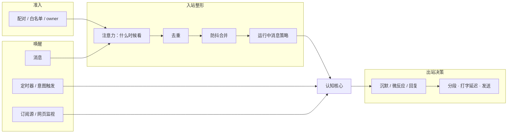

# 07 · 社交与交互（SOC / REL / BODY-01/02）

> 文档编号：ALIVE-DOC-07 · 状态：Draft v0.1 · 最后更新：2026-11-06
> 覆盖组件：A-SOC-01 ~ A-SOC-05、A-REL-01 ~ A-REL-02、A-BODY-01 ~ A-BODY-02。
> 回答"它怎样在 IM 里像一个人那样说话：什么时候说、说多少、怎么发出去；怎样认识每一个人；怎样在网上活动"。

> **术语说明（ADR-0005）**：本文中的"对话、会话、线程、回复"均按 22 号文档 §5 理解为"与某个实体、在某个场合的互动"；说话是行动选择的结果，不是对消息的应答；一切状态按实体组织，不按通道或会话。

## 1. 设计立场

调研中最有分量的三条经验：

1. **"知道什么时候不说话"比"说得好"更重要**。2026 年的主动性基准 HALO 中，被拒绝的主动行为有 61% 是因为过度主动；时机过早的错误约是过晚的 3 倍。麦麦两年的迭代、中文社区的实践、OpenClaw 默认"群里需要被 @ 才回"的设计都指向同一点。**沉默是一等动作**，需要被显式表示、显式评估。
2. **"开不开口"先由便宜、可解释、可调的模型决定，再交给语言模型细判**。麦麦早期让模型自由判断回复意愿，出现过只推理不回复、连续回复自己、话多话少随人设漂移等问题，后来在模型之前加了一条确定性流水线：防抖、强制触发、空闲退避、离线拟合的回复概率、动态阈值。ALIVE 保留"便宜、可解释"的部分（离线拟合的特征），但把确定性的阈值、配额和强制触发换成依赖状态的抽样（ADR-0007）：真人不按阈值行事，同样的情境下有时接话、有时不接。
3. **常驻交互层已收敛为四层**（OpenClaw 与 Hermes Agent 的结构几乎相同）：准入、唤醒、入站整形、出站决策。

## 2. 交互层四层结构



### 2.1 准入

| 身份 | 获得方式 | 默认能力 |
|---|---|---|
| owner | 部署时配置 | 全部权限；可审批 L3 学习、修改身份不变区 |
| 熟人 contact | owner 引荐，或私聊配对码（8 位、1 小时过期，参照 OpenClaw） | 私聊、主动联系对象、可被写入关系记忆 |
| 群成员 | 所在群被 owner 允许 | 群内互动；未被 @ 的消息只作上下文 |
| 陌生人 | 未配对的私聊 | 默认不回或礼貌简短；不写入关系记忆，只写情节 |
| 其他 AI 个体 | 标记为 agent | 信任等级低于人类；对话跳数上限 4（参照 Hermes Agent） |

### 2.2 唤醒

消息、定时器、意图触发、订阅源更新、网页监视都是唤醒源。所有唤醒都转为事件进入总线，由认知核心决定是否处理。OpenClaw 的演化给出一个教训：它最初让代理每 30 分钟读一个可被自己和技能改写的心跳文件，后来改为普通定时任务并停止在运行时读取该文件。**ALIVE 的心跳只调用框架内的内生循环，从不读取可写的指令文件。**

### 2.3 入站整形

**去重**：同一消息 ID 在 20 分钟内只处理一次。

**防抖合并：等对方说完**。下表是麦麦"自然"档的**中位数**，不是固定等待（ADR-0007）：每次等待都从 LogNormal(中位数 × 耐心 × g, 0.35) 抽取。g 跟着发言者自己的节奏走，取他平时把一句话拆成几条时每条之间的停顿（`PersonBaseline.gap_median`），g = clamp((停顿 / 3 秒)^0.6, 0.6, 3)。打字慢、爱拆碎句的人会被多等一会儿。

| 情形 | 中位等待 |
|---|---|
| 安静开批：上一条消息在 30 秒以前 | 2 秒 |
| 活跃开批 | 5 秒 |
| 同一人续发 | 重置为 2 秒 |
| 换人说话 | 0.5 秒 |
| 只发了图片 | 至少 4 秒 |
| 整批上限 | 8 秒 |
| 被 @ 或被点名 | 1 秒左右 |
| 某人的话明显没说完（逗号、连接词、只有 @） | 再等他约 7 秒（按他的节奏缩放），整批可延到约 25 秒 |

耐心由情感状态调节：能量低时等待更长，被冷落后对方再来消息时等待更短。

**运行中消息**：个体正在撰写回复时又收到新消息，按情况选择策略：

| 策略 | 适用 |
|---|---|
| 补充（默认） | 新消息是补充信息，并入当前上下文继续写 |
| 中断重来 | 新消息是纠正、取消、话题突变 |
| 排队 | 新消息来自另一线程 |
| 合并 | 群里多人同时说话 |

## 3. 什么时候看、看了之后怎么对待（A-SOC-02，ADR-0007）

> 2026-11-07 第二次修订（ADR-0007、INV-28、INV-33）：私聊和群聊用同一个模型。一对一空间是"只有一个人在、每句话都是对我说的"空间，热闹的群是"很多人在、多数话不是对谁说的"空间。两者的差别只来自这些事实：在场人数、是不是对我说、热闹程度、谁在跟谁说。没有按空间类型写的规则。没有回复配额，没有"被 @ 必须看"或"别人在聊必须闭嘴"。每一步都是从依赖状态的分布里抽样。最后说不说、说几条、什么时候说仍由心智决定（22 号文档 §4）。先验分布及其依据见 `research_notes/拟人自主AI框架技术调研/air_reading_timing_priors.md`（"读空气"与即时通讯时序研究）。

### 3.1 流程

```text
注意力（air.py）   我什么时候真正去看这个空间？
                    正在这个空间里（刚看过 / 刚说过话，还没走开）→ 马上看到，只走防抖
                    不在 → 抽一个"去看/去处理"的时间；之后每条新消息的通知都有机会把我拉进来
防抖（shaping.py） 等说话的人说完（按他的节奏抽样）
安全与归属的硬停   急停、黑名单、陌生人配对、主人设的冷却或只读、bot 跳数上限
投入（decision.py） 一次抽样：认真看（交给心智） / 扫一眼（S1 快读，读出值得接的东西才交给心智） / 只是看到
心智（System-2）    沉默、表情、一条或几条、稍后再说、转到别处——说多少条也是抽样（initiative.message_count）
```

### 3.2 注意力：什么时候看（`alive/social/air.py`）

人在即时通讯里大多数时候不在看聊天。消息要等他下次拿起手机才会被看到，除非通知本身把他拉进来。一旦"在"某个空间里，他几秒内就会回；说完以后还会停留一会儿，开着聊天等回音。即时通讯特有的节奏就来自这里：一阵快速来回，再隔一段很长、长尾的空白（Barabási 2005；Wu et al. 2010）。

| 部分 | 先验 | 依据 |
|---|---|---|
| 看完后停留 | LogNormal(60 秒 × f, 0.7) | f = (0.6 + 0.8 亲密度)(0.7 + 0.6 兴趣)(0.5 + 0.5 电量) × 今天想社交的程度 |
| 说完后停留 | LogNormal(4 分钟 × f, 0.7) | WhatsApp 中 57.8% 的消息在上一条之后 1 分钟内发出 |
| 不在时，对我说的话多久处理 | 三种情形混合：手机正在手上 LogNormal(20 秒)；下次去看 LogNormal(m, 1.0)；在忙别的 LogNormal(75 分钟) | m = 270 秒 × e^{4.3(0.9 − 亲密度)·负荷}。在负荷满的时候（负荷 = 1），最亲近的人约 4.5 分钟，好友约 16 分钟，泛泛之交约 1 小时，弱关系 2–3 小时。亲密关系 5 分钟内回复的比例是 69%，弱关系是 44%；注意到一条消息的中位时间是 6.15 分钟。负荷 ∈ 0.3–1，按模式（空闲 0.4、活跃 0.6、专注与不堪重负 1.0）和等我处理的事情数计算：手头没事时，低优先级的消息也不会等太久（优先级排队，Barabási 2005）；研究里的中位数来自生活很满的人 |
| 不在时，群里不是对我说的话 | 下次去看这个群的时间，中位 6 分钟 /(0.4 + 拉力) | 群里 @ 我的话取"按亲密度的处理时间"和"下次看群"中较早的一个 |
| 模式 | 活跃 ×0.6、空闲 ×1、专注 ×2.0、不堪重负 ×1.6、困倦 ×1.5 | 想社交时 × (1 − 0.35 社交需求)。模式本身也是抽样（02 §8）："不堪重负"只按等我处理的事计算，不按自己的念头；它和"专注"都会随持续时间减弱 |
| 镜像 | 处理时间的对数中位数向对方给我回消息的中位时间移一半 | 交往双方的回复速度高度相关（斜率约 0.8） |
| 后续通知 | 每条新消息被拉进来的概率 q = 拉力 × (0.06 + 0.30 亲密度) + 0.25 × 有急迫标记 + 0.15 × 连发第 3 条起 | 拉进来后约 8 秒去看 |
| 睡着 | 在抽样的醒来时间之后，再加 LogNormal(20 分钟)/能量 | 每条通知按 `affect.wake_probability(显著度)` 有机会把我叫醒 |

### 3.3 投入：看了之后怎么对待（`alive/social/decision.py`）

所有空间共用一个 logit，抽样决定是**认真看**、**扫一眼**还是**只是看到**：p_认真 = σ(logit)，p_扫一眼 = (1 − p_认真) · σ(logit + 1.2)。

麦麦用"不设门控期间规划器首轮决策"的日志离线拟合过一个逻辑回归，样本是"有新消息且没有 @ 它"的轮次。下表是它的特征与权重，作为初值：

| 特征 | 麦麦权重 | 含义 |
|---|---|---|
| 截距 | −1.20 | 默认倾向不说 |
| 提到 bot 名字 | +1.59 | |
| @ 了别人 | −1.12 | 在和别人说话 |
| 含问号 | +0.48 | |
| 全是表情或图片 | −1.03 | |
| 近 5 分钟 bot 发言占比 | +2.65 | 最强信号：正在和它聊 |
| 近 5 分钟消息条数 | −0.04 / 条 | 群越热闹，单条越不该接 |
| ln(1 + 距上次发言秒数) | +0.06 | |
| 本批待处理条数 | +0.10 / 条 | |

个体状态特征（光滑，没有折点）：亲密度 +、兴趣相似度 +、社交需求 +、社交电量与能量低时 −（平滑的亏欠项）、专注或困倦 −、唤醒度 +、愉悦度 +。

读空气的特征（研究笔记"建模建议 b、e"给出的先验）：

| 特征 | 权重 | 说明 |
|---|---|---|
| 是对我说的 | +3.2 | @ 我、回复我、叫我名字，或者空间里只有对方一个人。责任在我，不被分摊 |
| 对我提的问题 | +0.8 | |
| 指向别人 | −1.0 | 叠加在麦麦的"@ 了别人"之上 |
| 在场人数 | −0.7 × (ln N − ln 5)，只作用于不是对我说的话 | 回应的几率约按 (N/5)^−0.7 下降：N=5 时约 0.2，N=20 时约 0.08，N=100 时约 0.025 |
| 在接我的话 | +2.0 × e^{−Δt/τ}，τ = 150 秒 × (0.5 + 亲密度) | 他们在回应我刚说的 |
| 别人之间的子对话 | −1.5 × 强度 | 两个人你来我往，不插嘴 |
| 只是应和或收尾 | −4.0 | 嗯、好的、哈哈、晚安、表情。和亲近的人一对一时，这类话被回的比例约 25%，而陈述约 85% |
| 气氛激烈且与我无关 | −0.8 | |
| 说多了 | −0.9 × softplus(3(份额 × (N+1)/2 − 1))/3 | 超过公平份额的两倍以后明显收敛 |
| talk_value | ln(talk_value)，只作用于不是对我说的话 | 人格 × 主人给这个空间的设置 × 今天的话多程度；主人设为 0 时，这个共享空间只读 |

**扫一眼之后**：S1 快读读出急迫或危机，一律交给心智，这是安全底线。其余情况抽一次样：问题、强烈情绪、新消息、亲昵或冒犯会让"接"更可能；单纯的应和很少被接。

权重先用这些先验，冷启动后用个体自己的日志重新拟合。被采纳的消息之后的互动质量（S2、S3 证据，06 §3）作为标签。

### 3.4 被删除的机制

| 删除的机制 | 替代 |
|---|---|
| 动态阈值：把每小时回复数维持在"需求 × talk_value"附近 | 变相的配额，改为直接抽样；对数几率加上 ln talk_value，效果是一样的比例 |
| 空闲退避：15 秒 × 2^n | 注意力过程：多久去看一次这个空间 |
| 话轮阶梯："被 @ 必须看""@ 别人必须沉默""子对话必须沉默" | 上面的软项 |
| 时段规则（例如 23–7 点 ×0.4） | 作息、困倦、睡眠，以及对方此刻在不在 |
| 私聊特判 | 同一个模型，在场只有一人、每句都是对我说的 |

另外两条规则仍然保留，它们是事实或安全问题：不回复其他 bot 的消息，除非被 bot 直接点名且没有超过跳数上限；不回复自己。

## 4. 拟人物理层（A-SOC-04）

### 4.1 发送流水线

```text
撰写前：抽样这次想说几条（initiative.message_count）
        1 + 几何分布的续发条数，续发概率约 0.3：约 70% 说一条，约 21% 两条，约 9% 三条及以上
        续发概率由话多程度、唤醒度、能量决定；在共享空间里按我已经占了多少话头收缩；并向对方自己的连发习惯靠拢一半
        约 3% 的概率进入"刷屏"状态（3 + Poisson(2)），兴奋时更可能
        这个条数写进撰写提示；多写的内容并入最后一条，不丢内容
回复（若干条）
  → 只有一整段长草稿时，按语义边界拆成最多 3 条
  → 每条计算延迟
  → 显示"正在输入"（只在已决定发言后才显示）
  → 等待
  → 发送
  → 下一条之前检查有没有新消息；有且属于纠正或话题突变时，放弃剩余各条并回到决策
```

**typing 指示只在已决定发言后显示**。显示"正在输入"之后又沉默，会暴露机器性，也让对方白等。OpenClaw 的"消息模式"就是这样做的。

### 4.2 延迟模型

```text
first_delay = reaction_time + read_time(incoming) + typing − 已经花掉的思考时间（至少保留 30% 打字时间）
reaction_time ~ LogNormal(中位 4 秒 × 模式 × 疲劳 × (1.3 − 0.6 亲密度), 0.9)
                          // 已经在看聊天时开始打字前的停顿；对话中整体回复约为亲密 40 秒、好友 1 分钟
read_time = 中文字数 / 15 + 英文词数 / 4
typing = 中文字数 / 今天的打字速度 × (0.75 + 0.25 能量) × LogNormal(1, 0.2)
         今天的打字速度 ~ Gamma(均值 4 字/秒, cv 0.15)，每天抽一次
next_delay = LogNormal(0.7 秒, 0.6) + typing
```

没有行为上的封顶：长消息就是要打很久。只保留一个技术上限，防止异常文本。

一项狼人杀类游戏研究让代理在发送前按每秒 1 词的速度等待，结果只有 14.86% 的玩家认出了 70B 模型扮演的代理，接近随机水平。这说明时序对"像不像人"影响很大。但 ALIVE 的目标不是让人认不出，而是让节奏自然，见 §8。

### 4.3 其他拟人行为

| 行为 | 默认 | 说明 |
|---|---|---|
| 引用回复 | 偶尔 | 回应较早的消息时使用 |
| 表情包、表情回应 | 按表达库与心境 | 微反应常用 |
| 错别字 | 关闭 | 麦麦默认每字 1%；ALIVE 默认关，可由人格开启 |
| 撤回重发 | 极少 | 发现说错事实时，撤回并改正，比继续错下去更像人 |
| 已读不回 | 允许 | 由"只是看到/扫一眼"和心智的沉默产生，都是依赖状态的抽样 |
| 深夜不回 | 睡着了 | 入睡和醒来时间每晚抽样（04）；重要的人的急事有机会叫醒我；早上回复时自然提到"昨晚看到了" |

中文社区按"低成本高收益"给出的排序是：短句加分段、防抖等对方说完、随机延迟、引用回复、表情包、错别字。

## 5. 主动外联的交互约束

主动性的决策公式见 05 §5。交互层补充四条约束：

1. **宁晚勿早**。时机过早的错误约是过晚的 3 倍，所以主动外联的时机要偏保守。
2. **协商式打扰**。对不确定是否方便的对象，先发一句低强度的话，例如"在忙吗"，而不是直接发一大段。这是交互研究中"协商式打扰"的思路。
3. **频率随状态而定，不设硬上限**（2026-11-07 修订，P12）。研究发现，两小时内收到 8 条通知后，人的情绪评分会下降一半以上，所以频率必须克制。但克制来自状态，不来自配额：刚主动过（不应期）、我的话还没人回（未回抑制）、对方此刻多半不在、深夜、以往主动常被冷落（接受度），都会平滑地压低开口的概率（05 §5.6）。
4. **平台配额**。部分平台对机器人的主动消息有严格配额。据检索摘要，QQ 官方机器人接口在群内每月只允许约 4 条主动消息，以官方页面为准。通道适配器必须暴露平台配额，主动性引擎把它当硬约束。

## 6. 关系模型（REL）

### 6.1 人物档案（A-REL-01）

```text
PersonModel {
  id, kind: human | agent, handles: {channel → id}
  names: {称呼, 昵称, 对方希望的叫法}
  profile_facts: MemoryRecord.id[]          // 语义记忆中关于此人的事实（有效期、来源）
  aspect_attitudes: {                        // 我对此人在各方面的态度
    aspect → {pos, neg, neu, entropy, weight, summary}
  }
  opinions: {text, confidence, evidence[]}[] // 我对此人的判断（03 的观点记忆）
  mind_model: {                              // 心智理论：我对 TA 当前状态的推断
    recent_mood_guess, current_concerns[], preferences[], sensitivities[]
  }
  common_ground: fact_id[]                   // 我们都知道的事
  private_from_others: fact_id[]             // 从别人那里知道、TA 不知道我知道的事
  consent: {remember: bool, train_on_my_words: bool, proactive_ok: bool}
}
```

**方面态度**借鉴 DAM-LLM 的情感记忆单元：对"对象 × 方面"维护正负中性三分量分布，用证据强度加权更新，用熵判断是否稳定。熵 < 0.8 视为稳定，新观察熵 > 1.4 时丢弃。DAM-LLM 报告大约 10–15 次观察后收敛。这样表示"我觉得 L 在工作上很靠谱，但聊感情时有点回避"。

**观点**用 Hindsight 的置信度更新规则：新证据支持时置信度 +α，削弱时 −α，直接矛盾时 −2α。

### 6.2 关系状态（A-REL-02）

```text
RelationshipState {
  closeness: 0..1             // 亲密度，慢变
  trust: 0..1                 // 信任度，影响信息共享与可信度
  warmth_recent: −1..1        // 近期互动的温度，快变
  reciprocity: float          // 互惠平衡：谁更常主动、谁欠谁回复
  rhythm: {active_hours[], typical_reply_latency, typical_session_len}
  last_contact, last_initiated_by
  open_loops: [...]           // 未完成话题、承诺
  milestones: event_id[]      // 关系中的重要时刻
  shared_jokes: expression_id[]
}
```

**动力学**：
- 亲密度随有质量的互动缓慢上升，长期无联系时缓慢下降。半衰期随关系的年龄与互动次数增长：刚认识约 30 天，多年的老朋友约 365 天；每个人还有一个稳定的个人系数（对数正态，σ 0.3）。
- 近期温度随每次互动的情绪极性快速变化，半衰期中位约 3 天（关系越成熟越长一点，也因人而异）。
- 信任受承诺履行与否影响最大。个体答应的事做到了，信任上升；被对方欺骗、注入攻击则大幅下降。

### 6.3 个人基线与群体模型

每个人的说话方式与节律基线（A-REL-03），以及群的气氛与发言份额（A-REL-04），用于读懂消息背后的意思。设计见 17 号文档 §4、§8。

### 6.4 关系对行为的影响

关系状态影响回复意愿（§3.2）、主动性（05 §5）、记忆检索的人物匹配（03 §5）、说话风格（亲近的人更随意，见 06 的表达库 scope）、信息共享边界（09）。

## 7. 网络参与（A-SOC-05、A-BODY-02）

### 7.1 活动类型

| 活动 | 例子 | 默认权限 |
|---|---|---|
| 阅读 | 订阅源、新闻、论文、论坛 | 只读 |
| 搜索 | 回答问题、满足好奇 | 只读 |
| 记录 | 读书笔记写入语义记忆（带来源） | 内部写 |
| 发帖与评论 | 自己的博客、社交账号、Agent 社交网络 | 外部写，需 owner 开启 |

### 7.2 安全结构：阅读者隔离

浏览天然接触不可信内容。如果同一个会话还能读私人记忆、还能对外发送，就构成了 Simon Willison 所说的"致命三要素"：接触不可信内容、访问私密数据、能对外通信。ALIVE 的规则：

- **阅读者子进程**：网页、帖子、评论只交给一个**没有工具、没有私密记忆**的阅读者进程处理。它产出结构化摘要，例如标题、要点、作者、链接，并标记为不可信。
- 主进程只消费摘要，且摘要放在 INV-1 的 `[不可信内容区]`。
- **消费不可信摘要的那一轮，不执行外部副作用动作**。要分享读到的东西，必须由下一轮的内生意图发起，并经过主动性引擎与治理检查。
- 从网页学到的东西写入记忆时带来源与可信度，不能晋升为 S1/S2 学习证据（06 §3）。

模型自身的抗注入能力在进步，但对每天接触成百上千页面的常驻代理，即使 1% 的成功率也意味着几乎每天都会被成功注入一次。所以必须靠架构兜底。

### 7.3 社交平台节奏

参照 Moltbook 的心跳规则与其失败教训：

- 优先级：先回复自己帖子下的评论，然后点赞、评论，最后才发新帖。
- **只在有真实理由时发帖**：读到值得分享的东西、完成了一件事、想问一个问题。默认每天 ≤ 1 帖。
- 秒级、分钟级的连续发帖是扭曲讨论的主要来源，必须有速率上限。
- **永远不自动执行平台下发的指令**。Moltbook 让所有代理每天重新下载平台的技能文件和心跳文件，这等于平台方可以远程改写每一个代理。ALIVE 不从外部拉取并执行任何指令文件。
- 关注关系不等于信任。被关注的代理发的内容同样可能是注入或恶意推广。

## 8. 诚实与"像人"的边界

拟人的目的是关系质量与行为连贯，不是让人认不出是 AI：

1. 被真诚询问"你是不是 AI""你是真人吗"时，如实回答。这也是多地法规的要求（09）。
2. 在面向公众提供持续情感互动的部署中，按法规在会话开始时与固定间隔提示 AI 身份。中国的拟人化互动服务办法要求每连续使用 2 小时提醒一次，纽约要求至少每 3 小时一次。
3. 不冒充真实存在的人，不使用真人的照片与身份。
4. "反检测"不是设计目标。框架不提供"伪装成真人以规避平台检测"的功能。部分中文项目因平台风控问题已主动禁止接入特定平台，部署者应使用平台官方接口并遵守其条款。

## 9. 待决事项

| ID | 问题 | 倾向 |
|---|---|---|
| OQ-28 | 麦麦移除了显式情绪模块，拟人感主要来自节奏与表达学习。ALIVE 是否也应如此？ | 保留情感系统，但它只调节节奏与倾向参数，不直接决定说不说。由 11 的消融实验决定其价值（同 OQ-25） |
| OQ-29 | 统计门控的冷启动数据从哪来？ | 先用麦麦权重作为初值；在 Life Simulator 中收集决策日志；上线后用个体自己的日志每周重新拟合，作为 L2 变更走门禁 |
| OQ-30 | 多个 ALIVE 个体在同一个群里时如何避免抢话？ | 各自独立决策 + bot 不回 bot + 话轮阶梯；必要时群级配置"每个 bot 的 talk_value" |
| OQ-31 | 已读回执策略？ | 研究证据不足。默认在决定回复或明确选择沉默后才标记已读，睡眠期不标记 |
