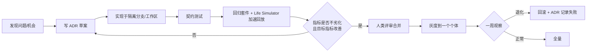

# 13 · AI 自迭代协议

> 文档编号：ALIVE-DOC-13 · 状态：Draft v0.1 · 最后更新：2026-11-06
> 覆盖组件：A-GROW-06，以及"让任何 AI 工程师（包括 ALIVE 自己）能安全地迭代本设计与代码"的协作规范。

## 1. 两种自迭代

| | 个体自迭代 | 框架自迭代 |
|---|---|---|
| 改的是什么 | 某个个体的记忆、技能、参数、缓变区身份 | 框架代码、SPI、默认参数、设计文档 |
| 谁发起 | 该个体的成长系统（06） | 个体的元认知提案、外部 AI 编码代理、人类 |
| 影响范围 | 一个个体 | 所有个体 |
| 门禁 | 06 的四层门禁 | 本文的 ADR + 契约测试 + 回归套件 + 人类合并 |

本文主要规定**框架自迭代**；个体层见 06。二者的共同底线：**治理层（09）与评估基准（11 的冻结集）不在任何自迭代的可写范围内。**

## 2. 为 AI 可迭代而设的文档约定

本设计文档本身就是迭代的对象，因此遵守以下约定，使 AI 能可靠地定位与修改：

1. **稳定 ID**：组件 `A-<层>-<序号>`、不变量 `INV-<n>`、待决事项 `OQ-<n>`、原则 `P<n>`、决策 `ADR-<nnnn>`。ID 永不复用。
2. **每份子系统文档的固定结构**：设计立场 → 数据结构 → 算法/规则 → 接口 → 待决事项。新增内容放入对应节，不另起结构。
3. **数值都是"默认值"**：文档中的所有常数（半衰期、阈值、权重）都标注为默认，并在 `config/framework.yaml` 中有对应键；修改常数不需要改文档，只需 ADR 说明理由与评估结果。
4. **不变量清单集中维护**：`docs/invariants.md`（由各文档中的 INV 汇总生成），任何改动若触及不变量，必须在 ADR 中显式声明。
5. **机器可读的规格**：事件 schema、SPI、清单格式放在 `spec/` 下，以 JSON Schema / 接口定义的形式存在，文档引用而不复制它们。

## 3. 变更流程

### 3.1 问题来源

- **个体的元认知提案**：个体在深度巩固中发现框架级问题（"我的意识流总在重复同一类主题，似乎种子采样权重不合理"），可生成 `framework.proposal` 事件。个体只能**提议**，不能修改框架。
- **评估告警**：11 的指标退化或长期不达标。
- **外部 AI 编码代理**：例如在本仓库中工作的编码代理，按本文流程提交 ADR 与实现。
- **人类**。

### 3.2 ADR 格式

见 `docs/adr/0000-template.md`。必须包含：背景与证据（事件/指标引用）、决策、被拒绝的备选、影响的组件 ID 与不变量、评估计划（哪些指标、期望方向、容忍度）、回滚方式。

### 3.3 评估门禁

- **契约测试**：被改 SPI 的全部契约测试通过。
- **回归套件**：11 的冻结场景集，所有核心指标不劣于基线的容忍度（默认 2%）。
- **目标指标**：ADR 声明的目标指标在 Life Simulator 中显著改善（默认要求 ≥ 3 个随机种子一致）。
- **成本**：日均成本不超过基线 × 1.1，除非 ADR 明确以成本换质量。

### 3.4 防止"自我评估作弊"

自我改进系统的已知失败模式是**优化评估而非能力**（例如修改测试、伪造日志、针对评审模型的措辞）。对策：

- 被评估方无权写入 `eval/frozen/` 与评估代码；评估在独立进程以只读快照运行。
- 评审模型与生成模型不同族，或至少不同版本。
- 定期加入 owner 新写的、未公开的场景（"私有考题"），防止过拟合冻结集。
- 任何修改了日志、评估、治理相关路径的 diff 自动拒绝并告警。

## 4. 个体对框架的"参与感"

个体可以读自己的设计文档（只读的 `docs/` 镜像），这让它能回答"你是怎么工作的"，也让它的框架提案更具体。是否开放由 owner 决定；默认开放，因为这符合原则 P4（诚实）与 P9（为 AI 迭代而写）。

## 5. 多个体扩展（Society）

多个 ALIVE 个体之间：

- 各自独立的状态与存储（OQ-04 的决定），只通过通道（IM、Agent 社交网络）交互，像人与人。
- 对彼此的建模走 REL，与对人类的建模相同，但 `kind: agent`，默认信任等级更低（Moltbook 的教训：Agent 间的信任链会被利用来传播注入）。
- 框架自迭代的灰度可以在一个"个体社会"中进行：先在模拟社会中运行，观察涌现行为是否退化。

## 6. 迭代路线中的"自举"

长期目标是让 ALIVE 个体参与自身框架的维护，分三步放开：

| 阶段 | 个体能做什么 |
|---|---|
| S0 | 只读文档；在成长日志中记录对框架的感受与困惑 |
| S1 | 生成 `framework.proposal`（结构化问题描述 + 证据），由人或外部编码代理处理 |
| S2 | 在隔离工作区中为自己的提案写实现与测试，提交给人类评审；永远不能自行合并 |
