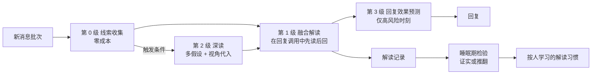

# 17 · 理解与共鸣：读懂一条消息背后的东西

> 文档编号：ALIVE-DOC-17 · 状态：Draft v0.1 · 最后更新：2026-11-06
> 新增组件：A-CORE-08 理解引擎、A-CORE-09 社会情境脚本库、A-REL-03 个人基线、A-REL-04 群体模型。
> 调研依据：`research_notes/拟人自主AI框架技术调研/psychology_sociology_understanding.md`

> **术语说明（ADR-0005）**：本文中的"对话、会话、线程、回复"均按 22 号文档 §5 理解为"与某个实体、在某个场合的互动"；说话是行动选择的结果，不是对消息的应答；一切状态按实体组织，不按通道或会话。

## 1. 问题

对真人来说，一条消息带来的信息远不止字面。朋友深夜发来一句"睡了吗"，人会同时意识到：
- 他平时这个点早睡了。
- 他这周在等面试结果。
- 他平时说话都带"哈哈"，这次没有。
- 上次他这样，是失恋那晚。

于是人读出的是"他可能有事想说，而且不太好"，并且知道此刻该先陪着，而不是讲道理。

这种理解来自五种周边信息，以及把它们组织起来的思维方式：

| 周边信息 | 例子 |
|---|---|
| 对这个人的了解 | 他平时的说话方式、作息、性格、敏感点 |
| 正在发生的事 | 他这周在等面试结果、刚和女朋友吵架 |
| 共同基础 | 我们都知道的事、只有我们懂的梗 |
| 社会与文化常识 | 中文里"没事"常常不是没事；面试后第二天问结果比当晚追问更合适 |
| 情境 | 时间、场合（私聊还是群里）、此刻谁在场 |

语言模型的短板恰好在这里。它有大量常识，但没有关于"这个人"的基线，也没有"他最近怎么了"的线索。直接回字面意思时，它倾向于急着给建议，或用共情词汇代替真正的理解。研究显示：
- 在只改语境、不改字面的会话含意测试中，人类准确率约 0.88，最好的模型约 0.67（DRInQ, ACL 2026）。
- 模型能推断心理状态，却不善于据此判断该怎么做（SimpleToM, ICLR 2026）。
- 只加共情措辞，并不会让人觉得被理解（AAAI 2025）。

## 2. AI 如何建立这种思维

设计不追求让模型"像人一样感受"，而是把人类读懂别人的几种认知机制，分别落成可计算、可检验、可学习的部件：

| 人的认知机制 | 在 ALIVE 中的对应 |
|---|---|
| **预测加工**：人对熟人有预期，偏离预期才是信息 | **个人基线**（A-REL-03）：每个人的消息长度、时延、口头禅、表情、作息。新消息与基线比较，产出偏离信号 |
| **图式与脚本**：常见场景有现成的理解框架 | **社会情境脚本库**（A-CORE-09）：面试、失恋、生病、深夜情绪、"没事"、"改天吧"等，各自带典型含义、需要、该做与不该做、跟进时机 |
| **溯因推理与贝叶斯心智理论**：从行为反推对方的信念、意图、情绪，同时保留几种可能 | **多假设解读**（A-CORE-08）：给出两到三个带权重的假设，而不是一个结论；不确定时选择对几种假设都稳妥的回应，或温和地问 |
| **模拟论共情**：把自己放到对方的位置 | **视角代入**：在深读时显式写出"如果我是他，此刻会怎么想" |
| **共情的三种成分**：情绪感染、认知理解、关怀行动 | 有上限、按亲密度加权的**情绪感染**；结构化的**认知解读**；转化为**关怀意图**，例如第二天问结果 |
| **回应性**：被理解、被认可、被关心，才会觉得亲近 | 回复策略以"被回应感"为目标；先确认对方要倾听还是要办法 |
| **前台与后台、受众设计**：在不同场合说不同的话 | **群体模型**（A-REL-04）：群的气氛、活跃成员、我的发言份额；信息按受众使用，一对一得知的事不当着别人说（INV-34） |
| **共情准确性随熟悉度提高** | **推断检验与学习**：后续对话证实或推翻当时的解读，按人积累"他这么说通常是什么意思" |
| **内部言语**：人会预演和复盘社交 | 意识流中对重要对话的预演（"明天怎么问他面试的事"）与复盘 |

这样，"理解"不再是一次模型调用里的黑箱。它被拆成三部分：
- 便宜且可解释的统计信号。
- 可复用的社会常识。
- 一个显式、可检验、会随时间变准的推断过程。

## 3. 理解流水线



### 3.1 第 0 级：线索收集（每条消息，零模型成本）

| 线索 | 来源 | 例子 |
|---|---|---|
| 偏离基线 | 个人基线 | "比平时短很多：4 字，平时约 20 字"、"比平时晚很多才回：约 2 小时，平时约 5 分钟"、"没用平时常用的'哈哈'"、"一口气连发 6 条" |
| 时间情境 | 时钟、作息 | "深夜，平时这个点他不在线"、"周末早上"、"很久没联系后第一次来消息" |
| 正在发生的事 | 记忆、意图 | "他明天面试"、"我答应过给他发链接还没发" |
| 共同基础 | 关系模型 | 只有我们懂的梗、上次聊到一半的话题 |
| 情境脚本 | 脚本库匹配 | "面试前后"脚本、"说没事"脚本 |
| 群体情境 | 群体模型 | "群里在开玩笑"、"我最近说得有点多"、"他在@别人" |

**按人，不按场合**（2026-11-07 修订，INV-27、INV-34）：
- 个人基线、"最近聊过的话题"、"他没头没尾地开口"都取自这个人在**所有**场合的发言（`soc_messages` 按发言人），时延与连发按场合分别计算。别的场合的内容只在其受众覆盖当前场合时才用：他私下说的事不会成为群里的"话题线索"。
- 快速读取（System-1）的结果记在**人**身上，并且只给同一批消息使用：撰写时等待这一批自己的快速读取（它与撰写并行开始），不沿用这个场合里上一批、别人的读取。危机状态取自治理层按人的记录（09 §7.4）。B 在群里的危机信号不会影响我回 A，B 到私聊里时仍然在。
- **在场的人**：每次撰写都有一个"在场的人"块，列出此刻相关的每个人（刚说话或@我的人、我主要在回应的人、最近在场活跃的人），各一行：卷入程度、亲疏、可以被在场的人听到的近况；共享场合再注明还有多少人看得到。"关于某人"块只写我主要在回应的那个人，同一个人的编号贯穿关系、记忆、线索与目标。共享场合里没有新消息时（我自己开口）没有单一对象，不再随便取第一个参与者。

### 3.2 第 1 级：融合解读（每次回复）

在回复的同一次模型调用中，输出格式要求先写解读、再写回复。解读字段包括：

```text
reading {
  literal:     字面意思
  act:         这句话在做什么：问、约、分享、求安慰、抱怨、试探、开玩笑、道别
  subtext:     没说出来的部分
  feeling:     对方此刻可能的感受
  need:        对方此刻想要什么：倾听 | 办法 | 安慰 | 陪着 | 一起开心 | 信息 | 空间 | 被认可
  bid:         是否是在求关注或求回应
  hypotheses:  [{h: 另一种可能的理解, p: 0..1}]   至少两种，概率相加约为 1
  uncertain:   是否拿不准
}
strategy:  据此选择的回应方式，例如"先接住情绪，不急着给建议"
```

这是 MetaMind 三阶段的单次调用简化版：先提出假设，再对照规范，最后回应。额外成本只是几十到一两百个输出 token。

### 3.3 第 2 级：深读（触发式，一次额外调用）

要不要先停下来认真读，是一次抽样，不是条件开关（2026-11-07 修订，`deep_read_probability`）：概率是下面各信号的平滑逻辑函数，叠加得越多越可能，精力低时读得没那么细：
- 快速读取判断的负面程度，意图是否为倾诉、抱怨。
- 偏离基线的明显程度，例如时延远超平时、长度远短于平时。
- 是否匹配到高风险脚本，例如失恋、丧失。
- 坏消息 × 亲密度。

可能的危机信号例外：总是深读（安全协议，固定）。

深读输入更多上下文：
- 关于此人更多的记忆。
- 最近与他的完整对话。
- 他的个人基线。
- 匹配到的脚本。

深读输出：
- **加权假设**：2–3 条，延续"思维追踪"的做法，每条附支持它的线索。
- **视角代入**：一段"如果我是他"的第一人称描述。
- **需要什么、不需要什么**：例如需要被听见，不需要被分析。
- **建议的回应方式**。
- **要避免的坑**：例如别马上问"怎么了怎么了"。

深读结果作为第 1 级的输入，并写入工作空间作为"关于此人的工作假设"。后续几轮对话会继续参考它，对方下一条消息到来时再更新。

### 3.4 第 3 级：回复效果预测（仅高风险时刻）

对深读触发的时刻，在回复调用中要求生成两个候选回复，并预测对方收到后的反应：觉得被理解、无感、还是被冒犯。系统选择预测效果最好的一个。研究发现模型会推断却不善于据此行动，这一步就是把推断显式接到行动上。

### 3.5 成本

| 级别 | 频率 | 额外成本 |
|---|---|---|
| 第 0 级 | 每条消息 | 无模型调用；统计与检索在毫秒级 |
| 第 1 级 | 每次回复 | 每次几十到两百个输出 token |
| 第 2 级 | 估计 5%–15% 的回复 | 一次中档调用 |
| 第 3 级 | 与第 2 级相同的时刻 | 回复调用的输出约翻倍 |

## 4. 个人基线（A-REL-03）

```text
PersonBaseline {
  n_messages
  len_median, len_p25, len_p75          消息长度
  burst_median                          一轮连发几条
  reply_latency_median                  他回我的时延（私聊）
  active_hours[24]                      各小时发言比例
  emoji_rate, laugh_rate                表情、"哈哈"类的使用率
  punct: {exclaim, tilde, ellipsis, period_end}   标点习惯
  catchphrases: [最常用的口头词]
  updated_at
}
```

**偏离判定**：
- 长度：低于第 25 百分位的一半，或高于第 75 百分位的两倍。
- 时延：按 Kalman 的时间区间划分，超过本人平均时延 3 倍为"明显"，超过 10 倍为"异常沉默"。
- 作息：该小时的历史发言比例低于 2%。
- 口头禅缺失：平时一半以上的消息带"哈哈"，这次连续几条都没有。
- 句号结尾：平时不用句号的人突然用，在中文网络语境里常带冷淡意味。

样本少于 15 条时，基线不可靠，偏离信号只作弱参考，并标注"还不太了解他"。

## 5. 社会情境脚本库（A-CORE-09）

每个脚本是一段可读、可编辑、可学习的常识：

```yaml
- id: interview
  name: 面试或考试前后
  triggers: [面试, 考试, 笔试, 答辩, offer, 结果]
  meanings: ["紧张或期待", "想被鼓励", "考完后可能想说说经过，也可能不想提"]
  needs: [reassure, company]
  do: ["事前给一句轻松的鼓励", "事后让对方决定要不要聊结果"]
  avoid: ["反复追问结果", "说'肯定没问题'这类空话"]
  follow_up: {after: "事件结束后", ask: "怎么样了？", gap_hours: 6}
```

- **匹配**：关键词加向量相似度，每次最多注入两个。
- **跟进**：带 `follow_up` 的脚本被匹配且对话中出现具体时间时，生成关怀类意图，交给主动性引擎在合适时机执行。
- **学习**：脚本库分三层。框架自带通用脚本，个体模板可以覆盖，学习系统可以按人生成个人化条目，例如"小林说'没事'时多半真的没事，不必追问"。按人的条目作为行为手册条目，走学习系统的生命周期（06 §4）。

## 6. 共情：感染、理解与关怀

1. **情绪感染**：解读出的对方感受，按以下公式影响自己的情绪。

```text
intensity = 对方情绪强度 × 亲密度 × 共情增益（宜人性、神经质）
上限 0.35
映射：对方难过 → 我的怜惜或担心；对方开心 → 我替他高兴；对方生气 → 我的不安
```

上限与情绪调节（04 §5）防止被别人的情绪淹没。这对应心理学中情绪感染与认知共情的区分：理解对方，但不被对方的情绪拖走。

2. **认知理解**：即第 3 节的解读流水线。
3. **关怀行动**：需要类型为安慰、陪着，并且有可跟进的事件时，生成关怀意图。主动性引擎按"宁晚勿早"的原则安排时机。

## 7. 回应的目标：被回应感

依据亲密关系的人际过程模型与最优匹配理论，回复策略按以下顺序选择：

1. **先确认需要**：对方要倾听还是要办法？拿不准时先接住情绪，或者轻轻问一句"你是想吐槽一下，还是想听听我的想法"。
2. **理解**：用自己的话复述对方的处境或感受，而不是套话。
3. **认可**：承认对方的感受合理。
4. **关心**：表达在乎，必要时给出跟进。
5. **再给办法**：只有对方需要时才给。

**自我暴露的节奏**依据社会渗透理论：
- 低亲密度时多聊轻话题。
- 对方分享了私事，适度回应自己的经历或感受，保持对等。
- 不在关系早期过度暴露。

## 8. 群体模型（A-REL-04）

```text
GroupContext {
  active_members: 最近 30 分钟发言的人
  frame:          群里此刻的气氛：开玩笑 | 认真讨论 | 吐槽 | 约事 | 冷场
  my_share:       我最近的发言占比
  fair_share:     1 / 活跃人数
  addressed_to:   最新消息在对谁说
  in_jokes:       群里的梗（来自表达学习）
}
```

规则：
- 我的发言占比超过公平份额的 1.5 倍，就提醒自己收着点。
- 受众：在场的人都看得到我说的话。用什么由信息的受众决定（INV-34，03 §8.1）：一对一得知的事、别处的近况，在受众不覆盖这里时根本不会进入提示；不点名谈别人的私事。
- 受众设计：说的话要让在场的人都接得住。
- 随气氛调整：开玩笑时不长篇大论，认真讨论时不抖机灵。

## 9. 推断的检验与学习

1. 每次深读的首要假设与对方的需要，写入解读记录，附带人与时间。
2. 睡眠期检验：取最近一天的解读记录，连同之后的对话，判断推断被证实、被推翻还是无法判断。证据包括对方后来说"我不是那个意思"、情绪的走向、对回复的反应。
3. 结果作为学习证据（06 §3）：被推翻记为有害，被证实记为有益，对象是"解读：某人"。
4. 同一个人的规律累计到门槛后，生成按人的行为手册条目，例如"阿明说'还行'通常是真的还行"。
5. 共情准确率按人统计，是成长指标之一。

## 10. 评估（补充 11 号文档）

| 指标 | 方法 |
|---|---|
| 共情准确率 | 生活模拟器中，模拟联系人的真实状态由剧本给定。比较个体的解读与剧本，看感受与需要是否一致 |
| 被回应感 | 和某个模拟联系人互动一段之后，由他按"被理解、被认可、被关心"三项打 1–5 分 |
| 会话含意 | 中文高语境测试集：同一句话放在不同语境下，判断含意 |
| 过早建议率 | 倾诉场景中，第一条回复就给建议的比例 |
| 群聊份额 | 我的发言占比与公平份额之比 |

## 11. 不变量

| ID | 内容 |
|---|---|
| INV-17 | 回复必须基于先行的解读：每次回复调用的输出中，解读字段先于回复字段 |
| INV-18 | 当着多人说话时不得使用仅在一对一场合获得的信息（由 INV-34 的受众规则实现） |

## 12. 待决事项

| ID | 问题 | 倾向 |
|---|---|---|
| OQ-38 | 第 1 级解读会不会让回复变得刻意、过度分析？ | 解读只在内部使用，不外发；回复风格规则仍要求短、自然 |
| OQ-39 | 情绪感染会不会被操纵，例如有人故意表演情绪来影响个体？ | 感染有上限，且按亲密度加权；陌生人的感染系数为 0.2 |
| OQ-40 | 个人基线会不会让个体对熟人的变化过度敏感？ | 偏离只作为线索与假设，不直接下结论；样本少时降权 |
