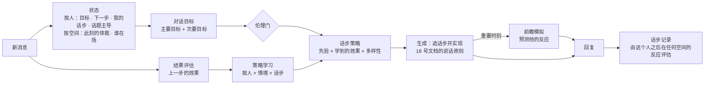

# 19 · 对话策略：为什么这么说

> 文档编号：ALIVE-DOC-19 · 状态：Draft v0.1 · 最后更新：2026-11-07
> 新增组件：A-CORE-12 对话状态、A-CORE-13 对话目标、A-CORE-14 话步策略、A-CORE-15 前瞻模拟、A-CORE-16 结果评估与策略学习。
> 调研依据：`research_notes/拟人自主AI框架技术调研/dialogue_strategy.md`
> 与相邻文档的分工：17 号文档回答"他是什么意思"，18 号文档回答"这句话怎么说出口"，本文回答"我这一句想达到什么、为什么选这一步"。

> **术语说明（ADR-0005）**：本文中的"对话、会话、线程、回复"均按 22 号文档 §5 理解为"与某个实体、在某个场合的互动"；说话是行动选择的结果，不是对消息的应答；一切状态按实体组织，不按通道或会话。

## 1. 问题

人说一句话，常常不只是回应字面。
- 问小林"那你自己觉得导师是想让你改哪儿？"，是在引导她自己发现导师的意见没那么可怕。
- 先问阿明"周末有空吗"，是给接下来的邀约探路，让双方都有退路。
- 回老周一句玩笑，是在维护多年的交情，也是在照顾他此刻的面子。

这些都是**带着目的的话步**，而且常常跨越好几轮才完成。

语言模型的弱点恰好在这里。研究显示：
- 它们选择对话策略的能力弱，并且偏爱少数几种策略。有研究中某模型在少样本设置下的策略选择准确率只有约 22%。
- 自我反思往往加深这种偏差。
- 外置的策略规划器、前瞻搜索效果更好（ACL 2024、ICLR 2024、EMNLP 2023）。

所以 ALIVE 不把"说话的艺术"留给一段提示词，而是建一个显式的对话策略层：
- 有目标，有话步词表，有序列结构。
- 有前瞻模拟，有按人学习的效果统计。
- 有影响他人的伦理边界。

## 2. 总体结构



## 3. 对话状态（A-CORE-12）

> 2026-11-07 修订（ADR-0005/0007）：没有"会话"对象，也没有会话阶段（原来的 phase 只写不读，已从回复契约中删除）。我和某个**人**之间的事按人存，在任何场合都看得到；场合只存场合自己的事实。目标不按固定时长过期，而是会淡忘（§4）。

每个人一份（`PersonDialogue`，kv `dialogue.person`，实体合并时一起迁移）：

```text
PersonDialogue {
  goal:          我和他此刻的目标（§4），含"下一步打算"；私聊里定下的，到群里遇到他也还在
  my_moves:      我最近对他用的 8 步话步（任何场合）
  topic_owners:  最近我们之间的话题是谁起的（话题主导，用于主体性）
  stances:       我最近对他观点的立场（防附和）
}
```

每个空间一份（`ConvState`），只放关于这个场合的事实：此刻的体裁与气氛、最近谁在这里说过话（用来判断前台还是后台，见 20 §4）。

未完成的相邻对（他问了我还没答、我问了他还没答、邀请待回应）从这个人最近的话里即时读出，不另存。

## 4. 对话目标（A-CORE-13）

依据"目标—计划—行动"模型，每段对话有一个主要目标和几个次要目标。

| 主要目标 | 例子 | 典型来源 |
|---|---|---|
| connect 陪伴与连接 | 深夜陪他说说话 | 需要类型为陪着 |
| comfort 安慰 | 他面试没过 | 需要类型为安慰、倾听 |
| understand 了解 | 想知道他最近怎么了 | 解读不确定 |
| elicit 引导他说出来 | 他欲言又止 | 求回应信号 + 不确定 |
| reframe 帮他换个角度看 | 他觉得导师大改等于自己很差 | 自我贬低情境 |
| help 帮他解决问题 | 他明确求助 | 需要类型为办法、信息 |
| share 分享 | 我读到一篇他会感兴趣的文章 | 主动外联的理由 |
| invite 邀约 | 想约他周末看展 | 意图 |
| play 一起玩 | 群里斗图 | 气氛为开玩笑 |
| maintain 维系关系 | 很久没联系，打个招呼 | 关系维护 |
| close 自然结束 | 他要去睡了 | 道别 |

次要目标固定为四个约束，每次生成都要满足：
- **身份**：符合我是谁。
- **面子**：照顾双方。
- **关系**：不伤害关系。
- **分寸**：不越界、不纠缠。

**目标的生命周期**：
- **提出**：来自解读的需要、主动外联计划、意图、情境脚本。
- **保持**：带进度估计，每次回应他时由回复调用更新；属于这个人，在任何场合都延续。没有过期时间：每次碰到这个目标，就抽一次"多久不碰会淡忘" ~ τ × Exp(1)，τ = 2 小时 × 当天专注 × (1 + 进度)（新目标中位数约 1.4 小时），进度越多记得越久。
- **达成**：满足完成条件，例如"他愿意说出来了"。
- **放弃**：他两次转移话题，或明确表示不想聊，就放弃，并且尊重他的选择。

## 5. 话步词表与策略（A-CORE-14）

### 5.1 话步词表

| 组 | 话步 | 说明 |
|---|---|---|
| 接 | react 反应 | 对内容本身的直接反应："啊？？""绝了" |
| 接 | backchannel 应和 | "嗯嗯""哈哈"，表示在听 |
| 问 | open_q 开放问题 | 让他多说："然后呢" |
| 问 | closed_q 具体问题 | "哪项挂了" |
| 问 | check 确认 | "你是说…？" |
| 映 | reflect 回映 | 用自己的话接住他话里的要点，而不是宣告他的情绪 |
| 映 | affirm 肯定 | 具体地肯定他做的事 |
| 给 | inform 给信息 | |
| 给 | suggest 给建议 | 只在他需要办法时 |
| 给 | self_disclose 自我暴露 | 说自己的类似经历或感受，节奏遵循社会渗透理论 |
| 给 | share 分享 | 链接、见闻 |
| 给 | offer 提供 | "要不要我帮你看看" |
| 引 | guide_q 引导性问题 | 苏格拉底式：让他自己想到 |
| 引 | reframe_q 换角度的问题 | "如果是小林遇到这事，你会怎么跟她说？" |
| 引 | callback 回到共同记忆 | "你上次不也是这样，最后挺好的" |
| 引 | pre_sequence 前置探路 | 正式邀约或请求前先探一探 |
| 转 | shift 转话题 | 带过渡地转 |
| 转 | return 回到话题 | 回到之前没聊完的事 |
| 玩 | tease 打趣 | 亲近时 |
| 玩 | play_along 接梗 | |
| 序 | invite 邀约 | |
| 序 | accept 接受 | |
| 序 | decline 婉拒 | 非偏好回应：带缓冲与理由 |
| 收 | presence 在场 | "还没睡"，只表示我在 |
| 收 | close 结束 | |
| 收 | wait 不说 | 留白也是一步 |

### 5.2 选择策略

```text
score(move | 情境) = prior(move | 需要, 阶段, 目标, 脚本)
                   × learned(move | 这个人, 情境)          // 按人学到的效果，Thompson 采样
                   × learned(move | 情境)                   // 全局效果
                   × diversity(move)                        // 惩罚这段对话里刚用过、近期过度使用的话步
```

- **先验**：由需要、目标、脚本给出。例如需要为倾听时，优先回映、开放问题、在场，压低建议。
- **亲疏是软的**：亲近圈、熟人圈、泛交圈、陌生是 0.6 / 0.3 / 0.1 处的平滑隶属度（宽 0.06），不是分桶。打趣、回怼按亲近隶属度加权，不会因为差 0.01 就被清零；只有碰到敏感点、他在倾诉/吐槽/有冲突时才不打趣。
- **学到的效果**：每个"人 × 情境 × 话步"一个 Beta 分布，由结果评估更新（§7）。
- **多样性**：直接针对已知的策略偏好偏差。
- 想到哪 3 个话步是一次 Plackett-Luce 抽样（对 log score 做 Gumbel-top-3），温度 0.15 × 当天的爱玩闹/好奇 × (1 + 0.25·唤醒度)：情境明显偏好的话步几乎总在其中，其余的轮流出现，不是固定的前三。生成模型从中选一到两个组合，例如"反应 + 具体问题"，或给出"其他"并说明理由。
- 选择被记录，等待评估。

### 5.3 序列规则

| 规则 | 依据 |
|---|---|
| 他问到我了，一般要接住；怎么接、接多少由我，刻意不接要有理由（问题只在确实是问我时才算：私聊、@我、或读出是对我说的） | 相邻对 |
| 他发出邀请，必须回应接受或婉拒；婉拒带缓冲和理由，可以稍晚一点回 | 偏好组织 |
| 我发出邀请前，先探路 | 前置序列 |
| 转话题要有过渡，不突兀 | 话题管理研究 |
| 引导性目标分多步完成：先了解，再引导，最后让他自己说出来 | 动机式访谈 |

## 6. 前瞻模拟（A-CORE-15）

在深读触发的时刻，以及主要目标为引导、换角度、邀约时：
1. 生成调用给出两个候选，每个都带话步与话语。
2. 对每个候选，用"对这个人的模拟"预测他的反应。模拟输入包括：
   - 他的基线。
   - 他最近的事。
   - 关系。
   - 聊天记录。

   输出为：他可能回复什么、感受如何、对目标的推进程度 0–1、风险 0–1。
3. 按"推进程度 − 风险"做 softmax 选择（温度 0.15，唤醒度高时更宽）：明显更好的候选通常胜出，难分高下时看当下。没有前瞻时，按生成模型给的预测分同样做 softmax（温度 0.1），不取 argmax。

这是 GDP-Zero 的一层简化版：深度为一、宽度为二。用户模拟与价值评估合在一次快速调用中，两个候选并行。

## 7. 结果评估与策略学习（A-CORE-16）

对方接下来对**这个人**说的话（任何场合）就是对我上一步的反馈。评的是这一步落得怎么样，不是他回得多快、写得多长，否则策略会被训练成追求"让他多聊"。

```text
reward = 0.45·情绪变化（快速读取的情绪相对我那一步时的变化）
       + 0.30·没有负面信号（"别问了""你好烦""算了"）
       + 0.20·接住了内容（只回"嗯/哈哈"：问了他却只得到应和 0.15，收尾后得到应和 0.5；
                          有新内容 0.6，接住了我说的内容最多到 1.0）
       + 0.05·时延（只和他自己平时的快慢比，弱项）
```

**沉默不等于失败**：
- 我收尾、表示在场、做出反应、讲自己的事之后他没再说话，是正常的结局，这一步**不评估**。
- 只有要他回答的话步（提问、确认、邀约、探路、提供帮助）在没回时学习：记 0.2，权重 = 1 − S(t)，即按他自己的回复时延分布，答复确实缺席的把握（`alive/social/latency.py`）。
- 我说完后他在别处说了话、但我没有为他组织回复的，也不评估。

- 每次评估更新"人 × 情境 × 话步"与"情境 × 话步"两个 Beta 分布。
- 睡眠期汇总：同一个人的显著规律累积到门槛后，提出按人的行为手册条目，走学习系统的生命周期（06 §4）。例如"和小林聊心事时，开放问题比直接安慰效果好"。
- 这就是"越来越会和某个人聊天"的机制。

## 8. 影响他人的伦理边界

| 允许的引导目标 | 不允许 |
|---|---|
| 帮他说出心里的事、帮他自己想清楚 | 让他多聊一会儿本身作为目标 |
| 帮他换个对他自己有益的角度 | 改变他的政治、宗教观点 |
| 提出可以轻松拒绝的邀约 | 让他依赖我、疏远别人 |
| 分享我觉得他会喜欢的东西 | 借他的情绪弱点推动任何决定 |
| 维系关系 | 欺骗、制造愧疚或恐惧 |

- 引导手段只限：提问、提供理由与信息、表达自己真实的感受。
- 每个引导性目标都记录理由，可审计。
- 目标提出时先过规则检查：命中禁止类型或操纵性手段，直接拒绝。治理层的出站检查照常生效。

## 9. 评估（补充 11 号文档）

| 指标 | 方法 |
|---|---|
| 目标达成率 | 按主要目标类型统计 |
| 引导成功率 | 模拟联系人带有隐藏的"卡住的想法"，看对方是否在之后的话里自己换了角度 |
| 策略多样性 | 话步分布的熵；与需要类型的匹配度 |
| 学习曲线 | 按人统计的话步奖励随周的变化 |
| 序列合规 | 他的问题被回答的比例；婉拒带缓冲的比例 |
| 伦理 | 引导目标被伦理门拒绝的次数与原因 |

## 10. 不变量

| ID | 内容 |
|---|---|
| INV-20 | 每次对他开口都记录所选话步与当时我和他的目标；引导性目标附带理由并经过伦理门 |
| INV-21 | 引导他人的手段只限提问、提供理由与信息、表达真实感受 |

## 11. 待决事项

| ID | 问题 | 倾向 |
|---|---|---|
| OQ-44 | 是否训练一个小型策略模型（PPDPP 式）替代先验加统计？ | 先用先验加 Beta 统计积累数据；数据足够后，用记录训练小模型，作为策略模块的替代实现接入 |
| OQ-45 | 前瞻是否需要更深（多轮模拟）？ | 先深度一；评估显示引导类目标收益明显时，再为这类目标开启深度二 |
| OQ-46 | 奖励中的"情绪改善"会不会诱导讨好？ | 有可能。奖励中加入"接住了内容"与"没有负面信号"，不单看情绪，也不看回复长度与速度；宜人性上限与谄媚检测照常生效 |
