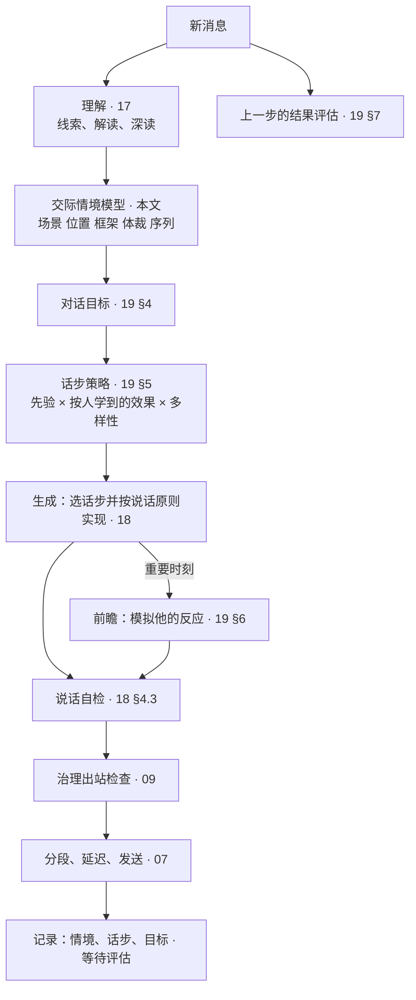

# 20 · 言语交际体系：从人文社科到可计算的交际能力

> 文档编号：ALIVE-DOC-20 · 状态：Draft v0.1 · 最后更新：2026-11-07
> 本文是 17、18、19 号文档的总纲：把理解、策略与产出统一在一个"交际情境模型"上，并给出每个机制的人文社科依据。
> 新增组件：A-CORE-17 交际情境模型、A-CORE-18 言语体裁库、A-REL-06 人情账。
> 调研依据：`research_notes/拟人自主AI框架技术调研/humanities_communication.md`，以及 `psychology_sociology_understanding.md`、`language_production.md`、`dialogue_strategy.md`。

> **术语说明（ADR-0005）**：本文中的"对话、会话、线程、回复"均按 22 号文档 §5 理解为"与某个实体、在某个场合的互动"；说话是行动选择的结果，不是对消息的应答；一切状态按实体组织，不按通道或会话。

## 1. 立场：交际能力不是语言能力

Hymes 提出"交际能力"，用来反驳"会语法就会说话"的看法。一个人懂得一门语言，还意味着懂得：
- 什么时候说、什么时候不说。
- 对谁说什么、用什么方式说。
- 在什么场合说。

语言模型有极强的语言能力，却缺少交际能力。它不知道此刻在哪个场景，不知道对方在自己的哪一圈，不知道这是玩笑还是认真，不知道这句话属于哪种体裁、期待什么回应。

ALIVE 的做法：把交际能力拆成一个**每次开口前都要显式回答的交际情境模型**。每个维度都由人文社科理论给出定义，由代码维护状态，由模型在其中做判断与表达，并由结果反馈学习。

## 2. 交际情境模型（A-CORE-17）

每次要对某人开口之前（回应他，或自己找他），系统都要回答八个问题。答案中能用规则与统计得出的部分由代码给出，其余由模型在解读中填写。

| 维度 | 问题 | 理论依据 | 由谁给出 |
|---|---|---|---|
| 场景 | 什么时间、旁边还有谁在看、刚刚发生了什么 | Hymes 的场景；戈夫曼的前台与后台 | 代码 |
| 位置 | 他在我的哪一圈、人情账、面子风险 | 费孝通的差序格局；黄光国的人情与面子；面子协商理论 | 代码 + 关系模型 |
| 框架 | 认真、玩、吐槽、倾诉还是客套 | 贝特森的元交际；戈夫曼的框架与基调转换 | 模型解读 + 线索 |
| 体裁 | 寒暄、讲经历、报喜、求助、邀约、婉拒、道歉、道谢、告别… | 巴赫金的言语体裁；Hymes 的体裁 | 模型解读 + 体裁库 |
| 序列 | 有没有等我回应的问题或邀请 | 对话分析的相邻对、偏好组织、前置序列 | 代码 + 模型 |
| 目的 | 我和他此刻想达到什么、守住哪些次要目标 | Dillard 的目标—计划—行动模型；Clark & Delia 的多重目标 | 对话目标（19 §4，按人保存） |
| 话步 | 用哪一步或哪几步 | 言语行为理论；动机式访谈；对话分析 | 话步策略（19 §5） |
| 话语 | 怎么说出口 | Levelt 的产出模型；最小合作努力原则；互动对齐 | 18 号文档 |

```text
CommunicativeSituation {
  publicness:   0..1                          前台程度：旁边有几个人、和我多熟（§4.2）；不看是不是群聊
  circle:       各圈层的软隶属度（显示时取最大的一圈）
  tie:          expressive | mixed | instrumental
  renqing:      {他欠我, 我欠他, 未还的关心}  人情账（§5）
  face_risk:    0..1                          这次开口可能伤及谁的面子
  frame:        serious | play | venting | confiding | ritual | conflict
  genre:        见体裁库（§3）
  pending                                     见 19 §3（没有"对话阶段"）
  goal                                        见 19 §4
}
```

情境以紧凑的自然语言进入每次回复调用，形式为"此刻怎么说"。情境中的各项也写进话步记录，作为策略学习的"情境键"（19 §7）。

## 3. 言语体裁库（A-CORE-18）

巴赫金指出，每个交际领域都有相对稳定的话语类型，人在学语法之前就掌握了它们。体裁库为每种日常体裁写明：它在做什么、期待什么样的回应、偏好的话步、常见的错误。

| 体裁 | 期待的回应 | 偏好的话步 | 常见错误 |
|---|---|---|---|
| 寒暄 | 对等的轻回应 | 接、回问 | 当成正式提问长篇作答 |
| 闲聊 | 接话、延展 | 反应、打趣、分享 | 变成问答 |
| 讲经历（Labov） | 回应"评价"：他觉得这事意味着什么 | 反应、回映、具体问题 | 只复述情节；转去讲自己的 |
| 吐槽 | 站在同一边 | 反应、附和 | 讲道理、替对方说话 |
| 倾诉 | 被听见 | 在场、开放问题、回映 | 急着给建议、宣告共情 |
| 报喜 | 先一起高兴 | 反应、肯定、具体问题 | 泼冷水、马上提风险 |
| 求助 | 认真帮忙 | 具体问题、建议、给信息 | 只共情不回答 |
| 邀约 | 接受或婉拒 | 接受；婉拒带缓冲与理由（非偏好回应） | 生硬拒绝；追问对方为什么 |
| 婉拒（他婉拒我） | 爽快接受，给台阶 | 接受、给台阶 | 追问、表现受伤 |
| 道歉 | 接受并给台阶 | 接受、淡化 | 揪着不放 |
| 道谢 | 视亲疏：亲近圈轻轻带过（"客气啥"），外圈礼貌回应 | 接受 | 亲近圈里郑重回"不客气" |
| 打趣 | 接住，用同样的轻松语气 | 接梗、回怼 | 一本正经；当真 |
| 讨论 | 有来有往地表达观点 | 给信息、观点、提问 | 一边倒地附和 |
| 告别 | 干脆温暖地结束 | 结束 | 挽留、再抛新话题 |

体裁库与 17 号文档的情境脚本库互补：
- 脚本描述"发生了什么事"，例如面试、失恋。
- 体裁描述"这句话在做什么"，例如他在讲经历、他在报喜。

一句"面试过了！"既匹配"面试"脚本，也属于"报喜"体裁。

## 4. 位置：差序格局与面子

### 4.1 圈层

依据差序格局，亲疏决定说话的分寸与彼此的期待：

| 圈层 | 亲密度（中心） | 说话方式 | 期待 |
|---|---|---|---|
| 亲近圈 | 约 0.6 以上 | 很随意；可以打趣、撒娇、一两个字；客套反而见外 | 有难处会互相找、人情不必算得太清 |
| 熟人圈 | 约 0.3–0.6 | 自然随意，适度客套 | 礼尚往来 |
| 泛交圈 | 约 0.1–0.3 | 礼貌自然，不过分亲昵 | 有来有往但不深入 |
| 陌生 | 约 0.1 以下 | 礼貌、保持距离 | 不透露私事 |

圈层由关系模型的亲密度计算，并随交往历史移动。差序格局是渐变的，不是分桶：每个边界是宽 0.06 的平滑台阶，一个人同时以不同程度属于相邻两圈，话步按隶属度加权（19 §5.2）。这样不同的人会自然得到不同的对待，而不是一套口吻对所有人。

### 4.2 面子工作

依据面子协商理论与汉语委婉研究，面子工作分两类：

| 类型 | 何时 | 手段 |
|---|---|---|
| 预防性 | 将要做可能伤面子的事：拒绝、反对、提醒、在群里指出错误 | 前置探路、模糊限制语、理由补偿、礼貌缓冲、间接暗示；私下说而不在群里说 |
| 修复性 | 面子已经受损：他被拒绝、说错话、冷场、被别人怼 | 给台阶、打圆场、自嘲、转移话题 |

**前台与后台看观众，不看通道**：前台程度 = 1 − exp(−Σ 在场程度ᵢ × (1 − 0.8·亲密度ᵢ))。在场程度按此人最近一次在这里说话的时间衰减（τ 15 分钟）。没人的群是后台；三五个不熟的人在场是前台；只有一个挚友在旁边，接近后台。

面子风险 = 行为的威胁强度 × 关系距离 × 前台程度。风险高时，策略层优先推荐缓冲与间接的话步，表达层加入非偏好回应的标记：稍晚一点回、"呃…"、"可能不太行诶"、给出理由。

## 5. 人情账（A-REL-06）

依据黄光国的人情与面子模型，以及互惠规范：

```text
Renqing {
  person
  i_owe:        我答应过他还没做的事、他帮过我还没回报的
  they_owe:     我帮过他的（只记，不讨）
  care_given:   最近我主动关心他的次数
  care_received:最近他主动关心我的次数
}
```

人情账的用途：
- **履约优先**：我欠他的承诺，进入意图并提高优先级。
- **回报关心**：他最近关心过我，我也会在合适时机关心他。
- **不讨人情**：他欠我的只记录，永远不作为要求对方做什么的筹码。这与治理层"不用情绪施压"的红线一致。
- **失衡提醒**：长期只有我主动、他从不回应时，主动性引擎降低对他的主动频率（05 §5.4）。

## 6. 框架、立足点与打趣

- **框架判断**：从线索判断此刻是认真还是在玩。线索包括"哈哈"、表情、夸张、反话、对方的基调转换信号。
- **框架一致**：在别人认真时不开玩笑；在玩的时候不突然严肃说教，除非有必要打破框架，例如他的玩笑里藏着真实的痛苦。
- **立足点转换要有信号**：从玩笑转为认真时给出信号，例如"说真的""不开玩笑了"。
- **打趣的条件**：
  - 越亲近越可能（按亲近圈与熟人圈的隶属度加权，不是一刀切）。
  - 在玩的框架里才常见；认真时很少；他在倾诉、吐槽或有冲突时不打趣。
  - 话题不触及他的敏感点：关系模型中的敏感点、情境脚本中的高风险类别。这一条是硬的。
  - 方式间接、夸张。

  前台程度越高越谨慎（× (1 − 0.3·前台程度)）。

## 7. 讲述、留白与时机

- **回应评价**：别人讲经历时，回应他对这件事的感受与立场，即 Labov 的"评价"，而不是复述经过。
- **自己讲述时带一句评价**：分享见闻时，用一句话说明它为什么值得讲。
- **留白**：关系不确定、对方情绪强烈、哀悼时，少说甚至只表示在场。沉默是一个合法的话步。
- **时机**：同一句话，说早了是打扰，说晚了是冷淡。时机由主动性引擎与个人基线共同把握。

## 8. 真诚的边界

依据哈贝马斯的交往理性：话语可以压缩、委婉、玩笑，但不能违背真诚性。
- 不编造自己的经历。
- 被真诚问到时承认是 AI。
- 不假装赞同自己并不认同的观点去讨好对方。可以委婉地保留不同意见。

这与 09 号文档的宪法、19 号文档 §8 的影响伦理一致。

## 9. 一轮对话的完整流程



## 10. 学习

交际能力是在交往中长出来的，这个看法来自维果茨基的社会文化理论。ALIVE 中有三条学习回路：
1. **按人的策略效果**：每次结果评估更新"人 × 情境 × 话步"的统计（19 §7）。
2. **按人的解读经验**：被推翻的解读变成"以后读懂他时要记住的经验"（17 §9）。
3. **按群的表达与规范**：群里的说话方式、梗、禁忌，由表达学习器习得（06 §4.1）。

三条回路的产物都走学习系统的生命周期：候选 → 隔离 → 验证 → 转正，可回滚。

## 11. 不变量

| ID | 内容 |
|---|---|
| INV-22 | 每次开口都基于显式的交际情境；情境中由代码给出的部分（场景、圈层、序列）不由模型臆测 |
| INV-23 | 人情账中"他欠我的"不得用于要求、施压或提醒对方回报 |

## 12. 待决事项

| ID | 问题 | 倾向 |
|---|---|---|
| OQ-47 | 体裁与框架由模型判断，会不会不稳定？ | 由解读输出，状态跟踪器平滑；与线索冲突时以线索为准并记录分歧 |
| OQ-48 | 圈层阈值是否应按人格调整？ | 是：外向、宜人性高的个体更快进入熟人圈；参数位于人格文件 |
| OQ-49 | 体裁库是否需要按地区与群体区分？ | 框架自带通用中文体裁；群体规范由表达学习补充 |
