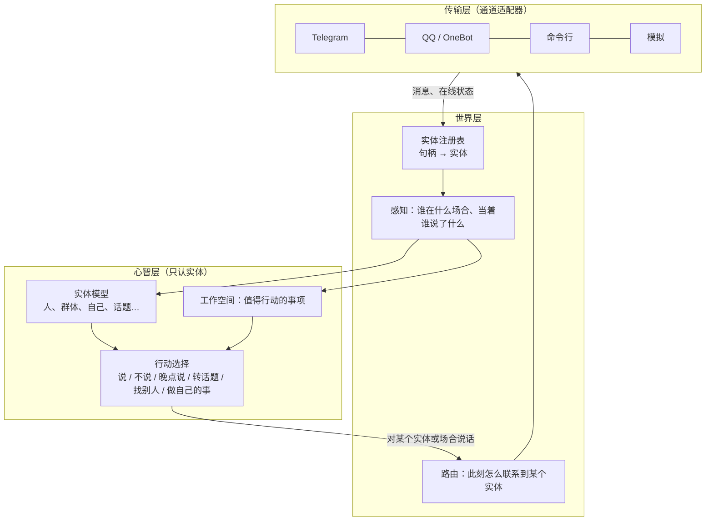

# 22 · 世界、实体与行动：非对话原则

> 文档编号：ALIVE-DOC-22 · 状态：Draft v0.1 · 最后更新：2026-11-07
> 本文是对全部设计的约束性修订，优先级高于 07、17–21 号文档中的表述（见 ADR-0005）。
> 新增组件：A-WORLD-01 实体注册表、A-WORLD-02 路由与在场、A-CORE-21 感知—行动通路。

## 1. 原则

**ALIVE 不是对话系统。** 它是生活在一个由实体构成的世界里的个体。
- 消息是它的感知之一，说话是它的行动之一。
- 对话不是它的组织单位，通道也不是。

这一原则分两条：

- **P10 · 以实体为中心**：记忆、关系、理解、情绪的对象、意图、主动性、治理中的信任，全部按实体组织。人、群体、它自己，以及事物、地点、话题、事件都是实体。同一个人在不同平台上是同一个实体。
- **P11 · 以行动为中心**：
  - 别人发来消息，不意味着它必须回、必须马上回、必须只回一条。
  - 说话、不说、晚点说、补一句、转个话题、去找另一个人、主动开口，都是同一条行动通路上的选择，由它此刻的整体状态决定。
  - 主动发起和"回应"没有本质区别。

## 2. 三层：传输、世界、心智



- **传输层**：只负责收发、打字状态、表情回应、平台配额。平台之间的差异只体现为能力差异，不体现为行为差异。
- **世界层**：
  - 把句柄解析为实体。
  - 把消息变成"某个实体、在某个场合、当着哪些实体、说了什么"的感知。
  - 记录群体成员与在场情况。
  - 为行动提供路由。
- **心智层**：只看实体与感知，不知道通道和会话。

## 3. 实体注册表（A-WORLD-01）

### 3.1 实体与句柄

```text
Entity  { id, kind: person | group | self | agent | thing | place | topic, name, aliases, attrs }
Handle  "telegram:12345"（人）、"qq:#678"（群）、"telegram:@12345"（私聊路由）
```

- 实体编号是不透明的稳定标识。默认取首次见到的句柄字符串，便于阅读。之后同一实体的其他句柄都指向这个编号。
- 句柄只存在于传输层与世界层，心智层从不看到它。

### 3.2 身份的确定

- **明确声明**：配置中的 `world.identities` 声明多个句柄属于同一个人。owner 的多个账号自动合并为一个实体。
- **owner 确认**：运行中由 owner 确认合并，通过 `link`。
- **永不猜测**：不因为名字相同或说话像就自动合并。错误的合并会造成隐私泄露。

### 3.3 合并

合并后，所有句柄指向保留的实体，名字并入别名，群成员关系随人转移，并发出 `world.merged` 事件。`link` 和 `declare` 都会触发合并：配置中声明的几个句柄如果已经分属不同实体，这些实体就被并为一个。

### 3.4 合并后的数据迁移（INV-27）

合并只改句柄还不够：被吸收的实体编号下的记忆、关系、信任、意图、学到的心得、人情账，都要搬到保留的实体下，否则合并后的人在系统里仍然是两个人。迁移由 `alive/world/rekey.py` 统一完成，内核订阅 `world.merged` 后执行：

1. **登记表**：实体编号出现在哪些表的哪些列，集中登记在 `rekey.py` 中（`register_entity_column`），按列的形态分为：

| 形态 | 含义 | 例子 |
|---|---|---|
| 文本 | 列值就是实体编号 | `soc_messages.sender_key`、`mot_intentions.target_person` |
| 场合 | 场合编号；私聊场合的编号就是对方本人的编号 | `soc_messages.thread_id`、`mem_records.thread_id`、`events.thread_id` |
| 前缀 | 带前缀或复合的键 | `person:<编号>`、`channel:<场合>`、`interpretation:<编号>`、`p:<编号>\|情境\|需要\|话步` |
| 编号列表 | JSON 列表 | `mem_records.person_keys`、`soc_threads.participants` |
| JSON | 任意 JSON 中等于编号的字符串与字典键 | 意图触发条件、kv 中的情绪状态、烦扰度 |

2. **主键冲突**：列属于主键或唯一索引时（从表结构自动识别），如果保留实体下已有同键的行，就按登记的策略合并后删除旧行。计数相加（治理用量、人情账、关系的互动次数），时间取最早或最晚，带时间戳的值取较新的一方（亲近度、最近的路由），列表与字典取并集，话步统计按 Beta 后验合并（先验只算一次），态度按权重平均，同意项取"两边都同意"。
3. **一次事务**：所有改写在单写线程的一个写作业中完成，要么全成，要么全不成。
4. **内存状态**：随后依次调用世界层与各子系统可选的 `rekey_entity(old, new)`（`alive/interfaces.py`），迁移缓存、缓冲区与活动对象；其他持有者可用 `register_entity_hook` 登记回调。
5. **补扫**：钩子执行期间仍以旧编号写入的行，由第二遍改写收尾。第二遍遇到主键冲突时保留现有行，避免把缓存里的旧快照重复计入；以增量方式写入的表（人情账）仍按原策略累加。
6. **记录**：发出 `world.rekeyed` 事件，因果父事件是对应的 `world.merged`，载荷记录每张表迁移的行数。

保证：

- **幂等**：再跑一次找不到旧编号下的数据，什么也不改。
- **可恢复**：启动时，凡没有对应 `world.rekeyed` 的 `world.merged`（例如本次启动时由配置声明的合并，或上次迁移中途崩溃），都在各子系统加载状态之前补做迁移。
- **版本不可变**：学习层的范围变化（`person:<旧编号>` 改为 `person:<新编号>`）作为新版本追加，父指针指向原版本（INV-9）；回滚不会恢复被吸收实体的范围。
- **事件日志**：载荷保持原样，作为历史记录；只改写可索引的场合列，使按场合查询能看到合并后场合的全部历史。

## 4. 感知—行动通路（A-CORE-21）

### 4.1 感知

传输层送来的消息，先合并对方连发的几条，即"把一句话拆成几条发"的情况。然后由世界层解析实体，成为一条感知：

```text
Percept { speaker: 实体, space: 场合实体（群体；私聊时为对方本人）, present: 在场实体, lines, ts, features }
```

社交层对每条感知做廉价的注意力评估：是否被点名、是否在问我、群里多热闹、和谁说话。评估结果决定这条感知此刻是否值得调用模型。

### 4.2 两种去向

| 去向 | 条件 | 心智层做什么 |
|---|---|---|
| 当下处理 | 注意力评估认为值得 | 理解、选择行动；行动的结果可能是说一条或几条、只做一个表情、什么都不说，也可能附带"晚点再说"的打算 |
| 先记下 | 没被注意到 | 不调用模型；更新对相关实体的认识，并在工作空间留下一个事项，显著性由兴趣、亲疏决定，之后可能自己回来接，也可能就此放下 |

### 4.3 行动

工作空间里的事项不分来源，统一竞争：
- 没回的话。
- 想补的一句。
- 想找的人。
- 自己想做的事。
- 冒出来的念头。

被选中的事项变成行动。在某个场合开口时，个体看到的是这个场合最近发生的一切，而不只是最后一条消息。它可以：
- 接上之前没回的话。
- 接着刚才的话题补一句。
- 带出自己想聊的事。
- 觉得没必要，就不说。

"晚点再说"不是定时回复，而是一个未来的工作空间事项。到时它依然要和其他事项竞争，并经过治理检查。

### 4.4 在场与前台

私聊和群聊的区别只体现为"当时谁在场"：
- 当着多人说话时，通常一次只说一件事：一次说几条是抽样决定的，在共享场合、没被点名时，期望条数更小（05 §5.6）。
- 不提只当着别人说过的信息（INV-18）。
- 发言占比显著高于合理份额而且没被点名时，让出话头。

### 4.5 实现要点（2026-11-07 全仓审计后的修正）

一次只读审计按本原则逐项检查了代码与文档，下面是据此改掉的结构性问题。

**一个说话行动。** 不由新消息直接触发的开口统一走 `Mind.speak(space, …)`，包括外联、"晚点再说"、工作空间的场合事项和指向某人的意图。
- 它与回应新消息共用同一个撰写器和输出合同。单独的外联撰写器和外联提示已删除。
- 什么时候开口由主动倾向过程按实体抽样（05 §5.6，P12），不设次数和间隔：
  - 一对一场合看对方此刻在不在、关系、对方以往的回应、我上次主动是多久前、我的话还有没有人回；
  - 共享场合看场合的热度、我占了多少话头、上次在这里主动开口是多久前，不再借用"最后一个发言的人"的状态。
- 接上对方之前没回的话，算晚回，不算主动。

**按人的注意力。** 同一时刻只为同一个人撰写一份发言。
- 他在另一个场合发来的消息，要等前一份写完才处理，处理时能看到"我刚在别处对他说了什么"。
- 撰写时附上这个人最近半小时在其他场合说的话，以及我对他说的话（跨场合的实体上下文）。

**拆句。** 一句话说完没有，按发言者分别判断。
- 依据是话轮转换相关位置（Sacks, Schegloff & Jefferson, 1974）：末尾是逗号、冒号、连接词，或者只有一个 @，就视为没说完。
- 这时别人插话或 @ 都不会在半句话上截断。等多久按这个人自己的拆句停顿抽样（中位约 7 秒，整批中位约 25 秒，ADR-0007）。

**不强制开口。**
- 什么时候看、看了以后认真看还是扫一眼，都是抽样（07 §3，ADR-0007）。只是应和（哈哈、好的、表情）通常只是看到或扫一眼。
- 被 @ 时多半会认真看（约 0.9），但不是一定；即使认真看了也不强制开口。"留白"话步被降权，不再被禁止。
- 决策理由的措辞只描述"什么引起了注意"，不再写"需要回应"。

**没说出口的也记得。**
- 心智选择沉默时，这件事以较低显著性留在工作空间。
- 被治理挡下时，草稿作为"想说但没说出口"的意图保留。

**关系与反馈按人计算。**
- 对方来找我而我没回，也算一次（较弱的）接触。
- 我主动说的话，对方在任何场合回应都算回应。
- 话步效果由这个人之后在任何场合的反应评估。
- 目标按"我和某个人"存放，按时间过期。
- 读心复盘看这个人之后在任何场合说的话。
- 情绪对象是实体，不是显示名。

**治理按人。**
- AI 身份声明按人记录：一个人在任何场合被告知过一次即可，群里告知过，私聊就不再重复。
- "已经聊了挺久"的提醒，按这个人的持续互动时长计算。

**平台只是能力。**
- 不再有按平台设定的发言倾向系数。
- @ 对象取这个人在当前平台上的原生账号（来自注册表），而不是解析实体编号。
- 启用平台的检查走注册表里的当前路由。

**评估。**
- 模拟器里的人会拆句、不逐条回复、会主动开口。
- 被回应感按人评分，每个联系人一次。
- 报告给出描述性的说话行为统计：沉默、一次几条、主动开口。"回复率"只作描述，不作目标。
- 留出评估支持一个场合里有多个实体发言。

**命名。** 代码里的 `thread_id` 存的是场合实体编号；`ReplyTask` 指"一次开口机会"；`dialogue` 包名保留，含义按 §5 理解。这些名字不再承载"会话"语义，改名只是表面工作，暂不做。

## 5. 与前序文档的关系

07、17–21 号文档中的"对话""会话""线程"，一律理解为"与某个实体、在某个场合的互动"：

| 前序表述 | 修订后的含义 |
|---|---|
| 会话线程 | 场合实体：群体，或私聊对象本人 |
| 对话状态（19 §3） | 与某个实体的互动状态 |
| 对话目标（19 §4） | 对某个实体的目标 |
| 回复意愿（07 §3） | 注意力评估：决定一条感知此刻是否值得深加工，不决定"回不回" |
| 主动外联（05 §5） | 行动通路中"去找某个实体"的一种 |
| 正在聊的话题（18 §5） | 与某个实体之间最近的话题，跨通道合并 |

## 6. 不变量

| ID | 内容 |
|---|---|
| INV-27 | 传输层之上的所有状态都按实体编号组织，不按通道或会话组织 |
| INV-28 | 收到消息不构成"必须回复"的义务；说话是由心智层状态选择的行动，可以为零条、多条、延后或转向其他实体 |
| INV-29 | 不由新消息直接触发的开口只有一条通路，与回应新消息共用撰写器；主动开口的节奏按实体计算 |
| INV-30 | 同一时刻只为同一个人撰写一份发言；一句话是否说完按发言者判断 |

## 7. 待决事项

| ID | 问题 | 倾向 |
|---|---|---|
| OQ-52 | 话题、事件、事物是否也应成为注册表里的实体？ | 是。v0.1 只实现人、群体与自己；话题与事件仍在记忆与生活纹理中，后续迁入注册表 |
| OQ-53 | 合并实体时的历史数据迁移 | 已决：集中登记、一次事务迁移，各子系统用 `rekey_entity` 迁移内存状态（§3.4） |
| OQ-54 | 注意力评估是否应完全移入心智层？ | 长期是。v0.1 由社交层做廉价评估，心智层做最终选择 |
